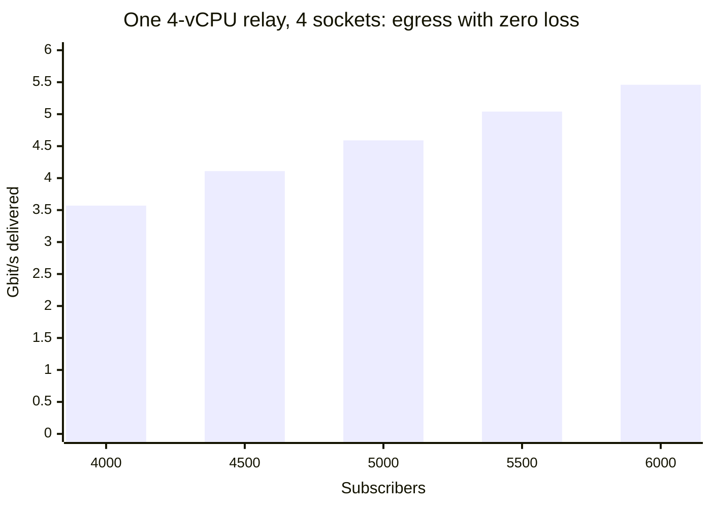
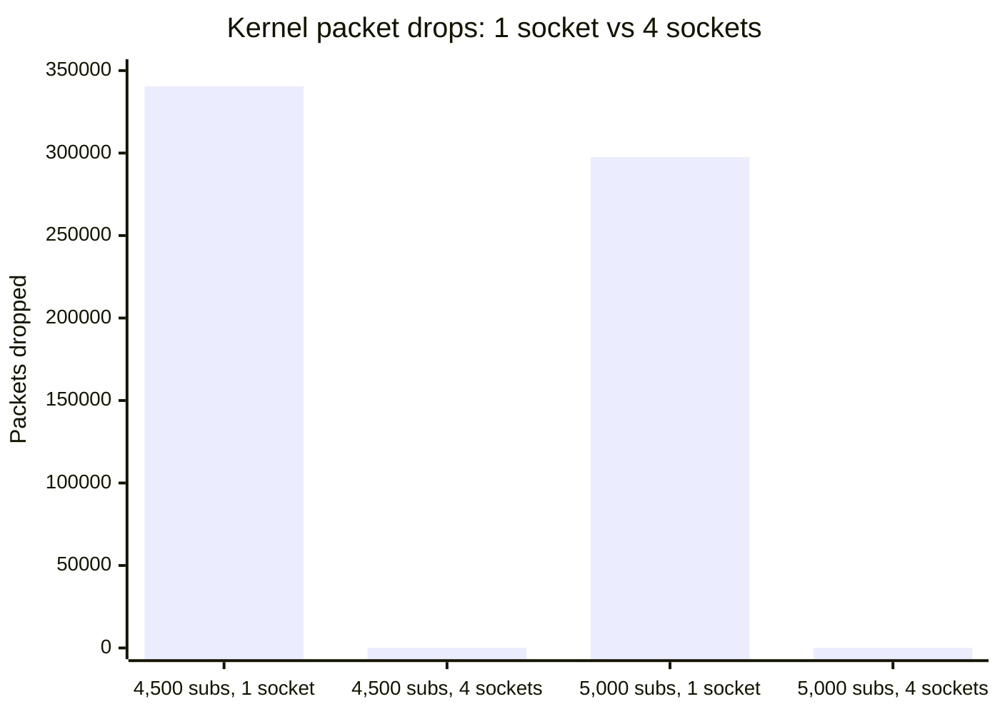
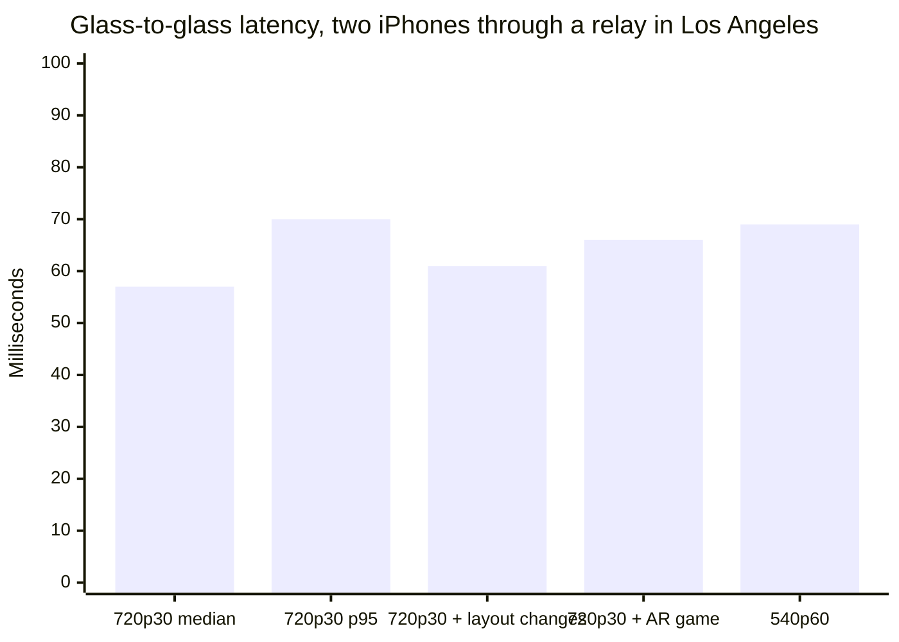
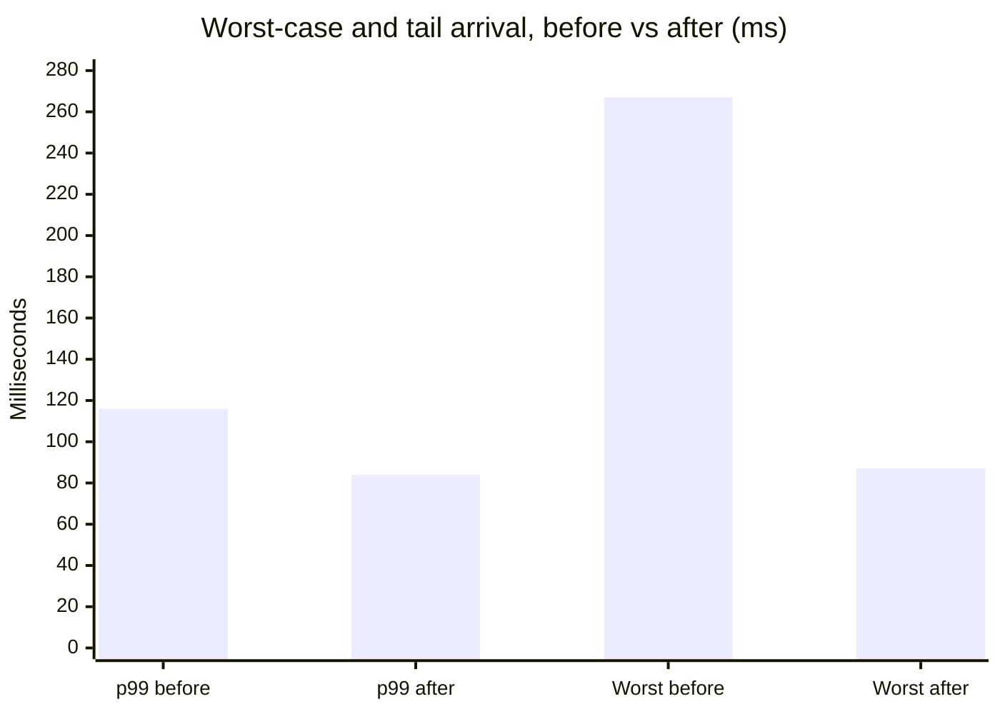

# Benchmarks and specifications

Every number here comes from a run whose raw output is committed, and each
section names where. A number without a run behind it does not belong in this
file. Measured on builds from August 2026; rerun before quoting externally.

> Publishing status: safe to publish once `PATENT-ASSESSMENT.md`'s checklist is
> clear. It describes what MOQOM does and how fast, not how.

## Headline

| Metric | Result | Conditions |
|---|---|---|
| Glass-to-glass latency, median | **56–57 ms** | 720p30 at 1.25 Mbit/s HEVC, two iPhones, home network, relay in Los Angeles, both directions at once |
| Glass-to-glass latency, p95 | **70 ms** | same run, every frame delivered |
| Fan-out, one relay, no loss | **6,000 subscribers at 5.46 Gbit/s** | 4 vCPU (GCP n2-standard-4), 4 sockets, 3.88 cores busy |
| Relay efficiency | **~1.3–1.4 Gbit/s egress per vCPU** | consistent across synthetic and real-video runs |
| SFrame cost | **54 µs** per 1080p keyframe | AES-256-GCM on device, against a 33 ms frame budget |

\* Built to scale: a Rust media plane and a Go control plane, each scaling out
horizontally. Measured in lab; pending load test (Oct 2026).

## Latency by resolution

Glass to glass at each size the camera publishes, largest first. Co-host sizes
(540p and 360p) matter most: shared video calls use smaller boxes, so they
publish at 360p–540p.

| Resolution | Typical use | Median glass-to-glass | Status |
|---|---|---|---|
| **4K (2160p30)** | Solo host, broadcast | Measuring Oct 9, 2026 | 4K rung added to the Swift SDK camera ladder (opt-in); end-to-end run scheduled |
| 1080p30 | Host / spotlight | Measuring Oct 9, 2026 | Supported (top rung of default camera ladder) |
| 720p30, 1.25 Mbit/s HEVC | Two-person call | **56–57 ms** (p95 70 ms) | Measured: two iPhones, home Wi-Fi, relay in Los Angeles, both phones publishing and decoding at once, 90 s, every frame delivered |
| 540p60, 600 kbps | Co-hosting | **69 ms** | Measured on a live co-hosted call, same relay: each phone publishing its camera while receiving and decoding the other host’s video |
| 360p30 | Co-host tiles in shared calls | Measuring Oct 9, 2026 | Supported (600 kbps rung) |
| Shared video calls (360p–540p per tile) | Group calls, co-host grids | Measuring Oct 9, 2026 | Closest references: 540p60 at 69 ms; 720p30 with the layout changing every 8 s at 61 ms |

\* Built to scale: a Rust media plane and a Go control plane, each scaling out
horizontally. Measured in lab; pending load test (Oct 2026).

**Shared video calls.** Each person publishes at the size of their tile
(360p–540p) rather than a full frame, so each person's stream is smaller. The
shared-call median is measured on Oct 9, 2026. Until then the closest measured
references are the 540p60 run (69 ms median) and a 720p30 run with the layout
changing every 8 s (61 ms median), both in [Results](#results) below.

## Relay fan-out

Source: `moqom-engine/moqom-loadgen/cloud/results/20260820T*`. Harness:
`moqom-loadgen` driven by `cloud/measure.sh`.

### Rig

| Role | Machine |
|---|---|
| Relay | GCP n2-standard-4 (4 vCPU), us-east1-b |
| Subscribers | 2 × n2-standard-8 load generators, split evenly |
| Publisher | n2-standard-2 |
| Network | One zone, gVNIC, MTU 1460, `rmem_max`/`wmem_max` 128 MiB |
| Relay binary | sha256 `9095c6c0…172c1be1`, identical across every run below |

One publisher, one track, N subscribers. The relay is restarted between sizes
so each size starts with cold quota state and fresh counters. A size is
**clean** only if every subscriber received every object *and* the kernel
dropped no packets. Subscriber reports and the relay's own Prometheus counters
are read together, so a relay that quietly gave up on some viewers cannot
look clean.

### Synthetic traffic: 30 fps of 4,096-byte frames

| Subscribers | Sockets | Clean | Relay cores | Gbit/s | Kernel drops |
|---|---|---|---|---|---|
| 3,500 | 1 | yes | 2.97 | 3.12 | 0 |
| 4,000 | 1 | yes | 3.44 | 3.55 | 0 |
| 4,500 | 1 | **no** | 3.61 | 2.90 | 340,498 |
| 5,000 | 1 | **no** | 3.68 | 3.61 | 297,551 |
| 4,000 | 4 | yes | 3.50 | 3.57 | 0 |
| 4,500 | 4 | yes | 3.76 | 4.11 | 0 |
| 5,000 | 4 | yes | 3.82 | 4.59 | 0 |
| 5,500 | 4 | yes | 3.82 | 5.04 | 0 |
| 6,000 | 4 | yes | 3.88 | 5.46 | 0 |





**Reading it.** With one socket the knee is between 4,000 and 4,500: the
kernel's single receive queue overflows before the CPU runs out. Sharing the
port across four `SO_REUSEPORT` sockets removes that limit, and the relay stays
clean through 6,000, the largest size run. **6,000 is the largest size tested,
not the ceiling.** The CPU is close to saturated at 3.88 of 4 cores, and the
machine's 10 Gbit/s egress cap was not reached, so the next limit is CPU and
the next step is a larger machine.

### Real video: H.264 clip at 24 fps

Real video is the number to prefer, because a keyframe arrives as a burst many
times the size of its neighbours, and that burst is where fan-out costs.

| Run | Subscribers | Sockets | Clean | Relay cores | Gbit/s | Kernel drops |
|---|---|---|---|---|---|---|
| 214517 | 1,000 | 1 | yes | 0.46 | 0.57 | 0 |
| 214517 | 2,000 | 1 | yes | 0.85 | 1.12 | 0 |
| 214517 | 3,000 | 1 | no | 1.17 | 1.49 | 53,600 |
| 215152 | 3,000 | 4 | no | 0.99 | 1.34 | 0 |
| 215941 | 2,000 | 1 | yes | 2.09 | 2.78 | 0 |
| 220549 | 2,000 | 4 | yes | 2.00 | 2.66 | 0 |
| 220549 | 2,500 | 4 | no | 2.55 | 3.34 | 0 |

The clip changed between runs 215152 and 215941: per-subscriber bitrate went
from about 0.56 to 1.39 Mbit/s. So compare rows within a run, and compare runs
by Gbit/s per core (1.2–1.4) rather than by subscribers per core, which depends
entirely on bitrate. The "not clean" rows with zero kernel drops are
subscriber-side loss, which the per-copy shedding counters attribute. Those
sizes need a profile before they are quoted.

### Reproduce

```sh
cd moqom-engine/moqom-loadgen/cloud
./up.sh --clip /path/to/clip.h264
MOQOM_RELAY_SHARDS=4 ./measure.sh 4000 5000 6000
./down.sh
```

## Glass-to-glass latency

*Glass to glass* is the time from light hitting the sender's camera to the
frame being on the receiver's screen. It includes capture, encode, packetising,
the network both ways through the relay, the jitter buffer, decode and display
— everything a person on a call experiences, not only the network.

Source: `moqom-swift/Samples/MoqomRoom/README.md`, harness
`Scripts/bench-two-phones.sh`.

### Rig

| | |
|---|---|
| Devices | iPhone 15 Pro and iPhone Air |
| Relay | GCP Compute Engine, Los Angeles (`us-west2`) |
| Network | Home Wi-Fi to the internet; mean round trip to the relay 21.8 ms |
| Media | One pinned 720p HEVC rung from the camera (720×1280 portrait, 1.25 Mbit/s at 30 fps, one temporal layer), VideoToolbox hardware encode |
| Direction | Both phones publish and subscribe at once |
| Clocks | Both disciplined against NTP; error bar reported beside every reading |

### Results

| Scenario | Median | p95 | Notes |
|---|---|---|---|
| 720p30 at 1.25 Mbit/s HEVC, both directions, 90 s | **56–57 ms** | **70 ms** | Every frame delivered |
| 720p30, layout changing every 8 s | 61 ms | — | Viewer buffer flat at 24 ms |
| 720p30 alongside a shared AR game | 66 ms | — | 61 replicated taps, identical state on both phones |
| 540p60 at 600 kbps, co-hosting | 69 ms | — | Same relay; each phone publishing and decoding the other host at once |



Roughly 22 ms of the median is the network round trip to the relay. The rest
is the device: capture, hardware encode, decode and the display's refresh. So
on this rig, the time MOQOM can still remove is mostly on the phone, not in
the relay.

### What the playout work bought

Measured on the same rig before and after each change:

| Measurement | Before | After |
|---|---|---|
| Viewer buffer during layout changes | 57 ms and climbing | 24 ms, flat |
| Arrival p99 with burst capping | 116 ms | 84 ms |
| Viewer buffer with burst capping | 38 ms | 19 ms |
| Worst arrival during layout changes | 203–267 ms | 87 ms |
| Lip sync (picture vs voice) | about −200 ms | stated per run, signed |



### Method

Latency is software-timestamped at capture and read at render on a shared
clock. The harness reports clock-agreement error beside every reading and
marks a run untrustworthy when the error exceeds the median. An earlier version
understated latency by about 15 ms by anchoring the offset on a minimum
delivery, and the numbers above come from after that fix. A physical
photodiode rig is planned and is the number to quote in a contract.

Before trusting a phone-side number, compare it with the relay's own counters
(`Scripts/relay-metrics-gcp.sh`). A run that looks smooth on the phones while
the relay reports shed subgroups was smooth because frames were thrown away.

### Not yet measured, and next

- **Other MoQ stacks on the same rig.** No published glass-to-glass figure for
  `moq-rs`, Cloudflare's relay or `moxygen` uses a comparable method, so this
  file makes no latency comparison with them. The fair test is the same two
  phones through each relay; `moqom-loadgen` can also drive any draft-19 relay
  for the fan-out comparison.
- **Cellular, and phones in different cities.**
- **Web, Android and desktop clients**, with each release.

## Test coverage

| Codebase | Tests |
|---|---|
| `moqom-swift` | ~864 |
| `moqom-engine` (excluding vendored quinn) | ~944 |

Counted by test annotations. Plus coverage-guided fuzzing of every decoder
(`fuzz/`, 60 s per target on every change, deeper runs on a schedule), mutation
from a valid seed corpus with a floor on how many inputs reach each decoder, and
cross-language interop: a Swift publisher and subscriber through the Rust relay,
and both backend SDKs against the real Go control plane.

## Specifications

### Protocol and transport

| | |
|---|---|
| Protocol | IETF `draft-ietf-moq-transport-19`, own implementation in Rust and in Swift, written independently |
| Control messages | All 18 in draft-19 |
| Data plane | Object datagrams, subgroup streams, fetch streams with gap markers |
| Carriers | Raw QUIC and WebTransport (HTTP/3) on **one UDP port** |
| QUIC stack | `quinn`, vendored unmodified and verified by `vendor/verify-quinn.sh` |
| Relay forwarding | Subgroup streams. Datagram forwarding not yet carried |
| Scale-out | `SO_REUSEPORT` sockets (`MOQOM_RELAY_SHARDS`); eBPF connection-ID steering in progress |

### Relay behaviour

| | |
|---|---|
| Upstream deduplication | Each track pulled from the publisher once, whatever the audience |
| Slow viewers | Per-copy bounded queue; a late subgroup is reset and counted, never allowed to stall the room or the publisher |
| Retention | Bounded by groups, bytes and seconds (`MOQOM_RELAY_CACHE_GROUPS`, `_MB`, `_SECONDS`), evicting whole groups; can be disabled |
| Join | New subscribers fetch the group in progress, so playback starts on a keyframe |
| Unsubscribe | Last viewer leaving stops the upstream pull |
| Publisher stop | `PUBLISH_DONE` to every viewer |
| Quotas | Per device and per user, every session, subscription, announcement, watch and fetch |
| Observability | Separate admin port (`MOQOM_RELAY_ADMIN_ADDR`, off by default): Prometheus, JSON snapshots of sessions, rooms and tracks, liveness and readiness, QUIC RTT, cwnd and loss, track-silence detection |

### Security

| | |
|---|---|
| Transport | TLS 1.3, inherent in QUIC, on every media connection |
| Tokens | ML-DSA-65-signed, tenant, room, grants and expiry checked against every namespace a request names |
| Session lifetime | Bounded by the token; renewed in-session via `REQUEST_UPDATE`, no reconnect |
| Device binding | `cnf.jkt` thumbprint of a Secure Enclave key; ES256 proof per check, bound to the relay's certificate, single use; required on every relay, and the control plane mints no token without it |
| Revocation | A ban closes the open connection, not only the next join |
| Media encryption | SFrame (RFC 9605) over MOQT, required in every room with no way to turn it off; AES-256-GCM (0x0005) by default, AES-128-GCM supported; payload-only, so relay caching and priority survive. Catalogs sealed by their publisher; the control log ML-DSA-65-signed |
| E2EE key management | MLS (RFC 9420, simplified group) per room in `MLS_192_MLKEM768_AES256GCM_SHA384_MLDSA65` from draft-ietf-mls-pq-ciphersuites (private-use `0xF0AA`, the only founding suite), built in MoqomKit and the control plane; viewers outside the group are sealed each epoch's key over ML-KEM-768 (sender keys), rotated every five minutes while there is an audience |

### Platforms

| SDK | Floor | Notes |
|---|---|---|
| `MoqomKit` (Swift) | iOS, macOS, visionOS, tvOS 26; Swift 6 strict concurrency | Network.framework QUIC, VideoToolbox |
| `moqom-go` | Go 1.23+ | gRPC admin API |
| `moqom-rust` | Toolchain pinned in repo | gRPC admin API, no QUIC dependency |
| `moqom-android` | — | Scoped, work ongoing, release planned October 2026 |
| `moqom-desktop` | Windows, macOS, Linux | Scoped, work ongoing, release planned October 2026 |
| `moqom-obs` | OBS Studio | Scoped, work ongoing, release planned October 2026 |

Benchmarks for these are published with each release.

### Not yet, stated so nobody quotes it

- `moqom-cc`, the media-aware congestion controller
- Datagram forwarding at the relay
- Authentication on the relay admin port, which is why it is off by default
- The director (global steering) and multi-replica control plane
- A relay ready to face the internet unattended — `moqom-relay/src/lib.rs`
  lists the gaps

## How MOQOM compares

Public-facing comparison, mirrored on moqom.dev (`getting-started/compare`) and
`sites/_shared/moqom-cloud-compare.md`. Outcomes only: say what MOQOM does and
how fast, never how.

### Why MOQOM

- **One protocol for calls and broadcast.** Built on the IETF's Media over QUIC Transport
  (targeting `draft-ietf-moq-transport-19`): the stream that carries a two-person call also
  reaches an audience of thousands, without moving to a second product.
- **Conversational latency, measured end to end.** 56–57 ms median glass-to-glass at 720p30
  (p95 70 ms), camera to screen on two iPhones.\*
- **Broadcast scale on modest hardware.** 6,000 viewers on one 4-vCPU relay with zero loss
  (5.46 Gbit/s), the largest size tested.\*
- **Encryption that costs almost nothing.** Per-frame end-to-end encryption (SFrame,
  AES-256-GCM) at 54 µs per 1080p keyframe.\* TLS 1.3 on every connection, always.
- **Tokens bound to the device.** A join token copied off one device does not work on another.
- **Your relays or ours.** Self-host relays and pay only the platform fee.
- **Prepaid, cost-plus, capped.** Capped 1¢ below Agora's list price per 1,000 minutes at every
  tier, enforced in code.
- **Open-source SDKs.** Go and Rust backend SDKs and a Swift client shell are open source; the
  media cores ship as signed binaries.

\* Built to scale: a Rust media plane and a Go control plane, each scaling out horizontally. Measured in lab, tested to 6,000 viewers on one 4-vCPU relay with zero loss; pending further load testing (Oct 2026).

### Where we are honest about gaps

- **Fewer platforms today.** iOS and macOS are available. Web, Android, Desktop and the OBS
  plugin: Scoped, work ongoing, release planned October 2026.
- **No independent audit yet.**
- **Load test pending.** Every number above is from the lab; the load test is scheduled for
  October 2026.
- **The protocol is still a draft.** Media over QUIC Transport is an IETF Internet-Draft, not
  yet an RFC. MOQOM targets draft-19; the IETF published draft-22 on 1 Oct 2026.
- **End-to-end encryption is opt-in per room**, on Apple platforms today.

### Against other platforms

Competitor figures are what each vendor's own documentation says, accessed 6 Oct 2026. Where a
vendor does not document something, we say so rather than guess. No latency figure below was
measured by us on the same rig as MOQOM's, so read them as published claims, not a head-to-head
test.

#### Latency and scope

| | Documented latency | Calls and broadcast |
| --- | --- | --- |
| **MOQOM** | 56–57 ms median glass-to-glass, 720p30 (measured in lab) | One stream and one protocol for both |
| **Agora** | "<200 ms global latency" (homepage). Docs: Interactive Live Streaming 400–800 ms host to audience; Broadcast Streaming 1,500–2,000 ms | One SDK; the audience latency level affects the price |
| **Tencent RTC (TRTC)** | Average end-to-end under 300 ms globally; live co-anchoring as low as 200 ms, viewing under 1 s | Calls and live rooms in TRTC; CDN delivery through Cloud Streaming Services: LEB 300–1,000 ms, HTTP-FLV 2–3 s, HLS 10–30 s |
| **AWS IVS Real-Time** | Under 300 ms host to viewer | Up to 12 publishers per stage; 10,000 subscribers per stage by default (adjustable); publish up to 720p. Stage broadcast to an IVS channel: those viewers get low latency |
| **AWS IVS Low-Latency** | Under 5 s | Broadcast only |
| **AWS Chime SDK** | Not documented | Meetings: up to 250 participants at 720p, or 25 at 1080p; replication to 10,000 / 1,000 |
| **Google Cloud** | No end-to-end figure documented; Live Stream API segments are 2–20 s (default 6 s) | Broadcast: Live Stream API (HLS/DASH) with Media CDN. No Google Cloud real-time video-calling SDK found; Meet Media API (Developer Preview) reads media from Google Meet calls |
| **Cloudflare** | Not documented for MoQ | MoQ relays (beta) on draft-14 and draft-16. Its MoQ docs list no Cloudflare client SDK for MoQ (examples use open-source moq-rs). WebRTC SDKs: RealtimeKit, Realtime SFU |

\* Built to scale: a Rust media plane and a Go control plane, each scaling out horizontally. Measured in lab, tested to 6,000 viewers on one 4-vCPU relay with zero loss; pending further load testing (Oct 2026).

#### Price, encryption and protocol

| | List price, video | Media encryption | Protocol |
| --- | --- | --- | --- |
| **MOQOM** | Prepaid cost-plus, capped per 1,000 min at $3.98 HD, $8.98 Full HD, $15.98 2K, $35.98 2K+ | TLS 1.3 always; SFrame E2EE (AES-256-GCM) opt-in per room | IETF MoQ Transport, draft-19 |
| **Agora** | Per 1,000 min: $3.99 HD, $8.99 Full HD, $15.99 2K, $35.99 2K+; broadcast audience $1.99–$17.99 | Built-in media encryption opt-in; E2EE in beta (web, by request) | Agora SD-RTN™ |
| **Tencent RTC** | Per 1,000 min: $3.99 HD, $8.99 Full HD, $15.99 2K, $35.99 4K; live audience $2.00–$18.00 | Built-in transport encryption by default; private payload encryption opt-in, not available with cloud recording or CDN relay | UDP-based Tencent protocol; WebRTC on web |
| **AWS IVS Real-Time** | $0.072 per participant-hour (about $1.20 per 1,000 participant-minutes), North America, first 10,000 h, any resolution | Not stated on pages cited | Not stated on pages cited |
| **AWS IVS Low-Latency** | Output per hour delivered: $0.036 SD, $0.072 HD, $0.144 Full HD (North America, first 10,000 h), plus input $0.20–$2.00/h | Not stated on pages cited | RTMP, RTMPS or SRT ingest |
| **AWS Chime SDK** | $0.0017 per attendee-minute ($1.70 per 1,000) | DTLS transport; E2EE not stated on pages cited | WebRTC |
| **Google Cloud** | Not compared (broadcast product) | Content encryption: AES-128, SAMPLE-AES, MPEG-CENC | SRT/RTMP in, HLS/DASH out |
| **Cloudflare** | MoQ relays free during beta | Not stated on pages cited (MoQ) | IETF MoQ Transport, draft-14 and draft-16; draft-18 in testing |

\* Built to scale: a Rust media plane and a Go control plane, each scaling out horizontally. Measured in lab, tested to 6,000 viewers on one 4-vCPU relay with zero loss; pending further load testing (Oct 2026).

AWS's per-participant list prices are below MOQOM's HD ceiling. MOQOM's charge is cost-plus and
depends on the bytes actually delivered, so compare on your own workload.

#### Notes by provider

**Agora.** Agora's list price is MOQOM's ceiling: at every tier MOQOM charges at most 1¢ less
per 1,000 minutes, and the code enforces it. Agora bills by the total pixels a user receives;
MOQOM uses the same tier boundaries so the cap compares like with like.

**Tencent RTC.** Tencent's video tiers and list prices match Agora's, with the top tier named
4K. TRTC documents that, to meet data-security storage requirements, it stores account and
troubleshooting data in the Chinese mainland for Tencent Cloud customers and in Singapore for
Tencent Cloud International customers, and that it processes audio and video only to deliver
them, without storing them. Teams with data-residency or jurisdiction requirements should check
which Tencent entity and region apply to their account. MOQOM runs on Google Cloud today, and
you can run relays where you choose.

**Google Cloud.** Google Cloud's Live Stream API takes SRT or RTMP in and writes HLS or DASH
segments of 2–20 seconds to Cloud Storage for delivery through Media CDN: a broadcast
pipeline, not a real-time one. MOQOM runs on Google Cloud today.

**AWS.** AWS splits live video across products: IVS Real-Time (under 300 ms, up to 12
publishers, 720p publish), IVS Low-Latency (under 5 s) for large audiences, and the Chime SDK
for meetings. Viewers of a stage broadcast to an IVS channel get low latency, not real-time
latency. MOQOM carries the call and the broadcast on one stream and one standard.

**Cloudflare.** Cloudflare runs MoQ relays across its network (beta, free during the beta), so
MoQ is becoming infrastructure, not one company's protocol. Cloudflare's MoQ documentation lists
no Cloudflare client SDK for MoQ; its examples use the open-source moq-rs tools, and its client
SDKs (RealtimeKit) are WebRTC. MOQOM is the SDK and platform layer. We hope to partner with
Cloudflare; no partnership is signed.

#### Sources (all accessed 6 Oct 2026)

- Agora pricing: https://docs.agora.io/en/interactive-live-streaming/overview/pricing
- Agora latency by product: https://docs.agora.io/en/api-reference/faq/product/streaming_difference
- Agora homepage ("<200ms global latency"): https://www.agora.io/en/
- Agora media stream encryption: https://docs.agora.io/en/realtime-media/rtc/build/secure-and-protect-channels/media-stream-encryption
- Agora end-to-end encryption (Beta): https://docs.agora.io/en/realtime-media/rtc/build/secure-and-protect-channels/end-to-end-encryption
- Tencent RTC pricing: https://trtc.io/pricing
- Tencent RTC audio/video duration billing: https://trtc.io/document/42734
- Tencent RTC live audience billing: https://trtc.io/document/66078
- Tencent RTC latency (FAQs for Beginners): https://trtc.io/document/38104
- Tencent Cloud Streaming Services protocol latency: https://www.tencentcloud.com/document/product/1071/39477
- Tencent LEB latency: https://www.tencentcloud.com/document/product/267/42226
- Tencent RTC security and default encryption: https://trtc.io/document/53568
- Tencent RTC private encryption API: https://www.tencentcloud.com/document/product/647/35125
- Tencent RTC private encryption limits: https://cloud.tencent.com/document/product/647/106173
- Tencent RTC data storage: https://www.tencentcloud.com/document/product/647/53569
- Tencent RTC data processing module: https://intl.cloud.tencent.com/document/product/647/48828
- Google Cloud Live Stream API overview: https://cloud.google.com/livestream/docs/overview
- Google Live Stream API segment settings: https://github.com/googleapis/googleapis/blob/master/google/cloud/video/livestream/v1/outputs.proto
- Google Meet Media API: https://developers.google.com/workspace/meet/media-api/guides/overview
- AWS IVS Low-Latency: https://docs.aws.amazon.com/ivs/latest/LowLatencyUserGuide/what-is.html
- AWS IVS Real-Time: https://docs.aws.amazon.com/ivs/latest/RealTimeUserGuide/what-is.html
- AWS IVS Real-Time quotas: https://docs.aws.amazon.com/ivs/latest/RealTimeUserGuide/service-quotas.html
- AWS IVS pricing: https://aws.amazon.com/ivs/pricing/
- AWS Chime SDK: https://docs.aws.amazon.com/chime-sdk/latest/dg/meetings-sdk.html
- AWS Chime SDK pricing: https://aws.amazon.com/chime/chime-sdk/pricing/
- Cloudflare MoQ docs: https://developers.cloudflare.com/moq/
- Cloudflare MoQ launch: https://blog.cloudflare.com/moq/
- Cloudflare MoQ relay API, draft-14 and draft-16: https://blog.cloudflare.com/moq-relays/
- Cloudflare Realtime: https://developers.cloudflare.com/realtime/
- Cloudflare RealtimeKit: https://developers.cloudflare.com/realtime/realtimekit/
- IETF MoQ Transport: https://datatracker.ietf.org/doc/draft-ietf-moq-transport/
