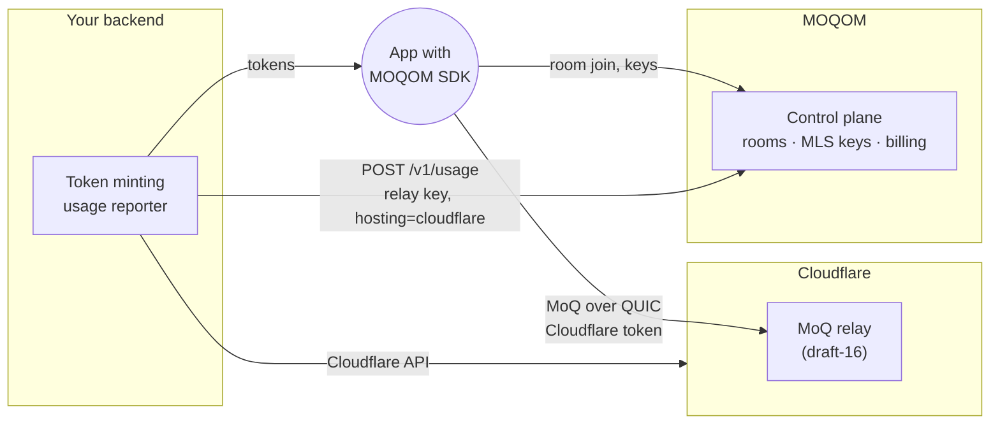

# Cloudflare MoQ relays: how it works and how to set it up

MOQOM SDKs can send and receive media through Cloudflare's MoQ relay network instead of MOQOM's
relays. Cloudflare runs MoQ relays in over 330 cities and, as of October 2026, offers them free
as a beta.

Use Cloudflare when you want free global distribution and can do without the features that only
MOQOM's relays have (listed under [Limits](#limits)). Use MOQOM's relays, cloud or self-hosted,
for everything else. They run the latest MoQ Transport draft and the full feature set.

**In one minute:**

1. The app connects to Cloudflare's relay with a Cloudflare token instead of a MOQOM token.
   The SDK sees the Cloudflare endpoint and switches to Cloudflare's draft (16) by itself.
2. Media is end-to-end encrypted on the device as usual, so Cloudflare forwards ciphertext. Room
   keys still come from MOQOM, so encrypted rooms also need a MOQOM participant token.
3. Your backend creates the Cloudflare tokens, and it reports usage to MOQOM with
   `"hosting": "cloudflare"` because MOQOM can't see Cloudflare's traffic.
4. Billing is free until 1 November 2026. After that, the first 1,000 participant-minutes each
   month are free, and the rest costs the self-hosted fee of $0.05/GiB.
5. Some features need MOQOM's relays, such as catch-up, pause and moderation. The SDK throws
   `unsupportedByRelay` rather than send them to Cloudflare.

The public version of this guide, without branch names or internal status, is
`sites/moqom-dev/src/content/docs/guides/cloudflare.md`.

> **Status, 6 October 2026.**
>
> | Part | State |
> | --- | --- |
> | Billing | Built, on moqom branch `oct-2026-cloudflare-billing` |
> | Swift SDK (drafts 16, 19, 22) | Done, on moqom-swift `oct-2026-moqt-drafts`. A live subscribe through Cloudflare works. |
> | Rust client and `moqom cloudflare sub` | Done, on moqom-engine `oct-2026-moqt-drafts`. A live subscribe through Cloudflare works. |
> | Publishing to Cloudflare | Unit-tested against a scripted relay only, until there's a Cloudflare account to test with |
> | SDK usage counters | Not started |
>
> Nothing is pushed or deployed.

## How it works



- **Media** goes between the app and Cloudflare's relay. MOQOM never sees it.
- **Encryption.** With end-to-end encryption on, the SDK encrypts each payload with SFrame before
  it leaves the device. Cloudflare relays ciphertext it can't read. Room keys come from MOQOM's
  MLS key service, as they do on MOQOM relays.
- **Draft version.** Cloudflare's production relays speak MoQ Transport draft-16; MOQOM's speak
  draft-22 and draft-19. The SDK uses a separate wire profile for Cloudflare and picks it from
  the endpoint. Nothing in your app changes between drafts.
- **Authentication.** Cloudflare authenticates with its own tokens, not MOQOM's. Your backend
  creates them with your Cloudflare account. The SDK sends the token as the MoQ connection path
  (`/<token>`), which is how Cloudflare expects it over raw QUIC. MOQOM's admission tickets and
  device proofs are not sent to Cloudflare.
- **Billing.** MOQOM can't see Cloudflare's traffic, so your backend reports usage to MOQOM, the
  same way a self-hosted relay does. See [Billing](#billing).

### Endpoints

| Relay | Draft | ALPN over raw QUIC | MOQOM support |
| --- | --- | --- | --- |
| `draft-16.cloudflare.mediaoverquic.com:443` | 16 | `moqt-16` | Yes |
| `draft-14.cloudflare.mediaoverquic.com:443` | 14, no authentication | `moq-00` | No (legacy) |
| `draft-18-interop.cloudflare.mediaoverquic.com:443` | 18, interop testing only | `moqt-18` | Added when Cloudflare deploys draft-18 globally |

The ALPNs were checked with a QUIC handshake on 6 October 2026. Raw QUIC works, so apps don't
need WebTransport to reach Cloudflare.

## Setup

### 1. Create a Cloudflare MoQ relay

Each Cloudflare relay is an isolated scope: other relays can't see its namespaces and tracks.
Create one per application or environment, either in the dashboard under
**Media › Realtime › MoQ Relay** or through the API:

```sh
curl -X POST "https://api.cloudflare.com/client/v4/accounts/$CF_ACCOUNT_ID/moq/relays" \
  -H "Authorization: Bearer $CF_API_TOKEN" \
  -H "Content-Type: application/json" \
  -d '{"name": "my-app-prod"}'
```

The response contains the relay ID and two tokens: one that can publish and subscribe, and one
that can only subscribe. Cloudflare shows token secrets once and doesn't store them, so put them
straight into your secret store.

### 2. Issue tokens from your backend

Apps should never hold your Cloudflare API token. Your backend creates relay tokens and hands
them to the app, as it already does for MOQOM tokens:

```sh
curl -X POST "https://api.cloudflare.com/client/v4/accounts/$CF_ACCOUNT_ID/moq/relays/$CF_RELAY_ID/tokens" \
  -H "Authorization: Bearer $CF_API_TOKEN" \
  -H "Content-Type: application/json" \
  -d '{"operations": ["subscribe"], "expires": "2026-10-07T00:00:00Z", "label": "viewers-2026-10-06"}'
```

Cloudflare's limits, as of October 2026:

- **Roles.** `operations` is `publish`, `subscribe`, or both. Give viewers subscribe-only tokens.
- **Expiry.** It defaults to one year and can't be more than a year away. Set it short.
- **Count.** A relay holds at most 10 tokens, so you can't give every viewer their own. Share a
  short-lived subscribe token among viewers and rotate it. Give each publisher its own
  publish token.
- **Logging.** The token travels in the connection path, so it appears in Cloudflare's access
  logs. Cloudflare plans in-band tokens (C4M, Privacy Pass) later.

For end-to-end encrypted rooms, the app also needs a MOQOM participant token. It authenticates
the device to MOQOM's MLS key service, as it does on MOQOM relays. So the app holds two tokens:
Cloudflare's for media, and MOQOM's for room keys.

### 3. Point the SDK at Cloudflare

Swift:

```swift
let session = try await MoqtTransport.network().connect(
    to: .cloudflare(token: cloudflareToken),   // draft-16.cloudflare.mediaoverquic.com:443
    credentials: credentials                   // identity only; no MOQOM token is sent
)
```

`RelayEndpoint.cloudflare(token:host:draft:)` takes a different host for a relay that isn't the
default. `draft` is `.draft16`, the only value until Cloudflare deploys draft-18. When the
endpoint is printed or logged, its path, which holds the token, is redacted.

Rust CLI (binary `moqom`), handy for testing:

```sh
export MOQOM_CF_DEMO_TOKEN='<a subscribe token>'   # read by --token; keeps it out of `ps`
moqom cloudflare sub --namespace my-namespace --track 0.mp4 --track 1.m4s --count 20
```

`--filter` takes `none` (the default: the relay picks), `largest` or `next`. `--host` and
`--port` select another relay. The track names follow the layout of Cloudflare's `moq-pub`:
`0.mp4` is the init segment, and `<track id>.m4s` is media.

On a Cloudflare endpoint the SDK:

- speaks draft-16 and sends none of MOQOM's own setup options;
- never sends a message Cloudflare doesn't support (see [Limits](#limits)):
  - `fetch` throws `MoqomError.unsupportedByRelay(feature: .fetch, …)`. Rooms skip catch-up and
    start at the next group.
  - `updatePriority` and `updateForwarding` do nothing, so pause doesn't pause.
  - Credential renewal throws `.unsupportedByRelay(.credentialRenewal)`. The session ends when
    the Cloudflare token expires, so the app reconnects with a fresh one.
  - A GOAWAY from the relay is treated as an interruption, and the session redials.
- keeps end-to-end encryption exactly as on MOQOM relays.

### 4. Report usage to MOQOM

1. **Issue a relay key** once. A relay key can only report usage:

   ```sh
   curl -sS https://api.moqom.cloud/v1/keys \
     -H "Authorization: Bearer $MOQOM_API_KEY" \
     -H 'Content-Type: application/json' \
     -d '{"name":"cloudflare-reporter","kind":"relay"}'
   ```

2. **Report from your backend.** Add `"hosting": "cloudflare"` to the body; the records are the
   same as a self-hosted relay's:

   ```sh
   curl -sS https://api.moqom.cloud/v1/usage \
     -H "Authorization: Bearer $MOQOM_RELAY_KEY" \
     -H 'Content-Type: application/json' \
     -d '{
       "hosting": "cloudflare",
       "records": [{
         "id": "cf:2026-10-06T09:15:00Z:bea/41d07a9e",
         "room": "live/42",
         "participant": "bea/41d07a9e",
         "role": "broadcast_audience",
         "tier": "full_hd",
         "seconds": 60,
         "egress_bytes": 104857600,
         "ingress_bytes": 0
       }]
     }'
   ```

The rules are those of the [usage API](/reference/usage-api/): at most 5,000 records per
request, and the `id` makes each record idempotent. The figures come from the SDK's usage
counters on the Cloudflare profile. Those counters aren't built yet. Until they are, report what
your app measures.

What's rejected:

- `"hosting": "cloudflare"` with any credential other than a tenant's relay key;
- `direct_seconds` on a Cloudflare record. Only MOQOM relays issue direct-call tickets.

Keep the relay key on your backend. It's a secret, so apps never report usage themselves.

### 5. Test

Swift:

```sh
MOQOM_CF_DEMO_TOKEN=fetch swift test --filter CloudflareLiveTests   # reads the demo token from Cloudflare's page
```

On 6 October 2026 this connected on `moqt-16` and received `bbb/0.mp4`, a 1,312-byte segment
starting with `ftyp`, followed by a media segment from the live group. Cloudflare publishes a subscribe-only demo token for namespace `bbb` on its
[demo streams page](https://developers.cloudflare.com/moq/demo-streams/). Use it to check that a
client connects and receives objects before you create a relay of your own:

```sh
export MOQOM_CF_DEMO_TOKEN='<token from the demo streams page>'
moqom cloudflare sub --namespace bbb --count 10
```

Publishing needs a relay of your own, from step 1.

## Limits

Cloudflare doesn't implement every MoQ message (see its
[feature matrix](https://developers.cloudflare.com/moq/feature-matrix/)), and some MOQOM features
exist only on MOQOM's relays:

| Feature | On Cloudflare | Why |
| --- | --- | --- |
| Publish and subscribe, by track or namespace | Yes | |
| End-to-end encryption (SFrame, MLS room keys) | Yes | Payload-only; keys come from MOQOM |
| Catch-up and late join from cache | No | No FETCH |
| Pause, resume, priority changes on a subscription | No | No REQUEST_UPDATE |
| Graceful relay migration | No | No GOAWAY |
| Admission tickets, grants, kick and ban, spend limits | No | Enforced by MOQOM relays |
| Usage metering by the relay, events, recording | No | These run on MOQOM relays; you report usage instead |
| Relay-side layer and bitrate adaptation | No | MOQOM relay feature |
| Direct (peer-to-peer) calls | No | Tickets come from MOQOM relays |

## Billing

| Period | Price |
| --- | --- |
| Usage reported before 1 November 2026 (UTC) | Free. Recorded in the ledger at $0, marked `trial`. |
| From November 2026 | 1,000 participant-minutes free each calendar month, then the self-hosted fee of **$0.05/GiB** of egress, under the same Agora-based cap. |

- You pay Cloudflare for its relays, which are free during its beta. MOQOM paid for nothing, so
  there's no cost or markup.
- The 1,000 minutes are separate from the 1,000 free direct-call minutes.
- The trial is judged by when a report arrives. October usage reported after 1 November is
  charged, so report at least daily.

## Troubleshooting

| Symptom | Likely cause |
| --- | --- |
| Handshake fails, "peer doesn't support any known protocol" | Wrong host for the draft. Use `draft-16.cloudflare.mediaoverquic.com`. |
| The session closes right after SETUP with PROTOCOL_VIOLATION (0x3), "scope resolution failed" | Missing, expired or wrong-role Cloudflare token. Cloudflare uses this code rather than UNAUTHORIZED. |
| REQUEST_ERROR 0x10 "Track not found" | The namespace doesn't exist on this relay |
| REQUEST_ERROR 0x0 "internal error" on a subscribe | The namespace exists but the track doesn't. This is Cloudflare's behaviour, not DOES_NOT_EXIST. |
| `401` from `POST /v1/usage` | Not a relay key, or the key is revoked |
| `400` "hosting is \"cloudflare\", from a tenant's relay key, or absent" | A misspelt `hosting`, or the report wasn't sent with a relay key |
| Error naming FETCH, pause or priority | That feature isn't available on Cloudflare (see [Limits](#limits)) |

## Code

| Area | Where |
| --- | --- |
| Billing | `moqom/go/internal/billing`: `HostingCloudflare`, `Pricing.CloudflareFreeUntil`, `CloudflareFreeMinutesPerMonth`, `CloudflarePrice`. Tables `billing_cloudflare_months` and `billing_cloudflare_claims`. |
| Swift codec | `moqom-swift/Sources/MoqomWire/Draft.swift`, `Draft16.swift`, `Draft22.swift` |
| Swift session | `moqom-swift/Sources/MoqomKit/Transport/Draft16Session.swift`, `SessionDialect.swift`, `Transport.swift` (`RelayEndpoint.cloudflare`) |
| Rust codec | `moqom-engine/moqom-proto/src/draft.rs`, `src/control/d16.rs` |
| Rust client and CLI | `moqom-engine/moqom-client/src/cloudflare.rs`, `moqom-cli/src/cloudflare.rs` |
