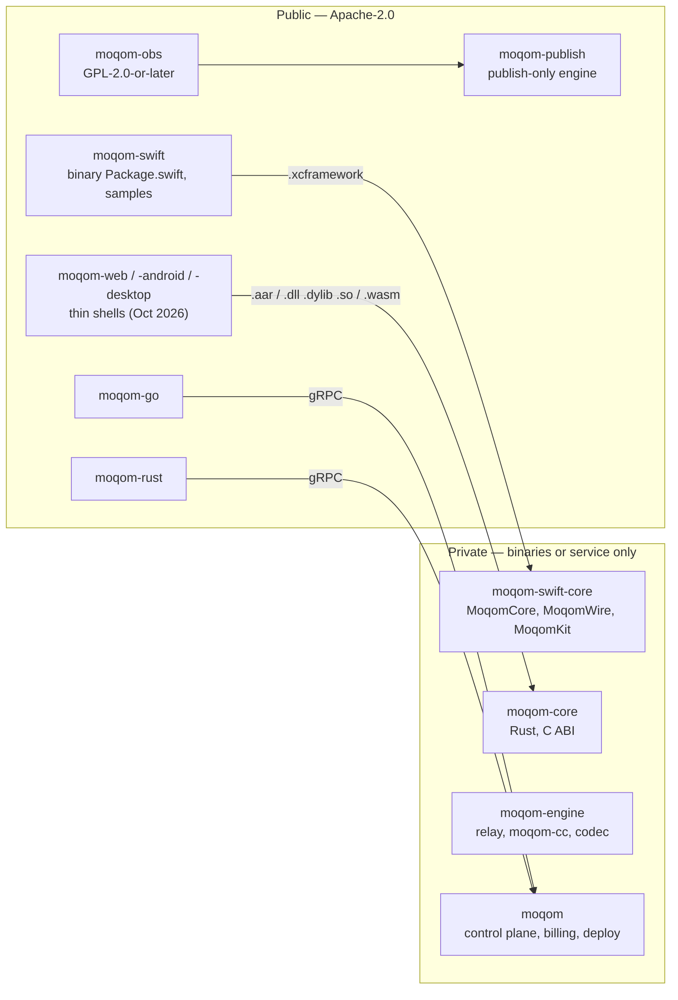

# Open core: what goes public, what stays private, and how the player is locked

Owner: **Elliott Wave LLC**, which holds the copyright in every first-party
line in these repositories and has patent applications pending. Read
[`PATENT-ASSESSMENT.md`](PATENT-ASSESSMENT.md) before changing anything below;
several items here are ordered by it.

## The model

The Agora model: **private engine and player cores shipped as signed binaries,
public thin shells around them**, public samples, public backend SDKs. A
developer can read, fork and build everything they integrate with; nobody can
rebuild the thing that moves media.

Elliott Wave LLC sells two things: **MOQOM Cloud**, prepaid credit metered on
delivery, and the **platform fee on self-hosted relays**, paid through the
same API key and balance. Everything public exists to make those easier to buy,
and nothing public may make either unnecessary. One test for every component:
*if a competitor had this, could they offer MOQOM's service without paying
Elliott Wave LLC?* If yes, it stays private.

## Repository map

| Repository | Visibility | Licence | Contents |
|---|---|---|---|
| `moqom` | **Private, permanently** | Proprietary + Apache `proto/` | Control plane, billing and metering, director, deploy, plans, patent assessment |
| `moqom-engine` | **Private** | Proprietary relay + internal crates | Relay, `moqom-cc`, codec and dependency descriptor, load generator |
| `moqom-swift-core` | **Private, new** | Proprietary EULA, binary only | Today's `moqom-swift` sources, whole: `MoqomCore`, `MoqomWire`, `MoqomKit`, `MoqomLoopback` |
| `moqom-core` | **Private, new** | Proprietary EULA, binary only | Shared Rust client core with a C ABI, for Android, desktop and web (WebAssembly) |
| `moqom-swift` | Public, **fresh history** | Apache-2.0 shell | `Package.swift` with `binaryTarget`s, README, `MoqomRoom` sample, docs |
| `moqom-web` | Public at release (planned October 2026) | Apache-2.0 shell | TypeScript over the `moqom-core` WebAssembly build |
| `moqom-android` | Public at release (planned October 2026) | Apache-2.0 shell | Kotlin over `moqom-core` in an `.aar` |
| `moqom-desktop` | Public at release (planned October 2026) | Apache-2.0 shell | C/C++ headers and bindings over `moqom-core` |
| `moqom-publish` | Public at release (planned October 2026) | Apache-2.0 | Open publish-only engine; see below |
| `moqom-obs` | Public at release (planned October 2026) | GPL-2.0-or-later | OBS output plugin on `moqom-publish`; required by `libobs` |
| `moqom-go` | Public | Apache-2.0 | Backend admin SDK; every call is an RPC to the control plane |
| `moqom-rust` | Public | Apache-2.0 | Backend admin SDK; every call is an RPC to the control plane |

The backend SDKs are safe to publish because they are useless without the
control plane, which stays private.

## Decisions taken

1. **`moqom-swift` splits into a private core and a public shell.** The whole
   of today's source moves to `moqom-swift-core` and ships as signed
   `.xcframework`s built with `BUILD_LIBRARY_FOR_DISTRIBUTION`. The public
   repository is created new, with no history, so nothing a past commit
   described is published with it.
2. **The codec stays private for now.** Including the dependency descriptor,
   until the patent-or-IETF decision on it is made.
3. **One shared Rust core for every non-Apple client.** `moqom-core` exposes a
   C ABI; Android binds it through JNI, desktop links it natively, the web loads
   it as WebAssembly. One implementation of the protocol, the session and the
   player, three thin shells.
4. **OBS gets an open publish-only engine.** Below.
5. **Billing ships before any repository goes public.** Built: prepaid credit,
   API keys, Stripe Checkout and automatic top-up, usage metering from cloud and
   self-hosted relays, a credit gate on every join and minted token
   (`go/internal/billing`).

## The open publish-only engine

OBS is GPL, so whatever it links has to be GPL-compatible source. That rules
out the private core and asks for a small open engine that can only send.

`moqom-publish` contains:

- MoQ transport publisher over [QUIC](https://www.rfc-editor.org/rfc/rfc9000) (quinn), draft-19 control messages.
- Catalog publication and track naming.
- [SFrame](https://www.rfc-editor.org/rfc/rfc9605) encryption of every object, with keys from the join endpoint.
- Token handling: device key, join, renewal.
- Plain congestion control from quinn.

It deliberately does **not** contain, and cannot be extended to contain without
the private core:

- Any subscriber or player code. It cannot watch anything.
- `moqom-cc`, the media-aware congestion controller (trade secret).
- The dependency descriptor and the codec's layer metadata (pending the patent
  decision). OBS publishes a single quality per track until then.
- Response to the relay's demand feedback (patent candidate 1): an OBS source
  encodes every configured layer whether watched or not.

Publishing the send side of the wire format is the accepted cost: the format is
the IETF draft, and a publisher alone gives nobody a service.

## Locking the player to the MOQOM network

A licence check in public code does not lock anything: Apache-2.0 lets anyone
delete it. Every lock that works rests on something the public code does not
contain, and there are three.

**Layer 1 — the player is not public.** It lives in the private cores and ships
as signed binaries under a EULA that permits use only with MOQOM Cloud or a
self-hosted relay paying the platform fee.

**Layer 2 — the media is keyed to the network.** Every track is SFrame-encrypted
and only the MOQOM control plane hands out keys, over the token-authenticated
join, which is also where credit is checked. Any MoQ relay can carry MOQOM
media and any MoQ player can receive it; none can show it. For broadcast this is
*network-keyed media*, not end-to-end encryption, and must not be marketed as
E2EE: the platform holds the keys.

**Layer 3 — the player only talks to MOQOM relays.** The binary refuses a
session unless the relay's certificate chains to the MOQOM relay CA pinned in
it, and the session token is signed by a MOQOM issuer key also pinned in it.
Self-hosted relays get certificates through their API key, which makes
certificate issuance the enforcement hook for the platform fee.

| Client | Player ships as | Strongest layer |
|---|---|---|
| Apple | Signed `.xcframework` | All three |
| Android | `.aar` with native `moqom-core`, R8-obfuscated shell | All three |
| Desktop | Signed native library per OS | All three |
| Web | WebAssembly `moqom-core` plus glue | **Layer 2.** Browser code is inspectable; the lock is the keys. Layer 3 partly, via `serverCertificateHashes` |
| OBS | No player | n/a — publish only |

What this costs, plainly:

- **`LICENSING.md` says an SDK that cannot work without a proprietary binary is
  not meaningfully open.** After this change that is true of every client SDK.
  Update the document rather than leave the contradiction.
- **Interop shrinks.** `moq-rs` and `moxygen` can still exchange protocol
  messages with MOQOM relays, but cannot render MOQOM media.
- **It is deterrence, not impossibility.** Keys can be extracted from a device
  an attacker controls; every DRM system accepts this. The goal is that using
  MOQOM without paying costs more than paying. Counsel to confirm how far DMCA
  §1201 reaches.
- **Release engineering.** Signed, reproducible binaries for every target, with
  symbols kept privately for crash reports.

## Blockers before any repository goes public

Legal, from `PATENT-ASSESSMENT.md`:

- [ ] Signed IP assignment from Elliott to Elliott Wave LLC
- [ ] Patent applications on file for everything a public repository describes
- [ ] IETF posture decided for the dependency descriptor

Business:

- [x] Billing: prepaid credit, API keys, Stripe, metering, credit gate
- [ ] Stripe keys in Secret Manager and `billing_enabled = true` in production
- [ ] Load test (Friday, October 9, 2026) before any number is quoted as more
      than a lab measurement
- [ ] Terms of service and privacy policy reviewed by counsel

Repositories:

- [ ] **Hardcoded dev relays.** `Samples/MoqomRoom` and the tests name GCP relay
      IPs and the project ID. Scrubbed from the public shell; rotate or key the
      relays regardless.
- [ ] **CI that clones private repositories.** Gate those jobs on the pull
      request coming from the same repository.
- [ ] **Links into private repositories.** Point READMEs at moqom.dev.
- [ ] **Licensing contact.** The proprietary licence names `legal@moqom.cloud`,
      which must exist.
- [ ] **CLA enforcement** before the first outside pull request is merged.
- [x] Microsoft MIT notice for `MoqomRans.xcframework`, in `NOTICE`.

## Order of operations

1. IP assignment signed; filings confirmed against what each public repository
   shows.
2. `moqom-go` and `moqom-rust` public: lowest risk, no restructuring.
3. `moqom-swift-core` created privately from today's `moqom-swift`; binaries
   built; public `moqom-swift` shell published with fresh history.
4. Network keying and relay pinning in the cores.
5. `moqom-core` (Rust, C ABI); then the web, Android and desktop shells and
   `moqom-publish` with `moqom-obs`, releases planned October 2026.
