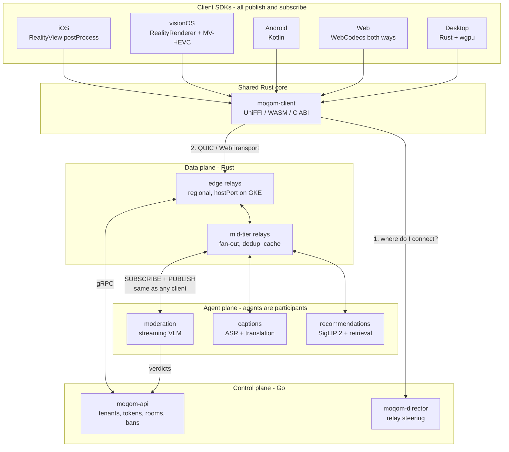

# MOQOM: Media Over QUIC Orchestration Mesh

## Product decisions, and three tensions they create

Settled: the wedge is **creator and social live streaming** — cohosting, gifts, large audiences. Licensing is **Apache 2.0 SDKs and protocol, with the relay and control plane held back**. Deployment is **managed SaaS and self-hosted/BYOC both**. Reach is **global from day one with data residency as a selling point**. E2EE is a **headline differentiator**.

Three of those pull against each other, and it is cheaper to resolve them here than to discover them in an architecture review.

### E2EE is near-meaningless for public broadcast, and that is fine

For a public broadcast to a million viewers, end-to-end encryption protects against exactly one adversary: us, the relay operator. Anyone who can join can decrypt, because the key must go to everyone who asks. Meanwhile it disables the server-side moderation a creator platform cannot operate without — and creator social is the *most* moderation-intensive category there is. E2EE everywhere plus creator social plus AI safety is not a set of tradeoffs, it is a contradiction.

**So scope E2EE to where it carries real weight**, and say so plainly rather than making a blanket claim that collapses under inspection:

- **Backstage and cohost-only channels** — genuinely private, small membership, real adversary.
- **Private and small-group rooms** — the direct-conversation case.
- **Paid or subscriber-gated small sessions** — where "the platform cannot watch your session" is a product feature people pay for.
- **Public broadcast** — transport encryption, full server-side moderation, and honest labelling. Not E2EE.

This is a *stronger* claim than a blanket one because it survives scrutiny, and it maps onto the group-size split below rather than fighting it. Zoom markets a uniform E2EE mode and quietly turns off every AI feature when you enable it; we can offer E2EE where it means something and full AI everywhere else, and explain exactly why.

### Key management needs two constructions, not one

This is the technical consequence of the above and the largest gap in the plan as written. SFrame encrypts objects; it says nothing about key distribution, and the answer differs by group size.

- **Small rooms use MLS (RFC 9420).** Forward secrecy, post-compromise security, and membership changes are exactly what it is designed for. It realistically scales to thousands, which comfortably covers backstage, private rooms, and paid sessions.
- **Anything larger uses a sender-key model.** The publisher generates a track key and the control plane distributes it to authorized subscribers, rotating on membership change where the membership is small enough for rotation to mean anything. Weaker post-compromise guarantees, and that limitation gets documented rather than obscured.

Two constructions, one SFrame layer beneath both, and a clear rule about which applies where.

### Residency and cross-border cohosting are in direct conflict

Hard residency guarantees mean a room's media and metadata stay in a region. Cohosting means media crosses between rooms. **An EU host cohosting with an Indian host moves personal data across a border by construction**, and no amount of relay engineering makes that not true.

There is no clever fix, only an explicit policy, and it must be enforced in the invite path rather than discovered at delivery:

1. **Residency is a room property**, set at creation and immutable.
2. **A cohost invite across incompatible residency zones is refused by default**, the same way it is refused across incompatible age policies — the mechanism already exists in the cohost session's stricter-policy inheritance.
3. **A tenant may opt in to cross-border cohosting explicitly**, with both hosts consenting, and the crossing recorded in an auditable transfer log.
4. Residency applies to **derived data too** — inference outputs, recordings, moderation evidence — which is the part that usually gets missed.

Global-with-residency also has a cost worth stating: it multiplies regional footprint, since each residency zone needs its own relay presence *and* its own control-plane shard. That is the single most expensive commitment on this list, and it argues for a small number of well-chosen zones rather than a long list.

### Source-available relay beats closed relay

Closed relay plus self-hosted plus security-as-a-cornerstone is an awkward combination: you are asking security-conscious customers to run an opaque binary inside their own perimeter while claiming auditability as a virtue. Recommend **source-available for the relay and control plane** — BSL or similar, readable and auditable, with a conversion date and a restriction on offering it as a competing service — while SDKs and the protocol stay Apache 2.0. That keeps the commercial moat, makes the security claim inspectable, and makes BYOC a much easier sale.

One thing to settle before the first outside contributor: **a CLA, not just a DCO.** Relicensing or acquisition both require it, and retrofitting one means chasing down every past contributor. Apache 2.0's express patent grant also interacts with any patent strategy, so the licensing and IP decisions want to be made together rather than sequentially.

## Migrating off Agora and LiveKit without downtime

Every customer worth having is already running on something. The switching cost, not the technology, is what loses those deals — so migration is a product surface with its own engineering, not a professional-services afterthought.

### The real constraint is the app store, not the cutover

Server-side migration is easy; we control both ends and a config change moves traffic. **The binding constraint is that mobile clients cannot be updated atomically.** Review takes days, staged rollout takes weeks, and a meaningful tail of users never updates at all — a large consumer app still sees traffic from builds eighteen months old.

So for months after the migration begins, some participants are on an Agora-only build and some are on a MOQOM build, **and they need to be in the same room**. That, not the SDK swap, is the actual problem. Any plan that assumes a flag day has not accounted for it.

### Three mechanisms, in order of leverage

**1. Compatibility adapters — their API, our stack.** Ship `moqom-compat-livekit` and `moqom-compat-agora`: packages exposing the shape of their client SDKs, implemented over MOQOM. Migration becomes a dependency swap rather than a rewrite, and a prospect can evaluate us in an afternoon instead of a quarter. Cover the subset that real apps use — join, publish, subscribe, mute, roles, events — and document the gaps honestly rather than stubbing them to no-ops that fail silently.

LiveKit is the easier and better first target: Apache-2.0, so we can read the source; a smaller and cleaner surface; and a room/participant/track model that maps almost directly onto MoQ namespaces. Agora's surface is far larger and proprietary.

**2. A server-side stack flag, per room.** The client carries both stacks and asks the control plane which to use when joining. Rooms are homogeneous — every participant on one stack — so no media bridging is needed for the common case. A room containing any legacy-build participant stays on the legacy stack automatically. Migration then completes as builds age out, without a coordinated moment.

The property that matters more than any other: **rollback is a server-side config change, never an app release.** If MOQOM misbehaves at 3am, the on-call fix is a flag flip taking effect on the next room join. A rollback that requires App Store review is not a rollback.

**3. Make-before-break for live cutover.** A room can move stacks mid-session without a visible gap: subscribe on the new stack, wait for the first decoded keyframe, *then* tear down the old. The viewer sees nothing.

Asymmetry worth designing around: this is cheap on the viewer side, where dual-subscribing spends downlink, and expensive on the publisher side, where dual-publishing spends the scarcest resource a mobile broadcaster has. **Viewers get seamless cutover; publishers get either a sub-second blip or a brief dual-publish at reduced quality**, gated on measured uplink headroom.

### Bridging mixed rooms, and the cheap version we already have

If a customer will not wait for build adoption, mixed-stack rooms need a bridge. The expensive answer is a WebRTC gateway terminating their stack and repackaging into MoQ.

The cheap answer is already in the plan. Both platforms can push a room out as RTMP — LiveKit through Egress, Agora through Media Push — and `moqom-ingest` already accepts RTMP and WHIP for OBS. So **legacy room → RTMP → our ingest → MoQ fan-out** works with infrastructure built for another reason. It adds a second or two of latency, which rules it out for interactive participants but is perfectly acceptable for the audience side of a broadcast, where the audience is the overwhelming majority of connections. Build the gateway only if a specific deal requires interactive mixing.

### Their tokens keep working

Server-side integration is often harder to schedule than client work, because it sits in someone else's release train. So **accept their token format at the edge and translate internally**: a LiveKit JWT with video grants maps cleanly onto our scopes, and their existing token-minting service keeps running untouched. Same for emitting LiveKit-shaped webhooks, so their backend does not change on day one either. Migrate the token service later, as its own project, with nothing else depending on the timing.

**The uid problem is worth calling out** because it is the exact pain that motivated string identity here. Agora identifies users by 32-bit integer, so every Agora customer maintains an int-to-username mapping somewhere. During migration we accept the integer and derive a deterministic string identity from it, then let them cut over to real usernames on their own schedule. The thing we designed to avoid becomes a compatibility shim with a defined end date.

### What cannot be zero-downtime, stated plainly

- **Feature gaps.** If they depend on something we lack, no migration mechanism helps. This is what the compatibility matrix is for, and it should be published rather than discovered mid-migration.
- **Publisher cutover on a constrained uplink**, per the asymmetry above.
- **Recording continuity.** A recording spanning a cutover is two files. Stitching them is a post-process, not a live property.

### The legal note

Reimplementing an API surface is defensible — *Google v. Oracle* (2021) held that reimplementing Java's API declarations was fair use — but it invites noise from a competitor who would enjoy making us spend money. Use their type and method *shapes*, never their code, never their documentation text, and keep provenance clean enough to demonstrate it. LiveKit being Apache-2.0 makes the LiveKit adapter straightforwardly safe; Agora warrants counsel review before it ships.

### What this changes today

Mostly one thing, and it lands in Phase 3. **The SDK API cannot be designed as a thin skin over MOQOM internals**, because it has to sit above a stack selection that is resolved at runtime, and because two compatibility adapters have to be expressible on top of it. Designing `sdk-api` while sketching the LiveKit adapter against it is how we find out whether the abstraction holds — and it is far cheaper to find out then than after three platform SDKs have shipped against the wrong shape.

## Protocol target

Implement **`draft-ietf-moq-transport-19`** (July 2026, 149pp) directly, and negotiate version via ALPN — which is the sanctioned mechanism, settled by moq-wg PR #499 removing version negotiation from SETUP entirely. Drafts use `moqt-NN`; the final RFC will use bare `moqt`.

This matters because there is no single "MOQT" today. Verified on the wire in July 2026: Cloudflare's production relay speaks **`moqt-16`** and rejects everything else, with a `draft-18-interop` endpoint live alongside it. `moq-dev/moq` implements **moq-lite**, which despite the name is a different protocol rather than a subset — string namespaces instead of tuples, no subgroups, and media timestamps pulled into the transport. And `moq-net` demonstrates that one binary can speak moq-lite 03–05 plus `moqt-14` through `moqt-19` behind a single API.

We pick draft-19 and are explicit about it. **Do not implement moq-lite** — it buys nothing, since Cloudflare picks `moqt-16` over `moq-lite-05` even when offered both.

## Architecture



Three planes, three languages, chosen deliberately: **Rust** for anything touching packets or pixels, **Go** for the CRUD/business control plane where iteration speed wins, **Python only inside agent workers**.

Note what the diagram is asserting: agents connect to relays with the same SUBSCRIBE and PUBLISH any client uses, and their output tracks fan out through the same tree as the video. There is no separate AI path, and that is the point.

## Identity and multi-device

Your instinct to avoid Agora's ID mapping is right, and MOQT makes it easy. Two properties of the spec do the work:

**1. User IDs stay as strings, unmapped.** The username is the CWT `sub` claim verbatim. Nothing maps it to an integer anywhere.

**2. Namespaces are tuples, not strings** — draft-19 §10.18 defines Track Namespace as an ordered tuple of fields with per-field matching. So the device is its own field rather than a suffix glued onto the username:

```
namespace = (tenant, "u", "alice", "iphone-3f9a")
track     = "video/hd"
```

This removes the whole class of bugs that comes from appending a device ID to a user ID (separator collisions, ambiguous parsing when usernames contain the delimiter, no way to scope authorization to just the user portion).

**3. Device identity is a keypair, not a string** — this is the more elegant solution you were open to. `draft-ietf-moq-c4m-01` §3.1.1 binds a Common Access Token to a device via the `cnf` claim carrying a JWK Thumbprint (`jkt`), with DPoP proofs preventing token theft and replay. Each device generates a non-exportable P-256 key in the Secure Enclave or Android Keystore at install. The device field in the namespace is derived from that thumbprint.

The result: one logical user, N devices, one credential per device, and revoking a single lost phone means revoking one `jkt` rather than rotating the user's identity.

**Authorization** uses the C4M `moqt` claim, which is an array of scopes over `[actions, namespace-matches, track-match]` with per-element exact/prefix/suffix matching:

```
publish:   [[PUBLISH], ["acme", "u", "alice", "iphone-3f9a"], nil]
subscribe: [[SUBSCRIBE], ["acme", "u", [prefix, ""], nil], nil]
```

The relay enforces this structurally without parsing strings. Use `moqt-reval` so long-lived broadcasts revalidate rather than running forever on a stale grant.

## Security

### The differentiator: E2EE that does not break the relay

`draft-ietf-moq-secure-objects-01` (adopted WG document, July 2026) layers SFrame (RFC 9605) over MOQT objects, and the crucial property is that **encryption covers only the payload**. Group ID, Object ID, Publisher Priority, and the track name stay visible to relays *and* are cryptographically authenticated as AAD.

That means caching, deduplication, and priority scheduling all survive end-to-end encryption intact — the relay's cache key is the Full Object ID, which it can still read. And because Publisher Priority is in the AAD, a relay can schedule on it but cannot silently downgrade a competitor's stream. **Priority becomes tamper-evident.** No WebRTC SFU can make this claim; there, E2EE via SFrame costs you server-side quality adaptation.

Implementation notes that matter:
- Use **AES-256-GCM (0x0005)**, not the mandatory-to-implement 128-bit suite. §6.1.1 of the draft analyses fan-out forgery amplification: a malicious relay serving 2^x subscribers with 2^y objects gets that many trial forgeries, so the recommendation is a key roughly (x+y) bits longer. At broadcast scale that is not theoretical.
- Track authentication-failure rates **across all subscribers of a track** as a malicious-relay detection signal.
- Enable the **Padding Property (0x32)** against traffic analysis — object sizes and track names remain analyzable otherwise.
- Don't aggregate large spans into single objects. Authentication needs the whole object, so a 6-second aggregate adds 6 seconds of latency.
- Start with application-managed per-track `track_base_key`. MLS group keying (`draft-jennings-moq-mocha-mls-keying-00`) is a -00 individual draft with a TODO security section; add it when membership-change forward secrecy actually matters.

**Caveat on timeline:** secure-objects is adopted but has **no chartered milestone**, unlike transport (Dec 2026) and Privacy Pass (Mar 2027). It is implementable today against its test vectors, but don't plan around an RFC number arriving predictably.

### Privacy Pass: viewers we cannot track

`draft-ietf-moq-privacy-pass-auth-03`, chartered for March 2027. Unlinkable tokens mean the relay can verify a viewer is entitled to watch without learning who they are or correlating them across streams. "Our relays cannot build your viewing history, and that is cryptographically true rather than a policy promise" is a claim no competitor can make.

Use the draft's **reverse flow**: bootstrap with a publicly verifiable Blind RSA token (0x0002) from an external issuer, then have the relay act as its own reverse issuer handing out cheap privately verifiable tokens in `SERVER_SETUP`. Continuous re-authorization rides on `REQUEST_UPDATE` carrying both a fresh token and a request for the next one, so long sessions never round-trip to the origin issuer.

Watch **ARC (0xE5AC)** — Anonymous Rate-Limited Credentials carry a presentation limit while staying unlinkable between presentations. That is the credential-sharing answer that doesn't require viewer tracking. Still early (`draft-ietf-privacypass-arc-protocol-01`).

Note the draft's Security Considerations section is currently a TODO stub. We write that analysis ourselves.

### The E2EE versus AI moderation conflict

These are irreconcilable, and pretending otherwise is how platforms get into trouble. Zoom's product demonstrates the real cost: enabling E2EE disables cloud recording, AI Companion, live transcription, streaming, and breakout rooms.

**Our position: scope E2EE by group size and adversary, honestly labelled.** Public broadcast is not E2EE — a key handed to a million viewers protects only against the relay operator, while costing the moderation a creator platform cannot run without. E2EE applies to backstage and cohost channels, private and small-group rooms, and paid gated sessions, where the adversary is real and the membership is small enough for the guarantee to mean something. Those rooms get franking-based reporting (a recipient can prove to us that a specific publisher sent specific content, without us reading anything unreported) plus metadata-only abuse signals. See the product decisions section for the full split and the two key-management constructions it implies.

**But we can beat Zoom's bargain, because on-device inference lives inside the encryption boundary.** Zoom's E2EE mode disables transcription, translation, and every AI feature, because all of theirs is server-side. Ours doesn't have to be. A publisher's device holds plaintext audio before it is ever encrypted, and a viewer's device holds plaintext after decryption — so **captions, translation, and accessibility features survive E2EE intact** by running where the media is already in the clear. That is a materially better product than the incumbent bargain, and it falls out of the architecture rather than requiring a compromise.

What genuinely cannot survive E2EE is anything whose output is *for us*: server-side moderation, content classification for recommendations, recording, and search indexing. Those are the honest disclosures, and they are a much shorter list than Zoom's.

**The line between on-device inference and client-side scanning is who the output is for.** This distinction is load-bearing and easy to blur, so state it precisely: inference whose result is rendered to the user on their own device and never transmitted is a feature. Inference whose result is reported to the platform about a user who did not ask for it is client-side scanning, and **we do not build that**. The research consensus is settled — Apple's NeuralHash was broken by adversarial collisions within weeks, the attack works in both directions including weaponized false positives against innocent users, and no jurisdiction currently mandates it for E2EE. The practical rule: an on-device model may publish to a track the user controls, never to a track we consume without consent.

**One implementation hazard worth naming now.** Apple's iOS 27 `LanguageModel` protocol lets `SystemLanguageModel` and `PrivateCloudComputeLanguageModel` be swapped without changing downstream code — which is the entire point of the abstraction, and precisely why it is dangerous here. PCC is a network hop with plaintext at the far end, so a well-intentioned refactor could silently move inference off-device and invalidate the E2EE claim without any test failing. **Assert on the concrete model type at the trust boundary rather than accepting `any LanguageModel`**, and make that assertion a test.

### Relay hardening

`draft-englishm-moq-relay-dos-01` (Cloudflare, Meta, Google authors) identifies the structural problem: **a single SUBSCRIBE can trigger backend lookups, upstream session establishment, and ongoing media delivery far exceeding the cost of the request.** Unlike HTTP, server cost does not track request cost. The direct consequence is that **per-session limits are useless** — an attacker who opens sessions cheaply just moves the problem. Limits must be scoped to an authenticated identity or billing account.

Specific defences, each mapped to a named attack:

- **Short-prefix subscriptions** (transport §13.7.2). One `SUBSCRIBE_NAMESPACE` near the tree root forces the relay to emit enormous NAMESPACE traffic as the tree changes. Forbid subscriptions above a minimum prefix depth in authorization rules.
- **Rapid subscribe/cancel churn** — explicitly analogous to HTTP/2 Rapid Reset (CVE-2023-44487). Rate-track per session, throttle new bidi stream grants, and terminate sessions with high churn and no useful data transfer.
- **`REQUEST_UPDATE` flooding.** Coalesce pending updates per subscription (transport §10.9): 100 queued priority changes need only the final value applied. Cheap fix, kills a whole class.
- **Slow subscribers** — the nastiest one, because relays MUST NOT reorder or drop objects on a multi-object stream, so the only bound on buffering is resetting the stream. The defence is itself a denial of service. Design explicit buffer caps with live-edge skip-ahead rather than discovering this under load.
- **Bound every peer-drivable queue.** Both confirmed quiche CVEs (CVE-2026-12707, CVE-2025-7054) were unbounded queues and loops in connection-ID and path-migration handling, not cryptographic failures. quiche implemented RFC 9000 §9.3 correctly and still shipped a DoS because the *application-facing event queue* was unbounded. Fuzz the CID and migration state machine specifically.

### Token hardening beyond DPoP

- **`jti` replay cache must be shared across relay nodes.** A node-local cache is trivially bypassed by replaying against a different edge. This is load-bearing, because the DPoP proof binds to the action and track, not to the QUIC connection — so a captured proof is replayable within the freshness window without it.
- **`moqt-reval` fails closed by spec:** a relay that cannot revalidate MUST reject tokens carrying the claim. Use it for continuous enforcement (issue tokens valid for hours, cap ongoing stream authorization at ~300s), plus a small bounded deny-list of revoked `jkt` thumbprints for compromised devices. Do not build a general CRL.
- **Push signed JWKS bundles to relays**, don't have relays pull on cache-miss — that creates a thundering herd at rotation and makes the issuer a hard dependency from every edge. Sign the bundle with an offline root key. Overlap key validity for at least 2× max token lifetime.
- **Bind audience to a relay cluster, not a hostname** — anycast and failover break hostname binding.
- **mTLS between relays** for endpoint identity (it excludes unauthenticated peers from the mesh entirely), tokens for authorization. Never mTLS for end clients; certificate distribution at consumer scale is a trap.

### Certificates

Use **WebPKI certificates for browser clients**. WebTransport's `serverCertificateHashes` escape hatch caps total certificate validity at **two weeks** and forbids RSA, which makes automated rotation mandatory production infrastructure where a missed rotation is a total outage. Reserve it for development and LAN devices.

Relay-to-relay uses a **private CA** with short-lived certificates. In native SDKs, if we pin at all: pin to intermediate rather than leaf, always ship a backup pin for a not-yet-deployed key, and include an expiry after which the pin fails *open* so a stale client degrades to normal validation instead of bricking.

### Legal floor

NCMEC reporting under 18 U.S.C. § 2258A as amended by the REPORT Act (2024): report on **actual knowledge**, preserve for **1 year**, penalties up to **$1M**. The key point for an E2EE platform is that there is no US affirmative scanning mandate — but the moment a user report gives us knowledge, the clock starts. **Our reporting pipeline is a legal requirement, not a trust-and-safety nicety.** DSA notice-and-action and statement-of-reasons plumbing is far cheaper built in than retrofitted. SOC 2 Type II has a 6–12 month lead time; start the clock early.

## Rooms, roles, cohosts, and moderation

MOQT has no room concept — it is pub/sub over namespace tuples. We build rooms on top, and the tuple structure does most of the work.

```
room namespace   = (tenant, "r", roomId, participantId, deviceId)
personal channel = (tenant, "u", username, deviceId)
```

A viewer subscribes to the prefix `(tenant, "r", roomId)` and receives every participant on stage, including ones who join later, via `SUBSCRIBE_NAMESPACE`. No roster protocol needed — namespace announcement *is* the roster.

### Roles live in the token, not in a role enum

There is no `setClientRole`. A participant is a host if their token carries a publish scope for their slot in the room namespace, and an audience member if it doesn't. Promoting a viewer to cohost is one control-plane call issuing a token with the added scope.

This is LiveKit's model rather than Agora's, and deliberately so. Agora's `setClientRole` does not actually take effect when co-host token authentication is on — you must issue a new token anyway — so their role enum is a second source of truth that can silently disagree with the authorization that actually governs. We collapse them: the token is the role.

### Watchdogs are a third entity class, not participants with a flag

A room contains three kinds of thing, and collapsing the third into the first causes a long tail of small wrongnesses — a viewer count that reads 13 instead of 12, a recorder that appears kickable, a moderation detector that can be promoted to the stage.

| Class | Publishes to the room | Appears in roster | Verbs |
|---|---|---|---|
| **Participant** | media | yes | kick, mute, promote, demote |
| **Agent** | media or data clients consume | yes | same as participant |
| **Watchdog** | nothing | no | attach, detach, start, stop |

The dividing line is output, not intent: **if it produces something participants see or hear, it is an agent; if it only subscribes, it is a watchdog.** A captions agent and the avatar are agents — clients render their tracks, so they need priority, spotlight, and the ability to be muted. A recorder, a safety detector, an analytics collector, and a customer's own archiver are watchdogs.

**Exclusion from the roster is structural rather than a UI filter**, which is the part that makes this clean. The roster *is* namespace announcement — a participant appears because they publish under `(tenant, "r", roomId, participantId, deviceId)`. A watchdog publishes nothing, so it has no namespace entry and cannot appear in the roster even by accident. There is no filtering code to forget.

That same property is why watchdogs need **explicit room state on the control track**: invisible to the roster mechanism, they would otherwise be invisible entirely, and that is not acceptable. Each carries a kind (`recording`, `safety`, `analytics`, `compliance`, `custom`), an operator (us, the tenant, a named third party), a human-readable descriptor for the UI, the track scope it observes, and when it attached. Clients render this as room-level chrome — a recording indicator — never as a tile.

Three consequences worth designing to:

- **Different verbs, so different authorization.** You do not kick a recorder, you stop it. Managing watchdogs is its own capability, generalising the `control recording` capability already in the moderator set, and every attach and detach lands in the audit log.
- **Health, not presence.** A participant is connected or reconnecting or away — a social state. A watchdog is attached, degraded, or failed — an operational one. A customer whose recorder died wants that surfaced in room state, not inferred from a missing file afterwards.
#### Metering: excluded from the viewer count, and billed on its own line

A watchdog is a real subscriber — it consumes relay capacity and egress like anyone else, and pins layers under the demand loop, with the recorder holding the top layer and the safety detector a minimum one. It has to be paid for. The requirement is that it is paid for *as itself*.

**The exclusion that keeps it out of the roster must extend to the participant meter**, and this is the half that gets missed. Fix only the UI and a customer who enables recording watches their concurrent-participant count tick up, gets billed viewer minutes for their own recorder, and cannot reconcile the invoice against anything they recognise. Roster and meter must draw from the same entity classification, not from two places that agree today.

So watchdogs bill as their own SKU, which is also the industry shape — Agora Cloud Recording and LiveKit Egress are both priced in minutes, separately from participant minutes:

- **Watchdog-minutes, accrued only while attached.** Start and stop are the billing events, and they are the same attach and detach events already written to the audit log. Billing from the audit log rather than a parallel counter means the invoice and the audit trail cannot drift apart, and a customer disputing a charge can be shown exactly when it started.
- **Egress and storage attributed to the watchdog**, never smeared into viewer egress. A customer-run recorder pulls full-bitrate media out of our network and that is a genuine cost; our own colocated recorder barely moves bytes but accumulates storage. Different shapes, both real, both attributable.
- **Priced against the layers actually consumed**, not a flat rate. A recorder pinned to 1080p costs materially more than one at 360p, and since layer pinning is already explicit, honest metering is nearly free — where competitors approximate this with coarse resolution tiers.
- **A reconnect is one session with a gap, not two.** A recorder that drops and resumes must not bill as two attachments.

**Not every watchdog is billable, and the distinction should be structural.** Platform-mandated safety scanning is our cost of operating, not a line item we hand to the tenant; customer-elected recording and analytics are SKUs. Carry `billable` as an attribute of the watchdog rather than inferring it from kind, so a tenant who opts into extra safety scanning above our baseline can be charged for the increment without reclassifying anything.

Finally, cap watchdogs per room. They are cheap to attach and unbounded attachment is both a cost surprise and a plausible denial-of-service against a publisher, since each one can pin a layer and keep an encode session alive.

### Moderator tiers are capability sets, not levels

"Mod" and "super mod" are the right product vocabulary and the wrong data model. **Build a capability set with named presets, not a hierarchy of levels**, because every platform that starts with levels eventually needs "this person can do X but not Y" and discovers the ordering was never real. Is "ban permanently" above or below "promote to cohost"? They are incomparable, and forcing them onto a line produces either a level nobody wants or a pile of exceptions.

So the moderation axis of the token is a **set of capabilities**, grouped roughly as:

- **Chat** — delete a message, timeout a user, ban from chat, set slow mode or follower-only, manage word and link filters.
- **Stage** — promote to guest, promote to cohost, demote, force-mute, spotlight, manage the queue, lock the stage.
- **Room** — kick, ban within the room, ban tenant-wide, close the room, change room policy, control recording.
- **Meta** — appoint moderators, read the moderation log and evidence, handle appeals.

`mod` and `super mod` are then **presets**: `mod` is the chat group, `super mod` is chat plus stage. Tenants define their own presets, and the preset is sugar over the set rather than a thing the system reasons about.

**Who can act on whom falls out of subset relations, and this is the part worth getting right.** A participant may moderate another only when their capability set is a **strict superset** of the target's. That single rule delivers everything a level hierarchy was trying to express and handles the cases levels get wrong: a mod cannot demote a peer mod (equal sets), a super mod can demote a mod (strict superset), and two moderators with different specialities simply cannot act on each other (incomparable). It is a partial order, which is what the real permission structure always was.

Three constraints on top, all of them the same escalation argument that bounds cohost promotion:

- **Never self-elevate.** No capability grants itself.
- **Never grant what you lack.** A grant can only ever be a subset of the granter's own set.
- **"Appoint moderators" is owner-held by default.** If a super mod can appoint super mods, one compromised account is a room takeover in one step.

The owner sits above all of it and cannot be demoted.

**Enforcement splits by capability, not by role.** Stage and force-mute capabilities affect live media, so the relay checks them from a compact bitmask in the token — self-contained, no lookup on the hot path. Chat, ban, policy, and appeals capabilities are control-plane concerns checked on API calls, where the full set can be read from Postgres and token size stays bounded. Revocation follows the rule already established: relay-enforced capabilities drop through relay state immediately, control-plane ones on the next call.

Two things that come free from existing machinery. Because roles are tokens with expiry, **appointing a moderator for one broadcast only** is just a short expiry. And because every moderation action is already attributed for the appeals system, the **moderation log doubles as the defense against moderator abuse** — which is a real and common failure mode, and the owner should be able to read it.

Chat itself is an ordinary data track, so chat moderation is a capability group over that track rather than a separate subsystem.

### Stage management: the non-punitive half of moderation

Most moderation actions in a live room are not punishments. Promoting a viewer to guest, inviting a cohost, bringing someone up audio-only, spotlighting a speaker, and sending a guest backstage are the actions hosts reach for constantly, and they need the same first-class treatment as bans.

**Roles are two orthogonal axes, not one ladder.** Publish rights and moderation rights are independent: a guest publishes but cannot kick anyone, a text moderator kicks but never appears on camera, an agent publishes and controls nothing. Modelling this as a single enum forces a fake ordering and produces the "moderator who mysteriously can't mute" bug. Two scope sets in the token, composed freely — and per the capability model above, the moderation axis is itself a set rather than a single bit.

Publish scope is also **granular rather than binary** — audio, video, and screenshare are separate grants, because the common flow is to bring someone up audio-only and grant video once they're settled.

**Promotion is an offer, never an act.** A publish grant permits publishing; it does not start it. The client must still affirmatively go live, and the SDK must never auto-enable a camera on scope change. This falls out of the protocol naturally — a scope is permission, not behaviour — but it is worth stating as a requirement rather than leaving it to be discovered, because getting it wrong is a privacy incident rather than a bug.

So both directions are handshakes with a pending state, a timeout, and a cancel:

```
viewer requests  → host approves → token reissued → viewer chooses to go live
host invites     → viewer accepts → token reissued → viewer chooses to go live
```

**Grants flow through tokens; revocations flow through relay state.** This asymmetry matters and it mirrors the one in stream termination. Promotion is additive, so token reissue is fine — a few hundred milliseconds of latency is a UX detail. Demotion is subtractive, and if it only takes effect when the token next revalidates, a demoted cohost keeps publishing into the room for the remainder of the revalidation interval. That is a security hole, not a UX detail. Demotion therefore rides the **same relay-state path as a ban** — checked on every PUBLISH, effective immediately — with the token reissue following behind as cleanup.

**Delegation is bounded by the subset rule.** Promotion is a grant, so it can only ever be a subset of the granter's own capabilities, and nobody self-elevates. In preset terms that means the owner and super mods promote to cohost, cohosts promote to guest, and guests promote nobody — but that ordering is a consequence of the capability sets rather than a separate hierarchy to keep in sync. If a cohost could promote arbitrary viewers to cohost, one compromised account would escalate to room takeover in a single step.

**Backstage is a sibling namespace.** A guest waiting to go live publishes to `(tenant, "bs", roomId, participantId, deviceId)`, which sits *outside* the room prefix viewers subscribe to and carries a scope only host tokens can subscribe to. Hosts can see and hear them, check their lighting, and cue them; the audience cannot. Going live is the participant switching their publish namespace to the room tuple. No media renegotiation, no reconnection — a namespace change.

That last point generalizes into a real structural advantage. **In WebRTC, promoting a guest means renegotiating SDP with every viewer in the room.** In MoQ, the promoted participant simply starts publishing under the room prefix, and every viewer's existing `SUBSCRIBE_NAMESPACE` fires automatically. Promotion cost is independent of audience size, which is exactly why the plan can claim a two-person room and a ten-million-viewer broadcast are the same code path — bringing a viewer on stage in front of ten million people is the same operation as doing it in front of two.

The remaining surface, all cheap once the above exists: **stage slots with a queue** and an ordering (the relay does not care how many publishers a namespace has, but the product needs a cap and a waiting line), **spotlight** to mark a participant primary in the catalog so clients lay out accordingly, **timed mute** alongside the existing forced mute, **lower hand** and **clear queue**, and **lock stage** to freeze promotions during an incident.

One thing to wire from the start even though nothing consumes it yet: **every invitation, acceptance, decline, and timeout is training data for the cohost recommendation agent.** That flywheel cannot be backfilled, and this is the surface that generates it.

### Rooms outlive connections

**A room exists because there is a row in Postgres, not because someone is currently publishing.** This is the inversion that makes everything below work, and it is worth stating explicitly because the tempting implementation — deriving room state from who is connected — produces a room that evaporates the moment a host walks into an elevator.

Participants, subscriptions, and relay sessions are all soft state layered on that record. Losing any of them is a degradation, never a deletion.

**Three situations that look identical on the wire and must not be conflated:**

1. **A transient blip** — a WiFi-to-cellular handoff, a tunnel, a lift. Should be invisible.
2. **An extended absence** — the app is backgrounded, the battery died. Participant is marked away, their slot is held.
3. **A deliberate exit** — the host pressed "end stream." The room actually closes.

Treating (1) as (3) is the bug being guarded against here.

**QUIC removes most of case one before we write any recovery code.** A WiFi-to-cellular handoff does not drop a QUIC connection — the connection ID survives the address change, so the session continues across a new five-tuple. In a WebRTC or TCP stack that same handoff is a disconnect requiring full renegotiation. The `sharding` and `deploy-gcp` todos already carry the pieces that keep this working (a migrating client must land on the correct shard, and the load balancer stays out of the media path), so the main work is *testing* migration under real handoffs rather than building for it.

**Subscriptions outlive the publisher's connection.** When a publisher's session drops, the relay holds their namespace announcement for a grace window rather than tearing it down. Viewers keep their existing subscriptions and simply receive no new objects; nobody gets `SUBSCRIBE_DONE`, nobody has to rediscover the room. When the publisher returns within the window they resume under the same namespace and objects start flowing again — the audience never re-subscribed. Only when the window expires does the relay withdraw the announcement.

**Where the grace window actually lives, today, is the client.** The relay withdraws an announcement as soon as the session holding it ends; `SeatPolicy` in `MoqomKit` then holds the roster entry, marks the participant `reconnecting`, and only reports a departure when its window runs out. Same visible behaviour, wrong side of the wire: every viewer runs its own timer, so two viewers can disagree about whether somebody is still in the room, and a viewer joining during the gap never sees them at all. Moving it into the relay is the remaining work, and it is what makes the window authoritative rather than merely consistent-looking.

**The relay tells clients which kind of ending it was.** Draft-19 cannot: there is no `UNANNOUNCE`, a publisher withdraws by closing the stream that announced it, and the resulting `NAMESPACE_DONE` is a bare suffix. So a deliberate stop and a dead battery arrive identically, and a client with only that has to guess — hold the seat and leave a tile of somebody who plainly finished, or release it and reflow everybody's layout over a lift. MOQOM appends an optional reason varint to that message: `stopped` when the publisher closed the stream, `vanished` when the session ended without doing so. It rides after the suffix in the same length-framed body, so a draft-19 peer ignores it and one of ours reads `None` from a draft-19 peer — a new message type would instead require every conformant peer to hang up, per §10. Unknown codes resolve as `vanished`, because patience costs a stale entry and impatience costs a visible disruption.

**Resumption always starts a new group.** Frames were lost during the gap, so decoders need a fresh keyframe; continuing the interrupted group would hand every viewer an undecodable stream. New group, new IDR, and the relay's group cache serves late joiners from it.

**Participant state is published, not inferred.** Connected, reconnecting, away, and left go out as events on the room control track — the same track carrying stage events and terminal events. Clients render a "reconnecting" treatment instead of a frozen frame with no explanation, and they get it at media latency through the same fan-out tree.

**Succession grants moderation rights; it never transfers ownership.** If the owner is gone past the threshold, the longest-tenured cohost can be promoted to *acting host* — a temporary moderation scope so the room stays governable — and the owner reclaims automatically on return. Ownership stays with the row. Automatic ownership transfer would mean a host with bad WiFi permanently loses their room, which is unacceptable; transferring ownership is always a deliberate act. This composes cleanly with the two orthogonal scope axes above: acting host is a moderation grant with no publish implications.

**No application heartbeat, and the idle timeout is short rather than long.** An earlier version of this plan called for a ~30s idle timeout "tuned longer than the default for mobile", which had the trade backwards. A long idle timeout does not make a flaky connection survive; it only delays the moment the relay admits the peer is gone, and it delays that moment for the *dead* peer as much as for the recovering one. What keeps a live-but-quiet connection up is a keep-alive, and QUIC already has one: the relay PINGs, a PING is ack-eliciting, and the ACK resets the idle timer at both ends — so one side pinging is enough and the client sends nothing extra, which matters on a radio. Detection is then fast (10s idle, 2s keep-alive) and patience is expressed once, in the grace window, where it can differ by role. An application-level heartbeat on top of this would duplicate a transport mechanism and be strictly worse: it cannot see a path change, and it would keep answering from a process whose camera has stopped.

**The failure that survives all of it is a track that goes quiet on a healthy connection.** A frozen camera, a wedged encoder, an app the system suspended mid-broadcast: the connection answers PINGs, the RTT is fine, the announcement stands, and the viewer sees a still picture. No timeout reaches this, because nothing is timing out. Both sides therefore measure it directly — `ParticipantStatistics.silentFor` on the client, `/tracks` and `moqom_relay_tracks_silent` on the relay — and it is deliberately kept separate from presence: a participant whose camera hiccuped must not vanish from the room.

Indicative defaults, all tenant-configurable and all needing measurement against real mobile traffic:

- QUIC idle timeout 10s with a 2s keep-alive, short because the keep-alive is what carries a quiet connection and the idle timer only decides how fast a dead one is noticed. Three keep-alives may be lost before the connection is declared dead.
- Seat held after a vanish, by role: ~2 minutes for the owner, ~1 minute for a cohost, ~45s for a guest, ~10s for a viewer. Longer for whoever's absence costs more — dropping the owner early ends everybody else's broadcast, and holding a viewer late bills for a seat nobody is in.
- Zero for a deliberate stop, which is what the withdrawal reason buys: no window at all, because the publisher said they were finished.
- Away (slot held, participant shown as away) a few minutes.
- Acting-host promotion after ~2 minutes without the owner.
- Empty-room reap after ~10 minutes with no participants, excluding scheduled rooms that persist until their start time.

**Relay failure is the same problem with the same answer.** If a relay node dies, every session on it drops at once — but room state is in the control plane, so clients re-steer through the director to another node, resubscribe, and the room continues. The director therefore owns failover steering, not just initial placement. What is genuinely lost is that node's group cache, so late joiners wait for the next group boundary; acceptable, and worth stating rather than discovering.

**On mobile, "lost connection" usually means "switched apps."** iOS suspends networking shortly after backgrounding unless the app holds an appropriate background mode, so a host checking a message can look exactly like a host whose phone died. The SDK should hold the right background mode while broadcasting and publish an explicit backgrounded state, so the room can distinguish a host who stepped away from one who vanished.

Honest framing: most of this is table stakes that LiveKit and Agora already do, and the plan simply lacked it. The part that is genuinely better is the first line — under QUIC, a large share of mobile "disconnects" never become disconnects at all.

### What a client gets back after a gap: two mechanisms, not one

A subscription only ever delivers what is published from now on. That is deliberate in MOQT and it means a client returning from an outage has two different recovery problems, with two different correct answers. Conflating them is the mistake worth naming, because a single mechanism sized for one is wrong for the other.

**Missed media is recovered by FETCH, and is bounded on purpose.** The relay retains recent objects and answers a fetch from them, so a client that was away asks for the range it missed and gets back what is still held. Retention is a window — eight groups by default, roughly sixteen seconds at a two-second group interval — and an outage longer than the window cannot be filled. That is the right trade: nobody wants the frames from two minutes ago, they want to be live now, and a relay that retained enough to cover every outage would be storage rather than a relay.

The same mechanism does double duty. A subscription starts at the *next* group boundary, so joining a live track means waiting for the next keyframe — up to a whole group interval of black. A joining fetch closes that gap by asking for the group already in progress, which is the difference between a tile that fills immediately and one that is blank for two seconds. Reconnection and cold join are the same operation with a different starting point.

**Missed state is recovered by replaying a log, and is exact.** Grants, forced mutes, who is on stage, whether the room ended, which watchdogs are attached — none of that is media, and none of it may be approximated. A client that comes back believing it still has moderator rights it lost while offline is a security bug, not a rendering artefact. So room state travels on its own control track as a sequence-numbered log with periodic snapshots: every entry carries an absolute value rather than a delta, which makes reapplying one idempotent, and a reconnecting client either replays from where its sequence left off or takes the nearest snapshot and moves on. Gaps are detectable because sequence numbers are contiguous, and repairable by fetching the current group.

The division of labour follows from what each thing costs to be wrong about. Media is worth having and safe to lose — a dropped frame is a visual artefact. State is not optional and not approximable, so it gets snapshots, sequence numbers, and gap detection, which would be absurd overhead per video frame and are exactly right for a few hundred bytes of room state.

**A partial answer says which part is missing.** When a fetch range reaches past what the relay holds, the answer carries markers distinguishing "these objects do not exist" from "I do not know whether these objects exist." The distinction is load-bearing: the first is final and a client can stop asking, the second means somebody else might have it and the request is worth forwarding upstream. A relay that collapsed them would either make clients wait for objects that are never coming or make them give up on objects they could still get. Non-existence is only ever asserted from evidence — an end-of-group or end-of-track marker — and a hole between two retained objects is reported as unknown, because subgroups interleave Object IDs within a group and holding one says nothing about what the others carried.

### Mute is four features, not one

They share a word and nothing else. Each has a different decider and a different enforcement point, and collapsing them produces either a mute that can be bypassed or a preference that needs a server round-trip.

- **Self-mute.** The participant stops publishing. Client-side, instant, and the only one that needs no authorization — but the muted state must still be *published* so the room can see it.
- **Moderator mute, everyone.** Force-muting a cohost. **Must be relay-enforced**, never a polite request to the client, because a modified client ignores requests. The relay refuses to forward the track.
- **Moderator mute, audience only.** The cohosts still hear each other; the audience doesn't. This is the talkback or private-host-channel case.
- **Viewer local mute.** One viewer silences one cohost for themselves. Nobody else is affected and the server needn't know.

**Per-viewer mute is nearly free here, and that is a structural consequence of forwarding rather than mixing.** Each cohost publishes their own audio track; the relay forwards, never decodes. So a viewer muting a cohost simply stops subscribing to that track and **the bytes never leave the relay**. In an SFU the same action typically means receiving the audio and discarding it client-side. Local mute becomes a bandwidth saving rather than a wasted download, and it takes effect instantly with no server round-trip.

That also forces an architectural decision worth making explicitly: **audio stays per-participant, not server-mixed.** A mixed track would be cheaper on the wire — one stream instead of N — but it requires the relay to decode, which breaks both E2EE and the "relays never parse media" property the whole design rests on, and it makes per-viewer mute impossible without per-viewer mixes. The cost is real: ten cohosts at Opus is a few hundred kbps of audio per viewer, plus client-side mixing. The subscribe budget in the client SDK already bounds this, and for unusually large stages a **mix-down agent** can publish a combined track as an ordinary agent output for viewers who prefer the cheap path — which, like every agent, needs plaintext and so is unavailable in E2EE rooms.

**"Audience only" needs no new machinery.** The relay already authorizes subscriptions by token scope, so a track marked host-only is forwarded only to subscribers holding a host scope. The private cohost channel falls out of the existing authorization model.

**Moderator mute is a partial scope revocation, so it follows the revocation rule.** By the principle established above — grants through tokens, revocations through relay state — force-mute lands in relay state immediately and is checked on every PUBLISH. It therefore **survives the cohost reconnecting**, which matters because otherwise a force-muted cohost unmutes themselves by restarting the app.

**Publish the reason, not just the state.** Self-muted, moderator-muted, and locally-muted-by-me are three different things to a viewer, and a force-muted cohost needs to know they were muted rather than assuming a hardware fault. These go on the room control track alongside participant state.

All of this generalizes to video unchanged — hiding a cohost's camera is the same track-subscription operation. And force-mute slots naturally into the trust and safety action ladder as a rung well short of termination: an audio-only violation should cost the audio track, not the broadcast.

### The cohost graph: separate audiences, one uplink each

Cohosts usually bring their own audiences. A and B each have a million followers watching; when they cohost, all two million need both streams. This is a graph, not a tree, and the section above claims it is "just a subscription" — here is why that holds up and what it costs.

**The non-negotiable constraint: each cohost publishes exactly once.** Any design where a phone uploads its video twice because it is present in two rooms is broken — mobile uplink is the scarcest resource in the system and cohosting is overwhelmingly a mobile activity. So B does not republish into A's namespace. Instead **A's room catalog carries a reference to B's namespace**, and A's viewers follow the reference. One uplink, N audiences.

**The graph is emergent, not managed.** Because subscription is by namespace prefix and relays deduplicate, the distribution paths assemble themselves: when many subscribers under one relay subtree want B's track, that subtree makes **one** upstream request. Nobody computes a topology. This is the substantive difference from SFU cascading, where the cascade is explicit infrastructure you configure and operate.

**The arithmetic is the reassuring part.** Cross-links scale with the number of *distribution trees*, not viewers. Two cohosts with a million viewers each need one link carrying B's media into A's tree and one carrying A's into B's — two cross-links for two million viewers. In general the cost is roughly cohosts × trees, which stays negligible next to the fan-out itself. **Cohosting is essentially free at the distribution layer**, and that is what makes "no cap, no ticket" an honest claim rather than a slogan.

For very large stages the N² origin-to-origin pattern eventually argues for a shared rendezvous namespace — N publishes plus N subtree subscriptions instead of N×(N−1) links — but that adds a hop and a geographic detour, so it is the wrong trade at the two-to-eight cohosts that describe nearly all real sessions. Direct until measurement says otherwise.

**Cross-links should carry only the layers the receiving tree consumes.** A's viewers typically render A large and B as a thumbnail, so A's tree should pull B's low SVC layer, not the full ladder. The subscription is per-subtree, so this falls out of ordinary layer selection — but it needs to be deliberate, because pulling full quality across a link where 95% of viewers render a thumbnail wastes the most expensive bandwidth in the path.

**Cohosting must not become an access-control bypass.** If B's room is age-gated or subscriber-only and A's is not, following the catalog reference cannot silently expose B's content to A's audience. The cohost session grants **transitive view rights scoped to the session**, and the session inherits the *stricter* of the two rooms' policies — or the invite is refused outright when the policies are incompatible. When the session ends, those grants revoke through relay state immediately, by the same rule as every other revocation here.

**Cycles are a real hazard.** A cohosts with B, B with C, C with A, and a subscription forwarded upstream can chase its own tail through the mesh. Subscription forwarding therefore needs loop detection — a hop limit plus a path vector on upstream requests — and it belongs in the relay from the start rather than after the first production incident. This is the one genuinely new distributed-systems problem cohosting introduces, and it is worth fuzzing alongside the CID and migration state in `relay-hardening`.

One product question to settle early because it shapes metering: **whose bandwidth is B's media when it is delivered to A's viewers?** Attribute per-track egress at the relay so the answer is a policy choice rather than an archaeology exercise later.

The other half of that question is which of A's viewers were B's to begin with, and it has a shorter shelf life: egress can be attributed whenever the relay gets around to it, but who brought a viewer exists only at the moment they arrive. That is `cohost-attribution`, and it is captured now for that reason.

### Beating Agora's limits

Agora's documented ceilings and what we do instead:

- **17 hosts per channel by default, 128 maximum**, and a client can subscribe to at most 50. Our host count is bounded by what a client can decode, not by the server — the relay does not care how many publishers a namespace has. Client SDKs enforce a subscribe budget and use SVC layers to degrade rather than refuse.
- **Cross-channel media relay caps at 6 destination channels, requires a support ticket, and forbids string UIDs entirely** — which would force integer user IDs across the whole app, the exact thing we set out to avoid. For us, cross-room cohosting is *just a subscription*: room B's participants subscribe to room A's namespace. No special API, no cap, no ticket.
- **10,000 peak concurrent users and 10 Gbps per region** is Agora's actual quota, notwithstanding "unlimited audience" in their SDK docs. Everything above is a sales conversation.

### Moderation: parity and then some

The punitive half. Agora's `kicking-rule` API is the benchmark. We match its filter matrix — ban by user across the tenant, by user within one room, by IP, or close a room to everyone — and improve on it in three ways.

**Device-level bans.** Agora can ban a user ID or an IP. IP bans hit everyone behind a CGNAT; user bans are evaded with a new account. We ban the `jkt` thumbprint — the specific hardware key in that device's Secure Enclave. Precise, survives username changes, and doesn't touch innocent users on the same carrier.

**Kicks that cannot be silently lost.** Agora documents that a one-time kick fails silently if the SDK happens to be disconnected when the request lands, so the application must reissue on reconnect. We hold the ban in relay state, checked on every SUBSCRIBE and PUBLISH, and the `moqt-reval` interval forces ongoing sessions to recheck. A kick issued while a client is briefly offline still lands when it returns.

**No 24-hour cap.** Agora clamps durations to 1440 minutes. We support arbitrary expiry including permanent, with the ban record in Postgres and the enforcement decision at the relay.

Also matching: server-forced mute per track, granular privilege expiry (join, publish audio, publish video, publish data as independent timestamps), token renewal ahead of expiry, and network-adaptive quality fallback — though the last one works differently for us, see below.

## Trust and safety: detection, decision, enforcement

The section above is the *control surface* — how a ban is expressed and enforced once someone decides to issue one. This is the system that decides automatically.

### Three tiers, because the right response is not the same

Lumping "nudity" and "someone is smoking" into one category is the most common way this gets built wrong. They need different actions.

**Tier 1 — illegal.** CSAM and non-consensual intimate imagery. This is **not a classification problem**, it is hash matching against PhotoDNA and the NCMEC lists, with Thorn Safer as the practical integration. Response is immediate termination, evidence preservation, and a mandatory report — in the US, 18 U.S.C. § 2258A obliges a provider to report to NCMEC and preserve for 90 days. No thresholds, no tenant policy, no appeal-before-action. Access to the hash lists is itself gated, so this is a partnership to start early rather than a library to import.

**Tier 2 — prohibited.** Explicit nudity, sexual activity, graphic violence, self-harm. Classification, thresholded per tenant, terminating.

**Tier 3 — legal but age-restricted.** Smoking, alcohol, gambling, weapons, drug paraphernalia, suggestive-but-not-explicit. **These should label and gate, not kick.** A cocktail on camera is not a reason to end a broadcast; it is a reason to mark the stream 18+ and keep minors out of the audience. Terminating tier 3 the way you terminate tier 2 produces a product nobody wants to broadcast on.

Adopt **Amazon Rekognition's published moderation taxonomy as the wire vocabulary** rather than inventing one. It is already hierarchical and already carries exactly the categories asked for — `Alcohol > Alcoholic Beverages`, `Tobacco > Smoking`, `Gambling`, `Drugs & Tobacco Paraphernalia` — which means tenant policy maps onto a standard vocabulary, and swapping detection vendors doesn't churn every policy row. Hive Moderation is the strongest commercial option for live video specifically; Rekognition, Azure Content Safety, and Sightengine are credible alternates; open-source ViT-based NSFW classifiers cover tier 2 nudity adequately but nothing else.

### Actions are a ladder

```
label → age-gate → warn publisher → blur, degrade, or force-mute one track → suspend → terminate → terminate + preserve + report
```

Tenant policy maps `(category, confidence, publisher reputation)` onto a rung. The same 0.7 nudity score should end a broadcast on a children's education tenant and do nothing on an adult tenant, and that is a configuration row, not a code branch.

### Detection runs server-side, and the client tap is courtesy only

The publisher's device cannot be trusted to report on itself, so authoritative classification is a server agent subscribing to the track like any other participant. It already has a home: verdicts publish on the moderation agent track at priority 0–31, above captions and recommendations, so the safety signal is the last thing shed under congestion.

A **client-side pre-warning is still worth building**, but explicitly as UX rather than enforcement — the on-device classifier from `moqom-infer` warns the host *before* the server acts, which converts a large share of would-be terminations into self-corrections and takes the sting out of false positives. It is advisory, it is bypassable, and nothing depends on it.

Because effects plugins run before encode, moderation taps the **post-effect frame** as already specified in the effects pipeline. A filter must not be usable as an evasion tool.

### Sampling, cascade, and cost

Running a VLM on every frame of every stream is financially impossible — 1 fps across a million concurrent streams is a million inferences per second. Three mechanisms make it tractable:

- **Two-stage cascade.** A cheap low-resolution gate model on every sampled frame, the expensive model only on suspicion. The gate carries the volume; the expensive model sees a small fraction.
- **Reputation-based sampling rate.** New and previously-flagged accounts sample at 1 fps; established accounts with clean history sample far slower. Escalate the rate the moment anything trips.
- **Audio is not optional.** A stream can violate on audio alone, and the streaming ASR feeding a text classifier is much cheaper than vision. Run it always.

### Hysteresis, and honesty about latency

A single frame must never end a broadcast. Require N-of-M consecutive positives for the terminating rungs, with a fast path that bypasses hysteresis only at very high confidence on tier 1 and explicit tier 2.

That yields roughly **1–2 seconds on the fast path and 5–10 seconds through hysteresis**. We cannot promise zero exposure, and the plan should not imply otherwise — the honest claim is bounded exposure with a tunable trade against false positives.

### Ending the stream gracefully

This is the part with a real ordering constraint, and getting it backwards is the difference between a moderated stream and what looks like a crash.

**Publish the reason before closing the transport.** If the relay tears down the subscription first, every viewer sees an indistinguishable connection drop and the client cannot tell moderation from a dead network. So the terminal event goes out as media, on the room's lifecycle track, and only then does the transport wind down.

The sequence, and note the deliberate asymmetry — **the host is cut immediately, the audience gets the graceful path**:

1. Verdict reaches the enforcement point.
2. **Relay stops accepting the publisher's objects at once.** No grace window for the source; a grace window here is just more violating content delivered.
3. Publish a structured `StreamTerminated` object on the room lifecycle track, which fans out to every viewer at media latency through the same relay tree.
4. Hold a short grace window, ~2 seconds, so clients render before teardown.
5. `SUBSCRIBE_DONE` to viewers with a status code matching the published reason.
6. Revoke the publisher's token so `moqt-reval` fails the reconnect rather than letting them immediately restart.

Why a lifecycle track rather than `SUBSCRIBE_DONE`'s reason phrase: the reason phrase is an unstructured string with no room for localization or an application payload. A track carries structured objects in the MOQOM record format, which is what makes the client hook useful.

### The client hook

The terminal object carries four things, and the fourth is what makes it extensible:

- a **reason code** enum the SDK can switch on,
- a **default display string** so something sensible renders with zero integration,
- a **localization key** so apps can render their own copy,
- an **opaque tenant payload** the SDK passes through untouched.

The SDK surfaces one delegate callback. If the app implements it, it can do anything — route to an appeals screen, trigger age verification, fire analytics, offer a refund. If the app does *not* implement it, the SDK renders a default terminal card. **A silent black screen is never an acceptable default.**

The client must also be able to distinguish the four terminal states, which today it cannot: moderated, host ended normally, network failure, and token expired. Those want four different user-facing behaviours, and collapsing them into one disconnect event is a UX bug that gets baked in early and is painful to unpick later.

### Evidence, appeals, and the legal floor

Auto-kicking without an appeals path is both a support disaster and, in the EU, non-compliant. **DSA Article 17 requires a statement of reasons for every moderation decision, and Article 20 requires an internal complaint-handling system.** Build both alongside the detector, not after.

Reproducing a decision months later requires storing the triggering frames, the scores, **the model version, and the policy version**. Without the last two, "why was I banned" is unanswerable, and a model update silently invalidates every prior decision.

### What this cannot do

Proactive detection is **impossible in E2EE rooms** — there is no plaintext for a server agent to classify. Those rooms get reactive franking-based reporting and metadata signals only, and that limitation must be stated at room creation rather than discovered after an incident. This is the same conflict documented in the security section, and it is the sharpest instance of it: a tenant that needs guaranteed proactive moderation cannot offer E2EE, and should be told so in the console rather than in a postmortem.

## Audio: four features that turn out to be one pipeline

Echo cancellation, voice detection, music detection, and song identification arrive as four separate asks and share one seam — the few milliseconds between the microphone and the encoder, and the mirror of it between the decoder and the speaker. They also constrain each other in ways that are cheap to design for and expensive to discover, so the interactions are the point of this section.

### Echo cancellation is a property of the graph, not of capture

A canceller works by subtracting a reference — what went out of the speaker — from what came in the microphone. It can only subtract audio it was given. So the requirement is not "enable echo cancellation on the microphone", it is **capture and playback must be the same audio graph**, and that is a structural constraint on the SDK rather than a setting.

This interacts directly with a decision made elsewhere in this document: audio is **per-participant and never server-mixed**, because mixing would make the relay decode, break E2EE, and make per-viewer mute impossible without per-viewer mixes. The consequence is that the client is the only place a mix exists at all — and that mix has to live inside the same audio unit the microphone is tapped off, or the canceller's reference is empty.

The iOS SDK had this exactly backwards, which is worth recording because the failure is silent. `MicrophoneSource` owned an `AVAudioEngine` with voice processing enabled, and every `AudioPlayer` owned another one. A room with three cohosts ran four engines: one cancelling against a reference containing nothing, and three rendering the audio it needed to cancel. Voice processing was switched on, looked correct in code review, and could not work. Now there is one graph, with a player node per participant on its mixer, and the microphone tapped off the same engine. Everything the per-participant design buys survives it: volume is that node's volume, local mute is still an unsubscribe so muted bytes still never leave the relay, and the relay still forwards rather than mixes. What changed is only that the summing the operating system would have done one layer down, where we could not see it, now happens where the canceller can use it.

Three more things follow, and each is a way to have a canceller that does not cancel:

- **Take audio from the voice-processing graph, never from the video capture session.** The camera path's audio has no app-level canceller, so a video broadcast that draws audio from it is publishing echo by construction. The cost is two capture clocks that have to be reconciled on one host timebase.
- **Session purpose has to be explicit.** A voice call is held against an ear and belongs on the receiver; a video call cannot be, because the camera has to see a face, so the device is at arm's length and the loudspeaker and microphone are in the same room. That second case *is* the speakerphone case, and it is why it exists as its own configuration rather than as a flag.
- **Speakerphone at volume defeats linear cancellation.** The loudspeaker distorts nonlinearly, and what a linear canceller cannot model it cannot subtract, which is what the residual suppressor is for and why output level is part of the problem. This needs measuring on a device; nothing here proves it.

Platform-wise, Apple's voice-processing unit is good and free. Android's is a per-device lottery, so the floor there is WebRTC's AEC3 — BSD-3, compatible with our Apache-2.0 SDKs — rather than trusting `AcousticEchoCanceler.isAvailable()`. Browsers supply their own through `getUserMedia`.

### Voice activity, and why the obvious threshold cannot work

Three consumers want this answer with different tolerances: the silence property on published objects, the speaking indicator in the interface, and the gate in front of on-device ASR and translation that the thermal policy already assumes exists.

The trap is measuring an absolute level. The SDK previously asked whether any sample in a packet cleared −50 dBFS, which is a correct test for a digitally silent buffer and a useless one for a quiet room — with automatic gain control engaged, and gain control is engaged precisely because cancellation is, the noise floor is deliberately amplified until it is audible. Every packet clears −50 dBFS and nothing is ever silence. The flag was doing what it said and telling us nothing.

So the measurement is relative to a continuously estimated floor, and the estimator's failure modes matter more than its accuracy:

- **Speech must not teach it.** An estimate that chases the signal gets dragged up by a monologue until the margin closes, and the detector goes deaf in the middle of the sentence it was tracking. A broadcaster talking without pausing is the normal case, not an edge one.
- **But refusing to learn during speech deadlocks.** If the floor is too low — a fan switches on — every frame reads as speech, so nothing ever measures the room, so every frame stays speech. Nobody talks for twenty seconds without the level dipping, so speech that has apparently run that long is better evidence that the floor is wrong than that somebody is still talking, and the estimate resumes climbing.

Both bounds are configuration rather than emergent, which is the only way anyone debugging this later can reason about it. The complementary decision: **we keep sending marked silence packets rather than sending nothing.** Discontinuous transmission saves bandwidth that was never our constraint, and it makes a pause indistinguishable from loss on exactly the bad links where the difference decides whether a receiver conceals.

### Music detection changes the pipeline, not just a label

Detecting music is worth doing because three things should act on it: voice processing bypasses, so the canceller and its suppressor stop treating a cymbal as an artefact to remove; the encoder switches from a speech signal hint to a music one where it exposes that choice; and rights handling wakes up. Use the platform classifier rather than shipping a model — Apple's built-in sound classifier, YAMNet's AudioSet labels through MediaPipe on Android, a small ONNX model on web where there is no built-in — because on-device inference is what keeps any of this working inside the E2EE boundary.

The subtle part is an interaction that has to be written down rather than discovered: **the echo canceller treats music played by the same device as echo, and removes it.** And iOS does not let an app capture another app's output at all. So a broadcaster who starts a song in a music app and expects it in the stream is asking for two things the platform will not do together. The resolution is not a workaround, it is a product decision: **music intended for a broadcast enters through the SDK as its own declared source**, where it needs no detection because we already know what it is, arrives without passing through a canceller tuned for voices, and can be attributed exactly. Detection is then for ambient music nobody declared — a bar, a car radio, a television — which is also precisely the case rights handling cares about.

### Song identification: the algorithm is easy, the catalog is the decision

Landmark fingerprinting is well understood and cheap: spectrogram, pick local peaks into a constellation, hash pairs of peaks as `(f1, f2, Δt)`, look them up in an inverted index, and declare a match when the histogram of time offsets spikes. It is robust to noise and to codecs, and it runs continuously without being noticed.

What it needs is reference fingerprints, and that is a business decision rather than an engineering one. ShazamKit is Apple-only and needs an Apple-granted entitlement plus a network round trip. The commercial providers — ACRCloud, Audible Magic, Pex — are what large platforms actually use when the purpose is rights. AcoustID with Chromaprint is open, but it is built to identify an exact recording rather than a microphone in a noisy room. We should own the fingerprint format regardless of which we buy, because it has to be one wire vocabulary across iOS, Android, web, and OBS ingest, and because owning it keeps the catalog swappable.

**This is designed and deliberately not queued.** The choice cannot be made in the abstract: rights enforcement points at a commercial provider, a now-playing credit points at ShazamKit, and "did my advert actually run" points at tenant-supplied reference audio and needs no third-party catalog at all. They differ by an order of magnitude in cost and none of them is cheap enough to buy speculatively. Music *detection* is what the pipeline reacts to and is worth building now; identification waits for a customer to size it against.

**And there is a property here worth building the whole feature around.** A fingerprint is a one-way summary: it cannot be inverted back into audio. So a client sitting inside the encryption boundary can compute one and send *that* to the server instead of the audio, and matching happens server-side against a catalog no phone could ever hold — on streams the relay cannot decrypt, at a few kbps. This is the same argument as running captions on-device, but stronger, because here the server still participates in the answer. Zoom's bargain is that E2EE turns the AI features off; ours is that a summary crosses the boundary the media cannot.

Finally, be honest about what identification is: it is not a licence. It drives attribution, a now-playing credit, a warning to the broadcaster, and a report a rights holder can act on. Muting a stream because a song was recognised is policy layered on top, and it belongs with the rest of the enforcement ladder rather than in the detector.

## Scaling to millions, and the edge question

### Does an extra hop make it slower? No — usually faster

This is the counterintuitive part, and it's the core of the architecture. Loss recovery costs roughly one RTT **of the link where the loss occurred**. Consider Mumbai to US-East at 200ms:

- Direct: a lost packet costs ~200ms of head-of-line delay.
- Relayed (publisher → 10ms → relay A → 150ms backbone → relay B → 20ms → viewer): the same loss on the viewer's access link is repaired by relay B in ~20ms.

Two conditions must hold, and both do in practice. Loss concentrates on short access hops — Uber's QUIC deployment found their proxy 50ms farther from devices than the cloud LB still delivered a 15% p99 improvement, concluding "the last-mile cellular hop is the main bottleneck." And end-to-end RTT must substantially exceed hop RTT, true for any distant viewer.

`draft-yang-masque-dgram-retrans-01` states the mechanism precisely and gives the tuning rule: set the hop retransmit limit to `floor(RTT_e2e / RTT_hop)` so a loss is repaired locally *before* the end-to-end connection notices. The underrated half is that this **hides loss from the end-to-end congestion controller**, preventing a spurious window collapse on a long fat path. Measured gains from ART (ICNP 2023) over 20–100ms paths: p50 3.2ms, p95 32.8ms, p99 78.5ms reduction in recovery latency — concentrated exactly in the tail where rebuffering comes from.

**The condition we must not violate: pipeline at object granularity.** A relay that buffers a whole group before forwarding adds one group duration (~2s) *per hop* and destroys the entire argument. Fraunhofer's FAMIUM relay uses sub-GOP framing — each frame is its own object, forwarded on arrival — and demonstrated Berlin to Las Vegas, 9,300km, consistently under one second glass-to-glass.

### Fan-out arithmetic

With fan-out factor *k* per node, total egress across all tiers is `E_edge × k/(k−1)`. At *k* = 70 the interior tiers add **1.4% overhead**, and depth grows as `log_k(N_edges)`.

For 1M concurrent viewers at ~3.5 Mbps average: 3.5 Tbps total, ~140 edge nodes at 25 Gbps each, and **depth 2** — one origin feeds all 140 edges using 490 Mbps upstream. For 10M viewers: 35 Tbps, ~1,400 edge nodes, **depth 3**. Even 100M is depth 3 or 4.

The result that matters: **depth is nearly free, and essentially the entire cost sits at the last tier.** That is what lets us take the hop-by-hop loss recovery win without paying for it in latency or bandwidth.

Grounding: the only rigorous published numbers are `draft-evens-moq-bench-00` (Cisco), measuring ~1,000–2,000 subscribers per core for audio and ~1,000 for audio plus 360p on a Graviton4 core, which works out to roughly 0.7–1 Gbps per core. The bottleneck is per-packet processing and crypto, not the NIC. **Nobody has published MoQ fan-out at production scale** — our million-viewer numbers are architectural inference, and load testing our own relay is how they stop being inference.

Cost follows bandwidth, not compute. At 1M viewers, ~140 servers is $50–100/hour while egress is $3–8k/hour at negotiated CDN rates. Compute is roughly 1% of the bill. Negotiate committed egress before we need it.

### The seam we remove

Both Agora and LiveKit have a hard architectural discontinuity between "interactive room" and "large audience," and both cross it by switching to CDN/HLS — jumping from sub-second to 15–30 seconds. LiveKit's self-hosted design requires that **a room fit on a single node** (~3,000 subscribers per 16-core box). Agora quotas at 10,000 PCU per region.

MoQ has no such seam. The same protocol, the same relay, and the same client code serve two people and ten million. **That is the single strongest architectural argument for MOQOM**, and it should be the headline of how we position against both.

Two MoQ mechanisms replace the fallback machinery those platforms need:
- **Subgroups as SVC layers.** Lower subgroup ID means higher priority: subgroup 0 is the 360p base that must arrive, 1 and 2 are enhancement layers the relay sheds first. Viewers see reduced quality instead of buffering, decided *in the network* with no client API call. This is the structural replacement for Agora's `setRemoteSubscribeFallbackOption`.
- **Descending group order.** A viewer who falls behind gets the newest group prioritized and unsent objects from older groups cancelled, snapping them to the live edge.

**Late joiners** get the cached current group starting at object 0 — the keyframe — so they decode immediately rather than waiting for the next one. One spec trap to avoid: a "Largest Object" subscription starts *past* the largest object and therefore gets no cache replay. The correct warm start is a **Joining FETCH** to backfill the current group's head. This is an easy bug and reference implementations handle it explicitly.

**Don't hard-code the tree.** Alibaba's LiveNet uses a flat overlay with a dynamic mesh — a controller measures inter-relay latency and computes per-stream paths — and reports halving latency versus a static hierarchy. Our topology should be measured and rerouted, not configured.

## Recording: persisting the cache, not building a pipeline

Recording is the clearest case where MoQ's data model hands us something WebRTC platforms have to construct. It should be a small service, not a subsystem.

### Why this is cheap for us and expensive for everyone else

In WebRTC there is no durable, addressable unit of media on the wire — RTP is a packet stream, so recording means depacketizing and remuxing at minimum, and LiveKit's composite recorder runs a headless Chrome per room to do it. In MoQ, **objects are already immutable and already addressed by (Track, Group, Object ID)**, and the relay already caches groups to serve late joiners. Recording is persisting that cache.

So the recorder is an ordinary subscriber. It joins, receives objects, and writes them to object storage. Three consequences follow directly:

- **No transcode and no decode.** The bytes stored are the bytes transmitted. Recording is lossless by construction, not lossless as a quality setting, and costs storage and a memcpy rather than a GPU.
- **Live-to-VOD is instant.** Groups are written as they arrive, so the asset is complete moments after the stream ends. There is no post-processing job, which means there is also no post-processing job to fail at 2am.
- **The relay stays clean.** Recording lives in `moqom-record` as a subscriber, colocated with the relay so recording traffic never leaves the region, preserving both the relays-never-parse-media property and residency.

### Playback is FETCH, so live and VOD are one code path

Draft-19's FETCH retrieves a range of objects by group and object ID, which is exactly what a VOD request is. **The same client, the same decoder, the same renderer plays back a recording as plays the live stream** — no separate HLS player, no second integration, no different bug surface. Seeking is a FETCH at an offset. DVR and rewind-during-live fall out of the same mechanism, since recent groups are in the relay cache and older ones are in storage behind the same interface.

We should still package to CMAF/HLS as an *export*, for browsers without our SDK, for embedding, and for anything expecting a URL. That is a remux rather than a transcode — the encoded frames are already there and the codec configuration is already in the catalog — so it stays cheap and lossless.

### Composite recording is a different product, and mostly avoidable

A single file showing the room layout requires decoding every participant, compositing, and re-encoding. That is a GPU workload, it is where all the cost is, and it breaks E2EE by definition.

**But we own the clients, so most of the demand for it disappears.** Record each track separately, record the room control track alongside them, and playback can reconstruct the layout with the same renderer used live — including who was spotlighted, when someone joined the stage, and what the roster was at any moment. That is *better* than a flattened composite: the viewer can change layout, mute a participant retroactively, or full-screen one speaker in a recording of a conversation.

Server-side composite then narrows to one honest use case — producing a file for somewhere we do not control, like a YouTube upload. Build it as a separate, separately-priced tier, and do not make it the default that everyone silently pays for.

### Recording into the customer's own storage

Customers want this for sovereignty, for cost without our markup, and because the recording should land where their pipeline already reads. Two shapes are worth offering, and **they must be one implementation deployed twice, not two recorders** — the moment they diverge, one of them rots.

**The sovereign shape: they run the recorder.** Because a recorder is an ordinary subscriber, "run your own" costs us almost nothing — ship `moqom-record` as a container, issue it a service-account token scoped to subscribe on their namespaces, and it writes wherever they like. Media goes from our relay straight into their infrastructure; we never see their bucket, never hold their credentials, and never store their media.

Two properties that need to be deliberate rather than incidental:

- **Subscribe-only scope, never publish.** A recorder that can publish is a media injection vector into every room it can reach.
- **Egress is theirs and it is not small.** Every recorded track is a full-bitrate stream leaving our network, and if their recorder is in another region it is also a cross-border transfer that residency policy has to see.

**The convenience shape: we run it, writing to their bucket.** For customers who do not want to operate anything, the same recorder runs in our cloud with their bucket as the destination. **Authenticate through workload identity federation — GCP Workload Identity Federation, AWS `AssumeRoleWithWebIdentity` — never a stored access key.** We present an OIDC token, they configure the trust relationship, credentials are short-lived and revocable by them. Holding long-lived customer cloud credentials is a breach waiting to be attributed to us, and it is entirely avoidable.

**Subscription, not push.** The instinct is to POST segments at a customer endpoint, but a subscription is strictly better: backpressure, reconnection, and ordering are the transport's problem rather than something we reimplement badly over HTTP. It also makes gap repair natural — **a recorder that drops out reconnects and FETCHes the groups it missed from the relay cache**, so a brief outage on their side leaves no hole, bounded by cache retention. That property is worth documenting explicitly, because it is the first question anyone operating a recorder asks.

**A recorder is a watchdog, not a participant.** It never appears in the roster or the participant count — structurally, since it publishes nothing and the roster is namespace announcement — but it is fully disclosed as room state on the control track, with its operator named. Nothing about it is hidden; it simply is not a person. See the room model for the entity class.

Two more things fall out of the customer-run case. Their recorder pins the top layer under the demand loop, so it keeps a publisher's second encode session alive and costs that publisher battery — surface it rather than letting it be a mystery. And **signed group manifests** are worth offering for anything evidentiary: if the relay attests to object hashes, a recording becomes something the customer can prove was not altered after the fact.

### E2EE recording is a decision, not a feature flag

If the room is E2EE, the recorder stores ciphertext. **We cannot read it, which is the point, and it means the recording is unplayable without the key.** There are only three coherent options, and the tempting fourth — quietly holding keys — would negate the guarantee entirely:

1. **No recording in E2EE rooms.** Default, and the honest one.
2. **A customer-run recorder inside their own trust boundary**, per the section above. This is the cleanest answer by some distance: their recorder is a legitimate party to the room, so it holds the keys the same way any other participant does, and we store nothing and can decrypt nothing. E2EE and recording stop being in tension because the recording never enters our custody. Where a customer is willing to run one process, this makes escrow unnecessary.
3. **Key escrow with explicit opt-in**, decided by the room owner, disclosed to every participant on the control track before recording starts, and recorded in the audit log. The room is then encrypted in transit and at rest but recoverable by the owner. Reserve this for customers who will not operate a recorder, because it is a genuinely weaker guarantee.
4. **Client-side local recording**, which never involves us and cannot be silently disabled.

Recording an E2EE room must never be possible without participants being told, because it changes the guarantee they joined under.

### Storage shape, and the thing that gets this wrong

One storage object per MoQ object is the obvious design and the wrong one — video objects are single frames of a few KB, and per-frame writes make request cost dominate storage cost by orders of magnitude. **Write one storage object per group.** At a 2-second GOP and 2 Mbps that is roughly 500 KB, which is a sensible size for GCS.

Likewise, do not write a database row per group. An index of (track, group) → storage key belongs in a manifest per track, appended as the stream runs, with only the asset-level record in Postgres. A row per group turns a busy tenant into a write-amplification problem for no benefit.

### The parts that are policy rather than engineering

- **Consent and indication.** Participants must be told, on the control track, before recording starts — some jurisdictions require it and every user expects it. The `control recording` capability already exists in the moderator capability set, so authorization needs no new machinery.
- **Retention, residency, and deletion.** Recordings are derived data, so residency applies to them the same way it applies to inference output and moderation evidence. Retention is per-tenant policy with lifecycle tiering, and deletion has to actually delete — a GDPR erasure request that leaves objects in Coldline is not compliance.
- **Legal hold** overrides retention, and this is where recording and `safety-appeals` should share infrastructure rather than build two evidence stores.
- **Cost discipline.** Storage grows without bound and this is what makes recording quietly unprofitable. Lifecycle tiering to Nearline and Coldline, a default retention that is finite, and pricing that reflects egress — decided at design time, because retrofitting a retention default onto existing customers is a support event.

### Restreaming is the mirror image, and is not cheap

Pushing a room out to YouTube or Twitch is a frequent creator-platform ask and looks adjacent, but it is a different shape: those endpoints want H.264 and AAC in FLV over RTMP, so it requires real transcode. It is the inverse of `moqom-ingest` and belongs in the same crate, but it should be scoped and priced as a compute feature rather than folded into recording because both involve "media leaving the room."

## Serialization: three layers, and only one of them was a question

Worth splitting into three, because the answer differs for each.

**MOQT wire messages — fixed, and we would not want to change them anyway.** The layouts are set by draft-19 and departing from them means we no longer speak MOQT. Even setting interop aside, a vtable-based encoding would be the wrong choice here: it prepends offset tables, so an object header that costs 4–8 bytes as varints becomes tens of bytes, and reading it means an indirection rather than a sequential byte scan. At one object per frame per track that adds wire bytes and cache misses to buy nothing. QUIC varints are already the right encoding.

**Media payloads — nothing to serialize.** These are HEVC/AV1 bitstreams. They pass through the relay opaquely and go straight to a hardware decoder.

**Catalog, control, and data tracks — the real question, and it has been answered.** These are formats we define, and they started as JSON. FlatBuffers was the plan of record for them and the shared space track is what forced the decision, because it is the only one where the cost is measurable: it carries every moving entity at tick rate to every viewer, so a parse per tick lands on the frame budget of the device least able to afford it.

**The answer is a hand-rolled record format, specified in `docs/data-format.md`.** Tag-length-value over the QUIC varints already implemented in every language here, skip-unknown for evolution, and one deliberate exception where the cost actually is — contiguous fixed-layout arrays that a reader points at rather than decodes. Measured on a fifty-entity tick against the JSON it replaced: 1.9x smaller, and about 25x faster to read.

What decided it against FlatBuffers was not the encoding, which is good, but the runtime: roughly 7,400 lines of Swift and the same again in Rust, Kotlin, and TypeScript, in an SDK that has no third-party dependencies at all and that hand-ported an entire draft-19 codec rather than acquire one. What FlatBuffers sells over the format above is random access into an unparsed buffer through vtables, and none of these tracks need it — each is read front to back, once, by whoever asked for it. The cost was real and the thing it bought was not needed.

**Set expectations honestly:** this moves the number on the space track and nowhere else. A catalog arrives once per broadcast and a control entry eight times in thirty seconds; neither notices a parse, and client-side cost in a video pipeline is dominated by decode and colour conversion regardless. Moving those two off JSON is still worth doing, for the reason it always was — one codec per language instead of a codec plus a JSON schema, and no drift between four clients — but not because it will show up in a latency measurement. The GPU path is where latency is won.

**One consequence to carry forward.** The space track's encoding is stateful: entity names are interned so that a delta carries a 32-bit handle rather than a string, which is safe only because every group opens with a snapshot and a subscriber joins at a group boundary. Any future track that adopts the same trick inherits that requirement, and a handle nobody has seen must be an error rather than a skipped record — it means a snapshot was missed and the whole update is suspect.

## Repo layout

Five repositories, split along lines described below. `moqom` is the platform
and the others are siblings of it — cloned into one directory, which is what the
tooling here assumes.

```
moqom/                the platform: contract, control plane, deployment, plan
  proto/              the gRPC contract: admin API, and the internal relay link
  go/
    cmd/moqom-api/      control plane
    cmd/moqom-director/ relay steering: RTT, capacity, namespace residency
    internal/token/     CAT/CWT minting, DPoP verification
    internal/rooms/     room lifecycle, roles, bans, mutes
    internal/safety/    policy ladder, hysteresis, evidence, appeals, DSA notices
    internal/outbox/    durable event dispatch
  agents/
    python/ rust/     reference agents: captions, moderation, recommendations
  schemas/
    catalog.md        catalog + data track layouts on the MOQOM record format
    agent.md          agent output tracks: captions, verdicts, recommendations
    control.md        room control: stage events, roster, watchdogs, terminal events
    warehouse/        BigQuery table and property-graph definitions
  samples/
    quickstart/       <30 lines to publish, <30 to subscribe, per platform
    reference/        one creator app on iOS, Android, web - built in CI
    showcase/         visionOS immersive, Watch + Wear companion, WebXR
    tokens/           shared design tokens; native components per platform
  deploy/
    terraform/gcp/ terraform/aws/
  tools/              cross-repository checks: plan, interop, proto generation

moqom-engine/         the media path, pure Rust
  moqom-proto/        sans-io draft-19 codec: varints, control msgs, object model
  moqom-cc/           media-aware congestion controller behind quinn's Controller trait
  moqom-transport/    quinn endpoints, SO_REUSEPORT sharding, ALPN dispatch, CID gen
  moqom-relay/        sessions, subscriptions, cache, fan-out, clustering
  moqom-client/       client session logic; UniFFI + WASM + C ABI targets
  moqom-media/        catalog, LOC container, codec glue
  moqom-sframe/       secure objects: SFrame over MOQT, AES-256-GCM
  moqom-agent/        agent runtime: dispatch, session isolation, track plumbing
  moqom-infer/        placement policy + classify/transcribe/translate seam
  moqom-fx/           effects chain: GPU frame contract, tier-1 shader runtime, watchdog
  moqom-ingest/       WHIP and RTMP termination in, RTMP restream out (transcoding)
  moqom-record/       recorder-as-subscriber, group-per-object storage, FETCH serving
  moqom-cli/          the CLI: publish, subscribe, tail, ops, dev stack
  vendor/quinn/       pinned, unmodified, via [patch.crates-io] - patch-ready insurance

moqom-swift/          MoqomKit and the MoqomRoom sample
moqom-go/             server-side SDK
moqom-rust/           server-side SDK
```

Later: `moqom-android`, `moqom-web`, `moqom-desktop` for the remaining client
SDKs, and `moqom-obs` for the host plugin.

### What lives where, and why

The default was a monorepo, because a protocol still moving through drafts wants
the codec, the relay, and the SDKs to change in one commit. Each split was
forced by something specific rather than chosen.

| Repository | License | What forced it |
| --- | --- | --- |
| `moqom-swift` | Apache-2.0 | SwiftPM resolves a git dependency by looking for `Package.swift` at the repository *root* and cannot be pointed at a subdirectory, so a nested package is not consumable by URL at all. Verified, not assumed. |
| `moqom-go` | Apache-2.0 | A Go import path is a URL. `go get` resolves a module by fetching its path, so a module named `github.com/moqom-cloud/moqom-go` must be published from a repository of that name. |
| `moqom-rust` | Apache-2.0 | Not forced by Cargo, which resolves published crates wherever they were written. Forced by the engine's `[patch.crates-io]`, which applies to a whole workspace: staying inside it would put a QUIC stack in the dependency graph of every backend that only wants to change somebody's grants. |
| `moqom-engine` | Mixed | Not forced by a tool. The media path shares no code and no build with the control plane, so the split follows a line the architecture had already drawn — and it keeps the BUSL relay in one place rather than spread across the tree. |
| `moqom-obs` | GPL-2.0-or-later | An OBS plugin links `libobs` and is a combined work under the GPL, so its source must be public and GPL-licensed. This repo is private and its control-plane half is BUSL-1.1. |

Only two of those are architectural preferences, and the rest would still apply
to a project that wanted everything in one place. What the splits cost is that
the interesting failures moved to the seams, so three checks in `moqom/tools`
run against sibling checkouts and CI clones them: the plan against its evidence,
the token fixture against the relay that verifies it, and both SDKs against a
real control plane.

The distinction that matters for effects: `moqom-fx` is the effects *runtime* —
the frame contract, the tier-1 shader interpreter, the deadline watchdog — and
it is client core, so it belongs with the engine. Individual effects are not code we
link. A tier-1 effect is WGSL plus a parameter schema that our runtime executes,
and a tier-2 effect is a third-party native binary under contract. Both are
authored and versioned by whoever ships them, which is what makes their
repository question answer itself.

Host integrations follow OBS rather than the SDKs. Each one links a host we do
not control, inherits that host's license and release cadence, and wants to
track the host's versions rather than ours — the argument that puts the OBS
plugin outside is the same argument for the next one, so treat a new host
integration as a new repository by default.

## V1 vertical slice

**Publish from a SwiftUI RealityKit view on iOS, watch in Chrome, through our own relay, authenticated end to end.** Everything else is deferred.

**In scope:** `moqom-proto` (SETUP, SUBSCRIBE, PUBLISH, ANNOUNCE, FETCH, subgroup streams, datagrams), `moqom-transport`, single-node relay, Go control plane with device-bound tokens and the outbox, iOS publisher, web viewer, the catalog track, Terraform for one GCP region, conformance and latency harness, and the iOS and web **quickstarts** — the last of these because the API needs a consumer before it is fixed in place, and thirty lines is cheap. The reference app and wearable companions are v2.

### Structure the iOS work so most of it is testable without a device

The hardware dependency is real and it is the main execution risk, so the answer is to shrink the untestable surface rather than accept it wholesale.

**Push everything that can be Rust into Rust.** Session logic, subscription management, catalog handling, retry and reconnect, congestion signalling, and the bandwidth-to-encoder loop all live in `moqom-client` and are unit-testable on any machine. The Swift layer should be as close to pure glue as possible: camera in, `MTLTexture` through the color-convert pass, `VTCompressionSession`, hand bytes to Rust. When something breaks, that split is also what tells you which side to look at.

**Build the CLI publisher before the iOS app.** `VideoToolbox`, `Metal`, and `AVFoundation` are the same APIs on macOS, so `moqom publish --camera` exercises the hardware encode path, the zero-copy GPU path, and the whole Rust core — with no Xcode signing, no provisioning profile, and no device deployment. It runs with one command and iterates in seconds instead of minutes. The iOS app then becomes a thin shell over a path already proven, and the genuinely iOS-only surface narrows to RealityKit capture, thermal behaviour, and cellular network handling. This is a subcommand of the shipped CLI rather than a throwaway harness, so the effort compounds.

**Sequencing.** Get one mono stream flowing loopback on stock Cubic before anything else, so every change afterwards is measured against a working baseline rather than debugged in the dark. Order: vendor quinn, transport up, MOQT over it, macOS CLI publisher to browser viewer, then the iOS app, then socket sharding, drop notification, and priority mapping one at a time with the harness watching.

**Deferred:** visionOS, Android, desktop, AWS, Cloudflare interop, relay clustering, MV-HEVC stereo, the effects pipeline and its plugin tiers, the native OBS plugin, and `moqom-cc` (Cubic until the harness can tell us whether a custom controller actually helps).

**Blocked on things code cannot do, so start them in parallel now.** Several items have lead times measured in weeks or months and no engineering dependency: Apple Developer enrollment and notarization certificates, the NCMEC and Thorn partnership for tier-1 hash matching, the CLA and licensing decision before any outside contribution, GCP billing and quota for Premium-tier addresses, and trademark clearance on the name. None of these get faster by being started later, and two of them gate shipping.

**One exception worth pulling forward: WHIP ingest.** It is a self-contained server-side component with no client work, and it turns every OBS install on the planet into a MOQOM broadcaster. That is the cheapest reach in the whole plan, and it gives us a real encoder driving the relay long before our own SDKs are polished — which is a better load generator than anything synthetic.

**Deferred but sequenced deliberately, because these are the cornerstones.** Rooms, moderation, secure objects, and the agent runtime are v2, not "someday" — and the order is forced by dependency. Rooms come first because moderation and agents both address participants within them. Within moderation, **the graceful-termination path ships before the detector**: it is the piece every enforcement action depends on, it is testable with a manually issued verdict, and shipping a detector that can only kill streams abruptly is worse than shipping no detector. Tier 1 hash matching also starts early despite being deferred, because NCMEC and Thorn access is a partnership with lead time rather than a library import. Relay hardening lands with clustering, since per-identity limits only matter once a relay is public. Secure objects follow the harness, because we need to prove encrypted objects still cache and prioritize before building product on the claim. Agents come last of the four, since they subscribe to rooms that must already exist.

The one thing to do early despite being deferred: **instrument cohost invitations and outcomes from day one**, even with nothing consuming the data. The recommender is only as good as its flywheel, and a year of interaction history cannot be backfilled.

## Build order

The todo list above is a **catalogue, not a sequence** — it accumulated by topic. This is the order to actually build in, organised around milestones where something demonstrably works, because a milestone you can run is the only reliable signal that the previous phase was real.

### Phase 0 — Foundation

`scaffold` → `vendor-quinn` → `proto`

Nothing runs yet. `moqom-proto` is pure Rust with no I/O, so it is fully unit- and fuzz-testable from the first commit, and everything downstream depends on its object model being right. Getting the request-identity and datagram-versus-stream mapping decisions correct here is what avoids a refactor in month four.

**Done when:** draft-19 messages round-trip under property tests and the fuzz target runs clean.

### Phase 1 — Bytes move

`transport` → `relay` (minimal: sessions, subscriptions, fan-out — no cache, no clustering) → `cli` (publish and subscribe with `--file`)

Deterministic file input rather than a camera, because a reproducible byte stream is what makes everything after this debuggable.

**Done when:** `moqom publish --file clip.mp4` on one terminal and `moqom subscribe --out got.mp4` on another produce a byte-identical file through a local relay.

### Phase 2 — First frame on screen

`catalog` → `web-sdk` (viewer only)

**Done when:** the CLI publishes a file and a browser renders it through WebCodecs and WebGPU.

### Phase 3 — Real capture, real auth

`control-plane` → `cli` camera capture on macOS → `sdk-api` → `samples-quickstart`

The API design lands here deliberately: late enough that the internals are known, early enough that the quickstart can still change them.

**Done when:** a laptop camera reaches a browser through an authenticated, device-bound session — and the quickstart is under thirty lines.

### Phase 4 — Measure before optimising

`latency-harness` → `conformance`

This phase produces no features and is the one most likely to feel skippable. It is not. Every performance claim in this plan, and `moqom-cc` entirely, is gated on being able to measure — and the WebRTC A/B is what turns "faster" from a slogan into a number.

**Done when:** we know our glass-to-glass figure and how it compares to LiveKit on identical hardware.

### Phase 5 — Off the laptop

`deploy-gcp` → `director`

**Done when:** the same demo runs against a real GCP region rather than localhost.

### Phase 6 — iOS

`ios-sdk` → `encoder-feedback` → `playout`

Deliberately after the transport is proven, so a bug on device is a Swift bug rather than an ambiguity.

**Done when:** a RealityKit view publishes from a phone to a browser, and the latency number holds on cellular.

### Everything else

Rooms and the capability model come next, since moderation, stage management, and agents all address participants inside them: `rooms` → `capabilities` → `stage` → `room-persistence` → `mute` → `moderation`. Safety follows with `safety-terminate` **before** `safety-detect`, since a detector that can only end streams abruptly is worse than no detector. Then `whip-ingest` for OBS reach, the agent plane, effects, and the rest.

Migration work (`migration-*`) sits after rooms, because a compatibility adapter needs rooms and roles to adapt *to*. The exception is `sdk-api`, which has to account for it in Phase 3 — see below. `migration-compat-livekit` is the highest-leverage item on the whole list once there is something to migrate onto, since it converts a quarter-long rewrite into a dependency swap, and `migration-bridge` is nearly free because `whip-ingest` already built it.

Two workstreams run in parallel from day one because they are not engineering and have lead times: `licensing` (the CLA specifically, before any outside contribution) and Apple Developer enrollment.

## Dependency policy

**Default is to write it ourselves.** A third-party crate enters the tree only when it clears a specific bar, and there are exactly two categories that do.

**Category 1 — we write it.** Everything in the media and protocol path: MOQT, the relay, the media pipeline, the event bus, the control plane, every client SDK. This is the product. Anything we outsource here is a ceiling on how fast, how tolerant, and how debuggable MOQOM can be.

**Category 2 — cryptography.** `rustls` for the TLS 1.3 handshake, `aws-lc-rs` for primitives. This is a security exception, not a convenience one. Hand-rolling a TLS 1.3 key schedule, AEAD, or X.509 path validation is the single most reliable way to turn "more secure than WebRTC" into a false claim, and constant-time correctness is not something we can test our way into.

**Category 3 — the QUIC transport.** `quinn`, vendored unmodified and extended rather than forked. Reasoning below, because this is the one place the default rule loses and it is worth being explicit about why.

Small pure-utility crates (`bytes`, `thiserror`, `tracing`) are fine. Anything that owns state, a thread, or a protocol is not.

## Transport: extend quinn, vendor it, don't fork it

**Vendor `quinn` unmodified** into `vendor/quinn`, pinned to a commit and wired up with `[patch.crates-io]`. The diff stays empty, so upstream updates remain a trivial re-vendor, but we can patch the same day we need to instead of waiting on a maintainer. This is insurance, and at zero diff it costs almost nothing.

**Forking is a different thing and we rejected it.** Worth recording why, because the question will come back.

On the IP argument specifically: forking does not create ownable IP. quinn is MIT OR Apache-2.0, so a fork is still their code — copyright stays with the quinn authors, we would hold copyright only on our diffs, and attribution obligations travel with it. What a fork actually confers is the obligation to ship our own security fixes. The defensible IP in this project is the from-scratch MOQT implementation, the relay behaviour, the identity model, the visionOS capture and MV-HEVC pipeline, the agent plane, and the congestion controller below — none of which get stronger by carrying a QUIC fork alongside them.

The four technical arguments for forking each turned out weaker than they look:

- **Stream priority is not actually a gap.** MOQT's publisher priority is 8-bit; quinn's `set_priority(i32)` has billions of levels, so the mapping is trivial. What quinn lacks is RFC 9218's `incremental` flag governing whether equal-priority streams round-robin or complete sequentially — and for media, sequential completion is arguably *better*, since one whole frame beats three frames at 60%.
- **`RESET_STREAM_AT` needs an application-level equivalent regardless.** Browsers cannot reach it: WebTransport exposes `WritableStream.abort()`, which maps to plain `RESET_STREAM`. Building our network-tolerance story on a transport frame web clients cannot send would exclude them from it. Once the MOQT-layer mechanism exists — and it must — the frame becomes an optimization, not a capability only a fork can provide.
- **Multi-core does not require a fork.** `Endpoint::new` takes a plain `UdpSocket`, so we bind N sockets with `SO_REUSEPORT`, run N independent endpoints, and steer by connection ID with eBPF. Each endpoint owns its own connection map, so nothing is shared. quinn issue #1576 is about scaling a *single* endpoint, which we simply do not need.
- **CID layout does not require a fork.** The `ConnectionIdGenerator` trait is exactly that hook; `moq-native` ships a QUIC-LB server-ID generator through it in about 25 lines.

Against that, forking carries a permanent cost: we inherit every future QUIC security fix. quinn 0.11.11 was a remote memory-exhaustion fix in the stream assembler (GHSA-4w2j-m93h-cj5j), and after a fork nobody ships those to us.

**On the "experimental" concern.** Only `Bbr` carries that warning. `Cubic` is RFC 8312 and is the default; `NewReno` is plain RFC 9002. So the exposure is one opt-in feature we can decline. Note also what a fork would actually achieve here: if we fork and use quinn's BBR, we then own an experimental BBR. Forking transfers responsibility for immature code, it does not confer maturity. The real answer is `moqom-cc` below.

**quiche remains the fallback.** It has BBRv3 in Cloudflare production, native RFC 9218 priorities, and first-class multi-socket sharding in `tokio-quiche`. quinn wins on WebTransport — `web-transport-quinn` has 653k downloads against `web-transport-quiche`'s 14.2k, and its `Session::raw()` wraps a bare QUIC connection in the same `Session` type as a real WebTransport session, so relay session code is written once. Both are maintained in lockstep from `moq-dev/web-transport`.

**`moqom-proto` stays sans-io.** The MOQT layer has no I/O and no runtime — it consumes bytes and emits bytes, with QUIC behind a `Transport` trait. That keeps the quiche option cheap, lets the same protocol code run over Apple's `NetworkConnection<QUIC>` and the browser's WebTransport, and lets us test the protocol deterministically without sockets.

## Speed: concrete targets, and where we actually beat WebRTC

"Faster than WebRTC" is currently an unqualified claim and it needs to become a set of numbers with a methodology, because parts of it are true, one part is spectacularly true, and one part is not true at all.

### The floor is physics, so aim at imperceptible rather than zero

Light in fiber travels at about two-thirds of *c*, roughly 200,000 km/s, and real fiber paths run longer than the great-circle distance. That sets a hard floor nothing in software touches:

- Within a metro (10–50 km): **under 0.3ms**. Effectively free.
- San Francisco to New York (~5,000 km of fiber): **~25ms one way**.
- New York to London (~6,500 km): **~33ms one way**.
- San Francisco to Sydney (~14,000 km): **~70ms one way**.

So zero is not available, and intercontinental sub-30ms is not available either. **The goal worth setting is imperceptible, and that is a number we can actually hit.** The thresholds that matter: under ~30ms feels like playing music in the same room, under ~100ms feels instantaneous for touch and visual feedback, and under ~150ms one way is "excellent" for conversation by ITU-T G.114. **In-metro we can get under 40ms, which is past "low latency" and into "same room."** That is a far better claim than an impossible one.

### Optimizing the bytes: right instinct, and it matters more than I first credited

Byte count converts to latency through **serialization delay** — the time to clock the bits onto the wire — and whether that matters depends entirely on how fast the link is relative to the bitrate.

A 3 Mbps stream at 60fps averages about 6,250 bytes per frame. On a 100 Mbps link that is **0.5ms**, and halving it saves a quarter of a millisecond: nothing. On a 10 Mbps mobile uplink it is **5ms**. On a congested 1 Mbps uplink it is **50ms**, and halving the bytes genuinely saves 25ms of latency.

**We are mobile-first creator streaming, so the constrained uplink is the common case, not the edge case.** Optimizing bytes is therefore a real latency lever for exactly our users — it just is not a uniform one, and it does nothing for the well-connected viewer.

Where the bytes actually are, though, is the part that redirects the effort:

- **Protocol overhead is already negligible.** A MOQT object header is 4–8 bytes on a 6 KB frame — about 0.1%. There is nothing to win here, and this is why a vtable-based encoding on the wire would have been a mistake.
- **QUIC, UDP, and IP headers** run ~4% at typical MTU. Marginal, and largely fixed.
- **The video bitstream is ~99% of the bytes.** This is the only term worth attacking.

Which makes the answer concrete: **a better codec is the byte optimization.** AV1 delivers roughly 30% fewer bytes than HEVC at equal quality, so on a constrained uplink it is directly worth tens of milliseconds of serialization delay — and it independently sidesteps the HEVC patent-pool exposure noted in the licensing decision. Two unrelated arguments landing on the same choice is usually a sign it is the right one. Beyond the codec: never retransmit content whose deadline has passed, and do not spend bytes on FEC when the loss estimate does not justify it.

### The head-of-line objection has an answer: datagrams

RTP over UDP has no head-of-line blocking, and QUIC streams do have it *within* a stream, so a lossy subgroup can stall objects queued behind it. I previously framed this as a place we simply lose. That was wrong — **draft-19 carries objects over QUIC datagrams**, which have exactly RTP's no-HOL property.

So the mapping is the lever: **datagrams for small, latency-critical objects (audio, small frames), streams for large objects where ordered delivery and flow control earn their keep.** Done deliberately, we match RTP's behaviour where it matters and keep QUIC's advantages elsewhere. Done carelessly — everything on streams — we are slower than the incumbent. This is a design decision with a real latency consequence and it belongs in `moqom-proto`'s object-to-transport mapping from the start.

### Where we win, in order of magnitude

**1. Scale without a protocol change — this is the big one.** WebRTC to a million viewers means transcoding to HLS or LL-HLS and living with 2–6 seconds, or an SFU cascade that gets expensive fast. MoQ holds sub-second at any audience size. The honest framing is that this is a win over *HLS*, not over WebRTC — but it is the win that matters commercially, because it is the discontinuity every creator platform currently lives with.

**2. Time to first frame.** WebRTC needs ICE gathering, STUN or TURN, a DTLS handshake, and an SDP exchange before a single frame moves — typically 500ms to 2s. QUIC does 1-RTT, or 0-RTT on resumption, with no SDP at all. **Target under 200ms to first frame, versus a second or more.** This is the most visible latency to an actual user, it is trivially measurable, and it is a several-fold improvement rather than a marginal one.

**3. Network change resilience.** A WiFi-to-cellular handoff is an ICE restart in WebRTC — hundreds of milliseconds to seconds of interruption. Under QUIC the connection ID survives and the stream does not break at all. **Target: zero dropped frames across a handoff.**

**4. Reconnect.** 0-RTT resumption plus the relay holding the namespace announcement means a brief drop resumes in well under a second, against a full renegotiation.

### The budget, and where the milliseconds actually hide

Two columns: a conventional 60fps pipeline, and the floor we should be chasing with every lever pulled.

| Stage | Conventional | Optimized | How |
|---|---|---|---|
| Capture | 16ms | 4–8ms | 120 or 240fps sensor readout |
| Colour convert | 1–2ms | ~1ms | Zero-copy GPU, already planned |
| Encode | 5–10ms | ~5ms | Low-latency rate control, no B-frames |
| Packetize and send | ~1ms | ~1ms | — |
| Network out | 5–25ms | ~1ms in-metro | Physics; edge presence is the only lever |
| Relay | 1–3ms | ~1ms | Object granularity, never buffer a group |
| Network in | 5–25ms | ~1ms in-metro | Physics |
| **Jitter buffer** | **20–50ms** | **~5ms** | **Deadline-aware playout — the big one** |
| Decode | 5–10ms | ~3ms | Hardware, direct to texture |
| Render | 8–16ms | ~8ms | 120Hz display |
| **Total** | **~67–158ms** | **~30–34ms** | |

**Under 40ms glass-to-glass in-metro, under 100ms cross-country, under 170ms intercontinental.** Every line is individually attributable, so a regression points at a component rather than at "the network."

Three observations fall out of that table that were not obvious before writing it.

**The jitter buffer is the single largest controllable term, by a wide margin.** It is not physics and it is not protocol overhead — it is a choice about how much variance to absorb. Because MoQ objects carry explicit deadlines and the relay drops stale content, we can run a much tighter buffer and degrade gracefully instead of stalling. Expose it as a **latency-versus-smoothness dial**, because an auction or a gaming stream will happily take occasional stutter for 40ms.

**Frame rate is a latency lever, not just a smoothness lever**, and this is widely underexploited. Capture is quantized to the sensor period and render to the display period, so 60fps costs ~16ms at each end while 120fps costs ~8ms. Capturing at 120 or 240 while encoding at 60, and rendering on a 120Hz ProMotion display, is worth **~16ms for essentially free** on hardware we already target.

**Two of the ten rows are pure physics** and the only lever on them is edge presence — which is precisely the footprint argument in the Cloudflare section, now with a latency number attached rather than an abstraction.

### So: can we beat WebRTC? Yes, by 30–100ms, and here is the accounting

I was too conservative earlier in calling this parity. Against a *theoretically optimal* WebRTC implementation the transport layer is roughly a wash — but that is not what anyone actually runs, and it is not where the latency lives. Against real deployed stacks we have four levers they typically do not pull:

1. **A tighter jitter buffer with deadline awareness.** Worth 20–80ms, and it is the largest single item.
2. **Higher capture and display rates.** Worth ~16ms, available today on the hardware our users hold.
3. **A zero-copy native path.** Browser WebRTC carries extra copies through the capture and render stages that a native pipeline simply does not have.
4. **Controlling both ends.** We can measure true glass-to-glass and tune against it, and we can co-design encoder structure with relay scheduling. A generic stack interoperating with arbitrary clients structurally cannot.

None of that is protocol magic, and none of it comes free — it is per-stage engineering on a pipeline we own end to end, which is exactly the structural advantage argued in the Cloudflare section. But it does mean the honest claim is **materially faster, not merely comparable**, and the A/B harness is what converts that from an assertion into a number.

### A number without a baseline is marketing

The claim is only defensible if it is measured against a real WebRTC stack **on identical hardware and network**, so the harness has to do both:

- **Software path, for CI.** Embed a timestamp at capture, read it at render, same clock. Catches regressions per commit. Does not include display latency, so it is a relative measure, not the absolute truth.
- **Physical rig, for the real number.** Sender screen showing a counter, receiver screen beside it, high-speed camera, diff the frames. This is the only thing that can honestly be called glass-to-glass.
- **A/B against LiveKit or a raw WebRTC pipeline** under the same loss, jitter, and RTT profiles, published, and run continuously rather than once for a launch post.

This makes the latency harness a **v1 deliverable rather than a v2 one**. If speed is the headline, the measurement is part of the product, and it is also the hard prerequisite for `moqom-cc` already noted below.

## Should we build our own codec? No — and what to build instead

Worth settling explicitly, because it is a reasonable instinct that leads somewhere expensive.

### The decisive argument is silicon, not compression research

Even a genuinely superior codec loses to an inferior one that has hardware support, and the gap is not close. Hardware decode is a dedicated block that costs almost no power; software decode of 1080p60 on a phone burns CPU or GPU, adds tens of milliseconds, and thermally throttles within minutes. Our own thermal policy already rations the GPU between encode and inference — adding software video codec work to that budget is not a tradeoff, it is a non-starter.

And the timeline to silicon is brutal: **AV1 was finalized in 2018 and did not have broad mobile hardware decode until roughly 2023.** Five to six years from a finished specification, backed by Google, Netflix, Amazon, Intel, ARM, Nvidia, Samsung, and Microsoft. A new format from us would face the same wait with none of that leverage.

The scale is the second argument. AV1 took AOMedia three to four years with hundreds of engineers, building on VP10, Daala, and Thor. Per-generation gains are also shrinking — roughly 50% from H.264 to HEVC, ~30% from HEVC to AV1 — while the compute to achieve them rises steeply. A small team is not going to find a step change that thousands of specialists missed.

**One practical wrinkle worth knowing, since it complicates the AV1-first instinct: Apple silicon has AV1 *decode* from A17 Pro and M3 onward, but no AV1 hardware *encoder*.** iOS publishing therefore means HEVC or H.264 for the foreseeable future regardless of what we would prefer, so the HEVC patent exposure is unavoidable on the capture side near-term. AV1 is available to us for distribution and for Android flagship and desktop capture, not for iPhone capture.

### Three things that are genuinely ours, and one of them matters a lot

**1. A codec-agnostic dependency and deadline descriptor — build this.** Today a relay must either parse the bitstream or drop blindly. AV1's RTP dependency descriptor solved this for WebRTC SFUs and **MoQ has no equivalent**. Defining one gives the relay exact knowledge of which objects depend on which, so it can shed precisely instead of conservatively — which directly shrinks the jitter buffer, the largest controllable term in the entire latency budget.

This is the right shape of project in every dimension: it is small enough to actually finish, it works with every codec including ones that do not exist yet, it needs no silicon, it is a natural IETF contribution that buys standing in the working group, and it is open by construction. **This is the "our own format" worth building** — not a codec, but the metadata layer that makes any codec behave better over MoQ.

**2. Sub-frame objects.** Emit encoded slices as they are produced rather than holding until the frame completes. Worth roughly half a frame time, 8–16ms, and it is packaging rather than compression — entirely within our control.

**3. Gradual Decoder Refresh instead of periodic IDR.** Underused and directly relevant. A keyframe is ten to twenty times the size of a P-frame, so periodic IDR produces a recurring bitrate spike that inflates the buffer and shows up as a periodic latency bump. GDR spreads the refresh across many frames and removes the spike entirely. H.264, HEVC, and AV1 all support intra-refresh. The catch is random access for late joiners, so pair GDR on the steady stream with an on-demand IDR when a new subscriber arrives — which we can do precisely, because we know when someone joins.

Alongside those: content-adaptive encoding for bitrate savings with no format change, and per-frame QP driven by `moqom-cc`.

### The one place a novel codec makes sense

**Talking-head and avatar reconstruction.** Neural codecs that transmit facial keypoints and reconstruct the face at the receiver achieve compression far beyond anything general-purpose, and creator streaming is largely talking heads. It is a real research area where a small team can contribute, it fits the wedge, and it degrades to ordinary video when it fails.

But it is a *specialized track alongside* a real codec, never a replacement: it needs GPU inference at both ends, it can look uncanny, and it is reconstruction rather than reproduction — which has honesty implications for a platform that also runs authenticity and moderation systems. Worth prototyping for extremely constrained uplinks. Not worth betting the pipeline on.

### The open-source angle argues for contribution, not invention

A proprietary format nobody else implements has no ecosystem, no hardware, and no credibility. A codec-agnostic descriptor contributed to the MoQ working group has all three, costs a fraction as much, and strengthens exactly the standards position that makes us a credible partner or acquisition target. Publish the descriptor and the reference implementation; use AV1 and HEVC for the actual pixels.

## Subscribing to what you can actually see

Sending 1080p to a 160×90 thumbnail wastes most of the bytes, and in a grid it is the dominant cost. Nine participants at 1080p is roughly 22 Mbps of downlink; the same grid at the resolution the boxes actually render is closer to 5. LiveKit ships this as `adaptiveStream` and Agora as dual-stream mode, so it is table stakes — but it is markedly cleaner in MoQ than in an SFU, and worth building as a first-class property rather than an optimisation.

### Why MoQ does this better than an SFU

In an SFU, layer selection is *server-side state*: the client sends a proprietary message, the SFU changes what it forwards, and every implementation invents its own signalling. In MoQ, **layers are tracks, and the viewer subscribes to the ones it wants.** Changing quality is SUBSCRIBE and UNSUBSCRIBE — the protocol's native operation, with no custom control messages and nothing for a second implementation to get wrong.

Two existing properties compound it. **Relay dedup** means per-viewer selection does not multiply upstream cost: a thousand viewers on 360p and ten on 1080p pull each layer upstream exactly once. And **draft-19 subscriber priority** lets a viewer rank tracks directly, so the speaker's track outranks the thumbnails and the relay sheds thumbnails first under congestion — which is precisely the right behaviour for a grid, expressed in the protocol rather than in a heuristic.

### Two constraints, and conflating them is a bug

Render size and network capacity are independent limits and the subscription is the **minimum of both**:

- **What the box needs** — a function of layout, measured on the client.
- **What the link allows** — a function of congestion, owned by `moqom-cc`.

A viewer with gigabit fibre watching a thumbnail should still receive 360p. A viewer on a degraded link watching fullscreen should not receive 1080p. Treating quality as one number driven by bandwidth alone is the common mistake and it leaves the grid case entirely unsolved.

### Measuring the box

Render size is in device pixels, not layout units — a 320pt view on a 3× display is 960px, and getting this wrong under-serves every high-DPI client. On web that is `ResizeObserver` plus `devicePixelRatio`, with `IntersectionObserver` for visibility and the Page Visibility API for a backgrounded tab; on iOS and Android it is view bounds times screen scale plus hierarchy visibility and app lifecycle.

Then snap to the ladder — never try to match exactly. Choose the lowest layer at or above what the box needs, and apply **hysteresis with an upgrade threshold above the downgrade threshold**, or a window drag oscillates between layers and every switch costs a keyframe. Off-screen or hidden means unsubscribe from video entirely while keeping audio, which is the single largest saving available and the reason visibility matters as much as size.

Two transitions need explicit handling. **Fullscreen must pre-warm** — start the higher layer when the intent appears, on hover or touch-down, so the frame is ready before the animation finishes rather than a second after. And **grid-to-speaker switches change many subscriptions at once**, so batch them rather than emitting a burst of individual requests.

### Screenshare is a different ladder, and naive adaptation breaks it

Applying this to a screenshare makes text unreadable, because legibility depends on resolution in a way that faces do not. Screenshare wants **high resolution and low frame rate**; camera video wants the opposite. They need separate ladders and separate downgrade rules — degrade a screenshare's frame rate to nothing before touching its resolution.

### Producing the layers, and the loop back to the publisher

The realistic ladder on mobile is **temporal layers by SVC and spatial layers by simulcast**, because that is what the hardware gives us: VideoToolbox does hierarchical P-frames essentially for free, spatial SVC is not available in hardware, and AV1's native SVC is unusable on Apple silicon, which has no AV1 encoder. Two spatial layers each with three temporal layers gives six operating points from two encode sessions, which is about the thermal ceiling on a phone.

That cost is what makes the feedback loop worth building: **the relay knows which layers have subscribers, so it can tell the publisher when nobody is watching one, and the publisher can stop encoding it.** On a phone that saves a hardware encode session, its uplink, and its thermal budget — and it is only possible because we own both ends. Needs hysteresis and a fresh keyframe on resume, and needs to be honest about the ramp-up gap when a viewer asks for a layer that is not currently being produced.

**Two subscribers must pin layers regardless of demand**, and both are easy to miss:

- **The recorder**, which holds the top layer whenever recording is enabled — otherwise a stream nobody happens to be watching at full resolution gets archived at thumbnail quality.
- **The moderation agent**, which holds a minimum layer. A safety classifier running on 180p is both less accurate and an obvious evasion vector once anyone works out that an empty room downgrades the stream the detector sees.

## Sixteen boxes, and the audio room

The layout question the previous section leaves open is *who is in the grid*. Sixteen tiles is the number a cohost grid needs; it is not sixteen decoders, and the difference is where the design lives.

**Sixteen works because sixteen tiles are small.** A 16-up grid on a phone is roughly 90×160 points per tile, which is the bottom rung of the ladder — so the decode cost falls out of the layout automatically. Ask for sixteen tiles of anything larger and `VideoToolbox` refuses the session outright rather than degrading, and the tile stays black. So the tile count and the layer choice are one decision made twice, and the gallery has to be an input to subscription planning rather than a thing beside it. Under thermal pressure the client lowers the tile count, which is the same lever as lowering quality.

### Who gets left out, and why every obvious answer is wrong

Twenty cohosts and sixteen boxes means four people have no tile. The candidate rules fail in instructive ways:

- **Roster order** picks alphabetically and keeps picking. A cohost called Zoe is invisible for the whole broadcast, including while she is the only one talking.
- **Drawn area** — the ranking that works for a speaker view — cannot break the tie, because every tile in a uniform grid is the same size. It falls through to the identity string and lands back on alphabetical order.
- **Active-speaker order** picks the right people and then reshuffles constantly. Every tile move costs an unsubscribe, a subscribe and a wait for a keyframe, so the grid flickers black while faces jump between positions. This is the single most complained-about behaviour in the products that ship it.

The rule that works is to rank by claim — spotlight, then this viewer's pin, then speaking, then speech recency, then present, then disconnected — and then to **treat holding a tile as a claim in itself**. A tile is held for a minimum dwell before it can be taken, so speech changes who is on screen at a bounded rate; and an occupant keeps its *position* for as long as it holds the tile, so nobody moves because somebody else started talking. An explicit pin bypasses the dwell, because dwell exists to tame speech and not to make a viewer wait three seconds for a button they pressed.

**The overflow keeps its audio.** Exceeding what the device can decode costs video on the least important tiles and nothing else, so a twenty-cohost room is audible and legible on hardware that cannot draw it. This is the same bound Agora states as "subscribe to at most 50" and enforces by refusing the subscription.

### Active speakers, and why ours survive encryption

Every SFU-based stack computes the active-speaker list on the server: it has the plaintext audio, measures the energy, and publishes the answer. That is reasonable until the media is end-to-end encrypted, at which point the server holds ciphertext and the feature disappears — which is why products that took the server-side route treat E2EE as a mode with features missing.

We already publish a voice-activity flag on every audio object, and a subscriber already has each speaker as a separate track. So **the client answers the question itself**, at no extra cost on the wire, and the answer is unchanged by encryption. One hangover rule covers both cases that end speech: an explicitly silent packet, and no packet at all under DTX.

### The audio room is the same engine

An audio room — a stage of speakers, a much larger audience, hand-raising to come up — is the same model with square seats, no video, and a seat count unbounded by the decoder because an avatar costs nothing. Ordering, stability and promotion-on-speech are identical and were not worth writing twice.

Three things genuinely differ, and only one of them is layout:

- **A listener holds no microphone.** Every capture purpose is a recording session; a listener needs a playback one. Getting this wrong is four failures at once: an orange indicator on an app that is only listening, audio that stops when the screen locks, input hardware powered for nothing, and the input device held away from every other app. The screen-lock case is the one that decides whether an audio room is usable at all, and it also needs the *application* to declare the background mode — an SDK cannot grant itself a capability.
- **Twitter Spaces needs two stacks; we need one.** Their speakers use WebRTC and their listeners a separate low-latency streaming path, because an SFU connection per listener does not scale to ten thousand. In MoQ a listener is a subscriber, which is what the protocol already does at scale, and a late joiner gets FETCH instead of a special path. Server-side mixing — the usual answer for ten-plus speakers — stays off the table for the reasons in the audio section: it breaks E2EE and per-viewer mute. An optional mix-down agent for very large stages remains available as a *product* choice with those costs stated.
- **The audience is not in the roster.** The roster is built from namespace announcements, so it structurally cannot contain anyone who publishes nothing — which is exactly right for a room with ten thousand listeners, and means the audience count is a control-plane number rather than a MoQ one. No UI shows ten thousand avatars anyway; it shows a count and a sample.

## `moqom-cc`: a media-aware congestion controller

This is the one place we write transport-layer code, and it is the most defensible engineering in the project.

`quinn_proto::congestion` exposes public `Controller` and `ControllerFactory` traits, wired up through `TransportConfig::congestion_controller_factory`. Congestion control is a supported plugin point, so we get to own the part that matters without forking the part that doesn't.

**Why this is worth building rather than porting BBRv3.** Every general-purpose controller — Cubic, BBR, and their variants — optimizes goodput for bulk transfer and treats all bytes as equally valuable and infinitely patient. Neither assumption holds for live media. A frame delivered after its deadline is not late, it is worthless. An enhancement-layer object is not equal to an audio object. And unlike a file transfer, our source rate is elastic: we can tell the encoder to produce fewer bits. A controller that knows these things can make decisions no generic one can, and congestion response is precisely the axis on which we claim to beat WebRTC.

What `moqom-cc` knows that a generic controller cannot:

- **Deadlines.** Draft-19 §8 defines delivery timeouts. Objects carry an expiry, so the controller can decide not to send bytes that cannot arrive in time rather than queueing them and adding latency for everything behind them.
- **The value hierarchy.** Audio above base layer above enhancement layer. Under pressure it sheds from the bottom, and shedding is a first-class outcome rather than an emergent side effect of a full queue.
- **An elastic source.** The bandwidth estimate feeds straight back into the encoder's target bitrate on the publisher. This is the loop WebRTC has had for years via GCC and that most MoQ stacks have not closed, and it is worth more than any tuning of the controller in isolation.
- **A latency objective, not a throughput objective.** The goal is to minimize glass-to-glass latency subject to delivering the base layer, which is a different optimization than filling the pipe.
- **ECN.** quinn's UDP layer already carries ECN codepoints, giving a congestion signal ahead of loss rather than after it.

**Build order matters, because congestion control is easy to get catastrophically wrong.** Ship the vertical slice on stock Cubic. Build the lossy-link harness. Only then develop `moqom-cc` against it, A/B-ing against Cubic and BBR behind the same trait. Two failure modes to watch for explicitly: unfairness to competing TCP and QUIC flows, which makes us a bad internet citizen and eventually someone's incident, and the congestion-collapse spiral Cloudflare documented in their own QUIC stack. A controller that wins our benchmark by starving everything else on the link is not a win.

## Key decisions and their consequences

**One UDP port serves both client types.** A single rustls `ServerConfig` lists our MOQT ALPN plus `h3`; dispatch after the handshake on the negotiated protocol. Browsers get WebTransport, native clients get raw QUIC, and both land on the same session type so the relay's session logic is written once.

**Stale-media drops happen at the MOQT layer, not the transport layer.** Draft-19 §11.4.3 wants `RESET_STREAM_AT` so a receiver learns which subgroup was dropped rather than inferring it from timers. No Rust QUIC library implements it, and browsers cannot send it at all. So we build the equivalent in `moqom-proto`: reset the subgroup stream with plain `RESET_STREAM`, and carry an explicit drop notification (track, group, subgroup, final object ID) on the control stream. Every client gets identical semantics, and if `RESET_STREAM_AT` later lands upstream it becomes a native-client optimization behind the same API.

**Scale out with many endpoints, not one big one.** Bind N UDP sockets with `SO_REUSEPORT`, hand each to its own `quinn::Endpoint`, and steer packets to the right one with `SO_ATTACH_REUSEPORT_EBPF` matching on a shard index we encode in the connection ID. Each endpoint keeps its own connection map, so there is nothing to lock. This sidesteps quinn's single-endpoint scaling limitation entirely rather than waiting on it.

**Keep request identity separate from stream identity in `moqom-proto`.** This is a cheap decision now and an expensive refactor later, so make it on day one.

Draft-19 gives every request its own bidirectional stream: Request IDs are gone, cancellation is expressed as stream reset, and flow control is delegated to QUIC's stream limits. Draft-16 — which is what Cloudflare's production relay speaks — multiplexes every request onto one shared bidirectional control stream, correlates them by Request ID, uses explicit cancel messages, and runs credit-based `MAX_REQUEST_ID` / `REQUESTS_BLOCKED` flow control on top. Those are two different concurrency architectures, not two encodings of one.

A codec written naturally against draft-19 will collapse "which request is this" and "which stream is this" into the same concept, because in draft-19 they genuinely are. Prising them apart afterwards touches the whole session layer. Holding them apart from the start turns any future dialect support from a refactor into a plug-in module. `moq-net`'s `ietf/adapter.rs` bridges exactly this gap and is worth reading before finalizing the design.

Two related things to parameterize rather than hard-code, for the same reason: **the varint encoding** (draft-17 replaced QUIC's 2-bit-prefix varint with a leading-1s scheme spanning 1–9 bytes, so every integer on the wire differs between dialects) and the **setup handshake shape** (draft-17 merged CLIENT_SETUP and SERVER_SETUP into one message and moved the control stream from one bidi to a pair of uni streams). Neither is hard; both are pervasive if assumed constant.

**Connection ID layout serves two masters.** Our eBPF program reads a shard index to steer across `SO_REUSEPORT` sockets, and a QUIC-LB server ID field sits ready for load balancers that can route on it. Layout via `EndpointConfig::cid_generator`: byte 0 config rotation and length, bytes 1–8 server ID, bytes 9–19 nonce with the shard index carved out. The server-ID field is unused on GCP (see below) but costs nothing to reserve, and AWS NLB reads it directly if we ever deploy there.

**Tune before benchmarking anything.** quinn's defaults cost 3–5× on real paths; its maintainers took a test from 1.5 to 5 Gb/s by raising `net.core.rmem_max` to 2MB and the stream receive and send windows to 16–32MB. Set `max_concurrent_streams` high — MOQT opens a stream per subgroup — and leave GSO on.

## Deployment: GCP

### The constraint that shapes everything

**GCP has no equivalent to AWS NLB's QUIC Connection-ID routing, and no global anycast load balancer that carries UDP.** Passthrough Network Load Balancers are the only UDP option and they are strictly regional. Global forwarding rules — the ones that get a real global anycast IP — exist only for HTTP(S) and TCP/SSL proxies. The global external *proxy* NLB is definitively TCP-only.

Every passthrough NLB affinity mode hashes on source IP. So a phone moving from Wi-Fi to cellular gets rehashed to a different backend and the QUIC connection dies — **connection migration works perfectly at the protocol level and is defeated by the L4 hash beneath it.** Even `CLIENT_IP` (2-tuple) only survives port changes, not network changes.

### The answer: keep the load balancer out of the media path

Clients connect **directly to a specific relay**, at a stable address handed out by the control plane. No rehashing element sits in the path, so a network change triggers ordinary QUIC path validation against the same IP and port and simply works.

```
Client ──HTTPS/H3──► Global external ALB (Premium anycast) ──► director service
        "where do I connect?"                                   (Cloud Run is fine)
              │
              └── returns: relay-nyc-3 address + session token
              │
Client ──QUIC/UDP────────────────────────► relay-nyc-3 directly, no LB

              Regional GKE clusters, relay pods on hostPort,
              nodes with Premium-tier public IPs
                          │
              relay mesh over internal passthrough NLB with global access
```

This is not a workaround — it is what every production low-latency UDP service on GCP already does. LiveKit's Helm chart sets `hostNetwork: true` by default and a maintainer states flatly that "WebRTC connections cannot be load balanced." Agones uses `hostPort` with the node's external IP and a gRPC allocator service that returns a specific server's address, with the rationale that "you really can't use a LoadBalancer to route UDP packets to a specific game server instance, and you don't want or need the hop."

### Two GCP facts that help more than expected

**A Premium-tier passthrough NLB VIP is still anycast from Google's global PoPs.** Backends are regional, but ingress is not: a client in Tokyo hitting a `us-central1` relay enters Google's network in Tokyo and crosses the Pacific on Google's backbone rather than public transit. Call it anycast ingress, unicast backend. Use Premium everywhere on the media path; that *is* the "get on the backbone at the edge" product.

**MoQ needs one UDP port, not a range** — and this is a real structural advantage over WebRTC on Kubernetes. The reason SFUs are forced into `hostNetwork` (losing NetworkPolicy, service discovery, and multi-pod-per-node) is the 10,000-port ICE range, and Kubernetes has no UDP port-range support. A MoQ relay multiplexes everything over QUIC streams on a single port, so we use **`hostPort`** Agones-style, keep pod network isolation and sidecars, and run multiple relay pods per node.

### Traps to design around, not discover

- **Direct Server Return breaks naive UDP servers.** A passthrough NLB doesn't rewrite packets, so a server replying from its own address gets its responses dropped by clients. The relay must use `recvmsg`/`sendmsg` with `IP_PKTINFO` to recover the real destination and reuse it as the source. Required wherever an NLB fronts us.
- **There is no UDP health check protocol on GCP.** Valid protocols are HTTP(S), HTTP/2, gRPC, SSL, and TCP — nothing else. We run a TCP health endpoint beside the QUIC listener, and it **must reflect real UDP-path health** (last successful datagram, upstream subscription state, socket buffer pressure), otherwise we route traffic to relays whose media path is dead but whose HTTP port answers. Allow probes from `35.191.0.0/16` and `130.211.0.0/22`.
- **Cloud DNS has no latency-based routing policy.** Only `GEO` (static geography-to-region map), `WRR`, and `FAILOVER`. Route 53 has latency-based routing; Cloud DNS does not. This is why we build a director service rather than steering with DNS — and the director can steer on measured RTT, relay capacity, *and* which relays already hold the requested namespace, which DNS could never do.
- **GKE Gateway API does not support UDPRoute.** HTTPRoute only, still, despite upstream Gateway API promoting UDPRoute to GA in 1.6.0 and Google saying it was "on the roadmap" in 2022. Don't plan around it.
- **Cloud Run cannot serve UDP** and never could. Fine for the control plane and director, useless for relays.
- **There is no connection draining for UDP.** Drain with weighted load balancing (`X-Load-Balancing-Endpoint-Weight: 0` stops new sessions while existing ones finish) plus application-level migration hints.

### Deviation: what `deploy/` actually builds

**The Terraform in `deploy/` does not implement the design above.** It runs the
relay on a regional managed instance group behind an external passthrough UDP
Network Load Balancer, rather than GKE with `hostPort` and no load balancer in
the media path. Two departures, recorded here rather than reconciled quietly,
because the second one gives up the property this section was written to
protect.

**MIG instead of GKE.** Straightforwardly better for now and probably
permanently. The relay wants kernel-level tuning — socket buffers,
`SO_REUSEPORT`, gVNIC — which is natural on a VM and awkward through a
Kubernetes abstraction; draining is measured in stream lifetimes rather than pod
grace periods; and a self-hoster can take `modules/relay` without adopting a
cluster. The `hostPort` argument above was about escaping WebRTC's 10,000-port
ICE range, and that advantage is real but it argues for *one UDP port*, which we
have either way. If the platform later grows sidecars or per-tenant isolation,
GKE becomes the better answer and the backend service and forwarding rule are
unchanged.

**An NLB in the media path, which contradicts the section above.** The design
says clients connect straight to a relay address the director hands out,
precisely so no rehashing element can break QUIC connection migration. The
shipped version puts a passthrough NLB in front with `CLIENT_IP` affinity, which
survives a NAT port rebinding and *does not* survive a genuine wifi-to-cellular
move — the exact failure the direct-connect design was avoiding. The Terraform
comment admits this. It is acceptable today only because there is one region and
a handful of relays, so a migration failure costs a reconnect rather than a
dropped broadcast.

Reconciling them needs the QUIC-LB routable connection IDs already listed under
`transport`: once any relay can forward a stray packet to the one holding the
session, the hash beneath stops mattering and the NLB becomes a convenience
rather than a liability. Until that exists, treat the current ingress as
scaffolding. The director, when it ships, is what returns us to the design here.

Nothing in `deploy/` has been applied. No cloud resources exist, `terraform
validate` covers syntax and schema only, and quota, org policy, and IAM
propagation are unverified until a plan runs against a real project.

### Cost shape

Premium internet egress runs $0.12/GiB falling to ~$0.085 above 10 TiB. Inter-region VM-to-VM is $0.02/GiB within North America — **roughly a sixth of leaf delivery cost**. Combined with the 1.4% interior overhead from the fan-out math, this means mesh backhaul is nearly free and **leaf egress dominates the bill by an order of magnitude.** Don't over-engineer the tree; optimize subscriber-side delivery.

Two notes. CDN Interconnect does not apply to us — it only discounts traffic to a partner CDN's network, and Google doubled its North America rate to $0.08/GiB in May 2026 anyway. And volume discount conversations start around 500 TiB/month, which is worth more than any architectural optimization at scale.

## Competing with Cloudflare: owning both ends

Cloudflare is the only other serious MoQ relay network, so it is worth being precise about where we beat them and where we don't.

### What they have, and what they don't

They have the footprint: a MoQ relay on every Cloudflare server in **330+ cities**, against Google's ~80 GFE locations, at $0.05/GB outbound and $0 inbound. That is a real and durable advantage.

What they have around it is thinner, but less thin than their own documentation suggests. Verified by live handshake in July 2026 rather than from their docs, which are badly stale:

- Production speaks **`moqt-16`** and rejects every other ALPN including draft-07's `moq-00`. A `draft-18-interop` endpoint runs alongside it, and the `draft-18-dev` branch is actively committed to. **They are two drafts behind and closing**, not twelve behind and stalled — their engineers co-author MoQ drafts.
- **Authentication now exists.** Production rejects unprovisioned connections with `scope resolution failed`, and there is a relay provisioning API issuing JWTs with a signed publish/subscribe operations allowlist. The old "unguessable broadcast names" guidance is obsolete.
- **`PUBLISH_NAMESPACE` works**, and `SUBSCRIBE_NAMESPACE` landed in July 2026, so discovery is functional.
- **`FETCH` remains unimplemented**, and their README says "Not Soon." No catch-up, no DVR, and no joining fetch — a new subscriber waits for the next group boundary instead of getting the partial current group, costing up to one GOP of join latency.
- Production advertises **`MAX_REQUEST_ID` = 100**, capping concurrent outstanding requests per session.
- Still tech preview, free at any scale, $0.05/GB at GA.

What they still don't have is the part that matters: no SDKs, no rooms, no roles, no moderation, no agents, no encoder. Cloudflare is building a very good pipe and productizing it. We are building the platform.

**Cloudflare sells a very good pipe. We are selling a platform, and the difference is that we ship the clients.**

### Why owning the client is structural, not incidental

A relay-only vendor must interoperate with arbitrary third-party clients. That constraint is permanent, and it forecloses specific capabilities no amount of edge footprint recovers:

1. **The encoder feedback loop is impossible for them.** `moqom-cc`'s bandwidth estimate reaches our encoder and changes what gets produced. Cloudflare ships no encoder, so their relay can only drop what already arrived. Adapting at the source beats discarding at the edge, and this is the single largest structural advantage we have. It is already the `encoder-feedback` todo.
2. **Co-designed subgroup layout.** Our encoder picks temporal SVC structure, LTR placement, and subgroup boundaries to match exactly what our relay's scheduler sheds under congestion. A generic relay must work with whatever GOP structure shows up and can only make generic decisions about it.
3. **Real glass-to-glass measurement.** We own both the capture timestamp and the display timestamp, so we can optimize the number that actually matters. Cloudflare can only see relay ingress to relay egress. You cannot tune a congestion controller against a metric you cannot observe, so this gates how good `moqom-cc` can ever get — for us and for them.
4. **Authentication that requires hardware.** CAT plus DPoP bound to a Secure Enclave key needs a client that holds the key. A relay CDN cannot mandate that of arbitrary clients, which is precisely why theirs has no auth.
5. **E2EE needs key distribution in the client.** Secure objects is inert without a client that fetches and rotates track keys.
6. **Protocol velocity.** Controlling both ends means we ship draft-19 today and can ship extensions ahead of the working group. Cloudflare tracks the drafts actively but is pulled back by a long tail of third-party clients they don't control — which is why they run separate hostnames per draft rather than one multi-version relay. Our floor rises with every client release; theirs rises when the slowest integrator upgrades.
7. **Client-side relay selection.** Our client can race candidate relays, measure, and migrate mid-session. Theirs is whatever the customer happened to write.

### The footprint gap, and three honest responses

We will not match 330+ cities for years, and the multi-hop math says footprint is exactly what buys the short last hop that makes hop-by-hop recovery win. Three responses, in order of preference:

**Grow the edge tier as revenue allows.** Interior overhead is ~1.4% and depth is nearly free, so adding regions is a bandwidth and capital decision rather than an architecture change. Nothing in the design needs to change to go from three regions to thirty. Listed first because it is the most obvious, but see the partnership subsection below — it is also the response most in tension with a Cloudflare outcome, and the one to defer longest.

**Use them as a fan-out tier where we have no presence — but only for E2EE traffic.** This is the interesting one, and secure objects is what makes it defensible. Because encryption covers only the payload while Group ID, Object ID, and priority stay readable and authenticated, a third-party relay can cache, deduplicate, and schedule our traffic without reading it and without tampering undetected. We keep auth, keys, encoder control, and measurement; they provide pipe. Two caveats to state plainly: they still see track names, namespaces, timing, object sizes, and subscriber IPs, which is real metadata leakage the Padding Property only partly mitigates. And because their relay has no auth, anyone who learns a track name can pull ciphertext — harmless for confidentiality, but a bandwidth-theft and metadata vector. So this is a fallback tier for reach, gated behind a dialect shim, never the default path.

**Everywhere we do have presence, win on the seven points above.** That is the actual strategy.

### Can we be Cloudflare compatible? Yes, and the cheapest path is to wait

Not by deploying `moqom-relay` there — Workers cannot listen on UDP, so their edge runs their relay software or nothing. Compatibility means our clients and origin speaking their dialect.

**Cost of doing it today:** roughly 3–6 weeks and 3,000–5,000 lines to add a draft-16 dialect. Benchmark for that estimate is `moq-net`, whose 8,840-line IETF module covers six drafts (14 through 19) behind one API, so a single additional draft in a clean sans-io codebase lands well under it. The object model, namespace tuples, priority logic, caching, and subgroup framing are all reusable; the varint layer, control message codec, setup handshake, and request-multiplexing model are not. The last of those is the real work, and it is why the request-identity abstraction above is a day-one decision.

**Cost of waiting:** likely much less. Cloudflare went 14 → 16 → 18 over the past year, `draft-18-dev` is under active commit, and draft-18 → 19 is a mostly additive delta (range filters, a setup option, a rename) rather than the architectural break that 16 → 17 was. If we need Cloudflare in Q4 rather than now, **the sane move is to build draft-19 cleanly, keep request identity abstracted, and reassess in six weeks.** Their draft-18 endpoint is the earliest useful interop target.

So the plan is:

- **Now:** the request-identity, varint, and handshake abstractions. Costs days during initial design, saves weeks later, and is worth doing even if we never ship a second dialect — it is also how draft-20 lands without pain.
- **Deferred:** the dialect itself, revisited when they reach draft-19 or when the footprint gap costs us a customer, whichever comes first.
- **Develop against `interop-relay.cloudflare.mediaoverquic.com`**, which is unauthenticated, accepts any path, and tracks `main`. Production now requires provisioning, so it is the wrong target for experimentation.
- **Never build moq-lite.** Different data model, different namespace representation, media timing baked into the transport — and Cloudflare picks `moqt-16` over it when offered both.
- **R2 for recordings**, where zero egress is the best offer on the market and there is no protocol coupling.
- **Not** their relay for anything requiring `FETCH`, our congestion control, or our priority policy — which is to say, not for the core product.

### If partnership or acquisition is a live outcome

Worth reasoning about explicitly, because it inverts which parts of this plan are the crown jewels.

**The relay is the least acquirable thing we build.** Cloudflare has 330+ cities and their own MoQ relay written by people who co-author the drafts. A team whose core asset is "a better relay" is competing head-on with a product line they've already shipped, which is historically the worst position to be acquired from — they simply keep building theirs. What they structurally do not have, and have never demonstrated the appetite to build, is the **client stack and the application layer**: GPU capture pipelines on four platforms, RealityKit and visionOS, on-device inference, the effects runtime, rooms, roles, moderation, and the agent plane. Cloudflare is a network company that sells primitives. That is the asset, and the plan should be honest that its emotional center — vendored quinn, `moqom-cc`, the data plane — is not.

**This is the strongest argument against building our own edge.** Of the three responses to the footprint gap above, "grow the edge tier" is the one most in tension with this outcome: it is capital-intensive, it buys the single thing an acquirer already has in abundance, and it positions us as a competitor rather than a complement. The fan-out-tier response points the other way — running our clients over their edge for E2EE traffic is, in effect, a partnership pilot that we can build unilaterally and that demonstrates the fit before anyone signs anything.

**The interop timing logic does not change, but its value goes up.** Wire compatibility with their dialect is what makes "MOQOM clients on Cloudflare's edge" a demo rather than a quarter of work, and a working demo is worth more in that conversation than any deck. That is still not an argument to build the draft-16 dialect now — waiting for their draft-19 convergence remains the cheapest path to the same place, and converging on the standard is strictly better than chasing a moving private target. It is an argument to keep the request-identity and handshake abstractions genuinely clean rather than treating them as speculative.

**Two things break if their relay becomes the data plane, and both are worth knowing now rather than discovering later.** Our moderation model enforces bans, mutes, and token scopes *in relay state*, which assumes we own the relay; on a third-party edge, enforcement has to fall back to token revalidation and key rotation, which is slower and coarser. And `moqom-cc` only runs where we terminate the first hop, so on their edge our largest structural advantage — the encoder feedback loop — is reduced to whatever their transport does. Neither is a reason to change course. Both are reasons to keep the enforcement path and the congestion path behind clean interfaces, so the degraded mode is a configuration rather than a rewrite.

The honest summary: **build as though we are competing, structure as though we might be complementary.** Those happen to want the same architecture — clean transport boundaries, a client stack that is portable across relays, and application semantics that do not assume relay ownership. The one decision they genuinely disagree on is how much capital goes into PoPs, and that one should stay deferred until revenue or a lost customer forces it.

## Events and clustering: no NATS

**MOQOM is already a pub/sub system.** MOQT is publish/subscribe over QUIC with fan-out, caching for late joiners, deduplication, and priority — which is most of what a message bus does. Adding NATS means running a second pub/sub system next to the one we are building, and it would sit on the critical path of the thing we are trying to make fastest.

Split events by whether they need durability, because that is the only axis on which the answer differs.

**Live and ephemeral events go over MOQOM itself.** Cluster metadata, origin discovery, presence, viewer counts, chat, app data tracks. Relays announce their broadcasts to a root node over MOQOM; subscribers query the root to learn which relay holds an origin, then connect leaf-to-leaf. There is precedent that this works at scale — `moq-relay` distributes its own cluster metadata over moq-lite, describing it as "surprisingly useful," with a root node for discovery and leaves advertising their broadcasts.

Two things make this the better engineering choice and not just the more self-reliant one. There is no second system to deploy, secure, monitor, or reason about during an incident. And we are our own most demanding customer: if metadata fan-out is slow, our customers' media is slow, and we find out from our own dashboards before they file a ticket.

**Durable events go through a Postgres transactional outbox.** MOQT deliberately does not guarantee delivery — it is a live protocol with a cache for late joiners, not a log. But "stream ended" must reach billing even if the relay is killed mid-flight. So the control plane writes those events to an `outbox` table in the same transaction as the business state change, which eliminates the dual-write problem entirely: either both land or neither does. A Go worker drains the table and dispatches to webhooks, billing, and the audit log, with idempotency keys for at-least-once consumers. `LISTEN/NOTIFY` is a wake-up hint to avoid polling latency, not the delivery mechanism — its payload caps at 8000 bytes and notifications are not durable.

We already run Postgres for tenants, users, devices, and tokens. This adds a table and a worker rather than a stateful distributed system.

**When we would revisit.** NATS earns its place when many heterogeneous services in different languages need at-least-once delivery with queue groups. We have two services and our own pub/sub protocol. If durable event volume ever outgrows a Postgres outbox, the answer at that point is a real log (Kafka or NATS JetStream), not plain NATS — and by then we will know the actual access pattern instead of guessing.

## Observability: what we can see, and what we deliberately cannot

Every support conversation about live video is the same conversation: *it was bad, was it me or was it you?* Answering it takes measurement from both ends of the same session at the same time, and the shape of the answer is constrained by a decision made much earlier — the relay cannot see inside objects, so it can never explain a picture. It can only explain a link.

That splits the work cleanly, and the split is the design.

### The relay measures the network; the client measures the media

The relay knows things no client can: true QUIC round-trip time, congestion window, retransmissions, how many subscribers a track fanned out to, whether a cache answered a fetch or missed. It knows nothing about frames, because objects are opaque to it and, under E2EE, encrypted.

The client knows the other half: whether a keyframe arrived, whether a frame decoded, how long the jitter buffer held, how much the encoder dropped before anything reached the network. Nothing on the server can see an encoder drop — those frames never became packets.

Neither half is sufficient and the useful diagnosis is almost always the pair. "The relay says the link was clean and the client says it dropped a third of its frames" is a device that was too hot, and no amount of network telemetry would have said so.

### Shape: Prometheus for aggregates, JSON for the long tail

The relay exposes an **admin surface on a separate port**, off by default and enabled with `MOQOM_RELAY_ADMIN_ADDR`. Separate because metrics must not be reachable from the media port a stranger can dial, and off by default because an unauthenticated endpoint that lists who is in which room is not something to ship on by accident.

- `/metrics` — Prometheus text exposition. Counters, gauges, and histograms with **fixed, low-cardinality labels only**. No usernames, no room IDs, no track names. The rule is not stylistic: a label whose values grow with traffic turns a time-series database into an outage, and it is always the room ID that does it.
- `/healthz` and `/readyz` — separated on purpose. Draining flips readiness so the load balancer stops sending new connections while liveness stays true, because a relay finishing its existing sessions is healthy and killing it would drop them.
- `/sessions`, `/rooms` and `/tracks` — JSON snapshots, where the per-session, per-room and per-track detail lives. This is the pressure valve: the questions that genuinely need high cardinality get answered by a point-in-time query rather than by retaining a million series forever.
- `/tracks` earns its place by answering the one question no transport signal can. A publisher whose camera freezes or whose encoder wedges keeps a healthy QUIC connection — it answers PINGs, its RTT is fine, its announcement stands — and the viewer is looking at a still picture. `silent_ms` per track is the only evidence, and naming the track is the point, which is exactly why it cannot be a metric: a series per track is a series per participant per rung. `/metrics` carries the population instead, as `moqom_relay_tracks_silent{ge="1|5|30"}`, cumulative so one comparison makes an alert.

Round-trip time is sampled per session by polling the QUIC connection on a timer, not derived from anything above the transport, because `quinn` already maintains the estimate the congestion controller runs on and a second estimate would disagree with the first.

### The client reports one snapshot, not a dozen accessors

`RoomStatistics` is everything measurable about a room read at one instant: the link, the uplink including encode drops, per-participant receive and decode state, decryption, control-track health, and a derived quality level per participant plus one for this device. Available as a property and as a periodic `AsyncStream`.

One type at one instant because the comparison is the diagnosis. "The link says 3 Mbps and the encoder is sending 6" is a finding; read a few hundred milliseconds apart it is two unrelated numbers.

**Quality is five buckets, not a percentage.** A percentage invites an application to render a precision the underlying signals do not have. Loss dominates because loss is what a viewer sees; the congestion state can only lower the result and only by one level, floored above `bad`, because a controller backing off on a link that is delivering everything is the mechanism working rather than a fault — and an indicator that fires on every normal probe cycle is one that gets ignored on the day it is right.

**The client has no round-trip time and does not invent one.** `Network.framework` does not surface a QUIC RTT estimate. The client reports the one-way delay gradient it does measure, and the relay reports true RTT for the same session. Pairing the two is the supported way to answer "them or me".

**Per-participant quality uses that participant's own loss**, not the room aggregate. The aggregate spans every subscription, so one cohost on a failing connection would otherwise pull every tile's indicator down and point the viewer at their own network instead of at the person actually in trouble.

### Logging: a category that cannot hold a payload

The SDK logger is injectable, categorised, levelled, and **silent by default** — a library that writes to a host application's console uninvited is a bug report about the library.

Two properties are load-bearing. Suppressed records cost nothing: messages and fields are autoclosures behind a level check, because this is called from the object receive path and a `debug` line that formats a string before discovering nobody wants it is per-object work thrown away.

And **payloads and keys cannot appear, enforced by the type system rather than by review**. `LogValue` has no case that holds `Data`. There is no expression that puts a media payload or a key into a log field; the most a caller can say is `.redacted(bytes:)`, which renders as a count. A reviewer noticing a leak is a control that works until the once it does not. A case that does not exist cannot be bypassed by someone in a hurry.

Participant identities render according to the sink's privacy policy: readable on a device-local log, a short stable digest otherwise. Stable so two lines about the same person remain joinable, which is the entire diagnostic value of keeping the field — and honestly a defence against casual disclosure rather than against an adversary holding the user list, since a short digest over a known set of usernames is guessable by anyone who can compute it.

### Two distinctions worth stating, because getting them wrong trains people to ignore alarms

**Unmeasured is not bad.** A room joined half a second ago has observed nothing. A red indicator for it is a lie in the direction that destroys trust in the indicator fastest, so quality starts at `unknown` and stays there until there is evidence.

**Wanting a snapshot is not having a gap.** The room control log wants a snapshot from the moment of joining until the first one arrives, which is the right trigger for a repair fetch and the wrong thing to show a person. So the client reports both: the raw signal that drives the repair, and `hasGap`, which is only true once a log that had been whole develops a hole. The second is the one worth a warning, and it is worth it — until it heals, this client's idea of who may do what is stale, and stale grants present as a permissions bug rather than as the network problem they are.

## The data platform: metering, telemetry, and analytics are three systems

They get built as one and it never works, because their requirements are not merely different but opposed. Metering must be exact, auditable, and defensible years later. Telemetry is high-volume, low-value-per-point, and disposable within weeks. Analytics wants joins across history and tolerates being approximately right. A single store tuned for one of those is actively bad at the other two, and a store tuned for all three is authoritative about nothing.

So: **Postgres is the ledger, BigQuery is the warehouse, Prometheus stays exactly what it is, and there is no fourth thing.**

### The counter that looks like metering and is not

`moqom_relay_egress_bytes_total` exists today. It is the wrong number to bill from, and the reason is worth stating because the trap is well disguised — the number is real, it is accurate, and it is right there.

Prometheus labels in this codebase carry no tenant, no room, and no username. That is deliberate and it is correct: a label whose values grow with traffic turns a time-series database into an outage. But the same rule makes the series useless for an invoice, and two further properties finish the job — a counter resets when the process does, and a scrape is a sample rather than a record. None of that matters for the question metrics answer, which is *is the fleet healthy*. All of it matters for the question billing asks, which is *what does this specific customer owe*.

These are two jobs and they need two pipes. The gap today is that only one of them exists.

### Billing is a projection over the event log

Already settled for watchdogs and it generalises to everything: bill from the audit log rather than a parallel counter, so the invoice and the audit trail cannot drift and a disputed charge can be shown exactly when it started.

Concretely, the relay emits tenant-attributed usage records over the link it already has to the control plane; those land in the outbox transaction alongside the state change that caused them; the ledger is append-only with idempotency keys; and a rated line item is a *projection* over the ledger rather than a running total. The difference matters the first time a rating bug ships — a projection is recomputed, a running total is a support ticket per customer.

Two decisions inside that:

**Aggregate at the relay.** Per-object usage rows would be billions a day and would cost more to store than the media cost to serve. A session summary plus a checkpoint every minute or so is enough, and the checkpoint interval is a revenue decision rather than a performance one: it is exactly how much unbilled usage a relay crash destroys.

**The trusted clock is a billing feature.** Every event already carries a `Timecode` with an uncertainty and a trust level, which was built for audit ordering. It happens to answer the question a billing dispute actually turns on — were these minutes measured against a synchronised clock, and how tightly. Being able to say "yes, to within four milliseconds" or honestly "no, this relay had fallen back to local time and here is the error bound" is a stronger position than any competitor can take, and it costs nothing more because the field is already there.

### Where a graph database earns its place, and where it does not

A graph engine pays when traversal depth is variable and unknown at query time. When the depth is fixed, the query is a join, and a columnar engine does joins better than a graph engine does scans. Most of what looks graph-shaped here is fixed depth: tenant to room to participant is two hops, and usage rollups are aggregation.

Two workloads are genuinely not.

**Cohost recommendation.** Audience overlap is a bipartite walk — the people who watched A, and what else they watched — and past collaboration outcomes form a real graph over creators. This is already the plan's position, that cohost matching is a recommender problem rather than an agent one, and that the accuracy comes from the interaction flywheel.

**Ban evasion.** Not currently in this plan and it should be. Identity is device-bound through DPoP thumbprints and bans are enforced per participant, which makes "banned user returns on a new device" the obvious next move. Detecting it is a reachability question — every account connected to a banned one through any path of shared devices, addresses, or payment instruments — with no fixed depth, which is precisely the query SQL is bad at and GQL is built for.

Neither needs a graph *database*. BigQuery declares property graphs over tables you already have and queries them in GQL, so the graph is a view of the warehouse rather than a copy of it. That avoids the failure mode where the graph and the tables disagree and nobody can say which is right, and it avoids operating a fifth stateful system for two queries. A dedicated engine becomes worth reconsidering only if traversal moves onto the serving path under a latency budget — and note that the retrieval half of recommendation is Qdrant's job, which is a different shape of problem from traversal and is already scoped that way.

### Whose audience is this, and why the answer has to be captured on the way in

When two cohosts bring their own followings to one room, the useful question about that room is not how many people are watching but how the audience divides. It decides whether the collaboration was worth doing, which cohost to invite next, and — once cross-audience cohosting carries B's media to A's viewers — how the bandwidth and the revenue are split.

**Nothing about it is recoverable after the fact,** which makes it unlike almost everything else in this document. Presence, grants, moderation, usage: all of those are either stored or reconstructible from what is stored, so a gap in the pipeline is a gap in the record and not a gap in the world. Provenance is different. An hour into a stream, a viewer who tapped a notification about one cohost and a viewer who found the room on a front page are the same row. The distinction exists for one instant, at the join, and then it is gone.

**Only the tenant knows.** MOQOM sees a token arrive; it has no idea what the person tapped. So attribution is asserted at `MintClientToken` and signed into the token as a `via` claim, which buys three things at once. It is unforgeable, which matters as soon as the numbers divide money — a client that could assert its own provenance could inflate any cohost's audience for free. It is reasserted with every credential, so a viewer who renews tokens for six hours and moves between regions keeps their cohort without any replica having to remember them. And it reaches a relay in another region with no lookup on the join path, which a server-side pending record could not do — the control plane's store is in memory today and multi-replica tomorrow, and "the replica that minted the token remembers" is not a property either version has.

It is deliberately **not** an authorisation claim. Nothing reads it to decide what anybody may do, which is exactly what lets the Rust verifier keep parsing claims leniently while the Go one keeps refusing unknown ones: the asymmetry is only defensible while the lenient side reads nothing that grants anything.

**First writer wins per participant.** A viewer reconnects, and their token is renewed, several times over a long stream. Taking the newest token's word for provenance means a refresh that omitted the claim quietly moves somebody out of a cohort — so a cohost's count would sag over the course of an evening, with no error anywhere and nothing to reconstruct it from.

**What reaches clients is counts, never a membership list.** The roster is namespace announcements and a viewer announces nothing, so this is the only viewer figure a client can have at all; it does not follow that clients should get the names. A million identities on a track every client subscribes to would be a different product with different obligations, and the question nobody asks is which individuals are in a cohort. Counts also let this ride the room control track, whose rule is that entries carry values rather than increments — the whole set every time, so a lost entry cannot leave one cohort stale while the others move.

Two smaller decisions follow from what the number is for. **People, not devices**, because reach is a question about people and one person on a phone and a television is one viewer — the opposite of the choice the participant count makes, which is about load. And **publishers are excluded**, because somebody on stage is a tile rather than a number, so a guest promoted mid-stream leaves the cohort that brought them.

**Counts are quantised above a thousand, and say so.** Partly load: an exact count in a busy room changes several times a second, and republishing the control track for a digit nobody reads would spend the room's one broadcast-to-everyone channel on noise. Partly honesty, and the same instinct as `Timecode` carrying its uncertainty — a figure whose precision is unstated gets read as exact, and a UI printing "1,203,847 watching" from a number rounded to the nearest thousand is lying in a way nobody downstream can detect.

Finally, **unattributed is a cohort and not a remainder.** The viewers who arrived by themselves are the room's organic reach, and that is the number every cohost's contribution is measured against.

### What E2EE takes off the table, and why it barely matters here

Content-derived analytics cannot survive end-to-end encryption, which is already established. Everything metering and product analytics actually need is metadata — who joined what, when, for how long, at which layer, and what happened to a cohost invitation — and none of that is encrypted. The constraint bites recommendation quality, not billing, and the plan already routes around it with client-side classification.

Worth stating explicitly all the same, because a data model designed on the assumption that content signals will be available is a data model that has to be rebuilt.

### The two gaps to close first

**The control plane does not persist.** It defaults to an in-memory store that logs a warning saying all state including the moderation log is lost on restart. Everything above depends on a durable, sequenced event log, so Postgres and the outbox worker are not one item among several — they are the item the others wait on.

**`RoomStatistics` never leaves the device.** The client half of every support conversation is measured, structured, and thrown away. Encode drops and decode failures are invisible to the relay by construction, because those frames never became packets, so without an upload path the paired diagnosis this design is built around is only available live and only to the user experiencing it.

One input is also expiring while the rest is being built: cohost invitations, acceptances, declines, and timeouts are recommender training data, and that flywheel cannot be backfilled. It is cheap to log now into a table nothing reads and impossible to recover later.

## Video effects: beauty filters and third-party re-renders

There is already a GPU seam between capture and encode on every platform — the Metal RGB-to-NV12 pass on Apple, the wgpu pipeline on desktop, WebGPU in the browser. That seam is the effects slot, and the one inviolable rule is that **frames never leave GPU memory**. A plugin that forces a CPU readback and re-upload destroys the latency budget and the thermal budget at once.

### Copy Agora's contract, not LiveKit's

LiveKit's processor API is one function — `process(frame) -> frame?` — which is elegant for first-party use and useless to a vendor. No lifecycle, no format negotiation, no property channel, no async. Agora's `IExtensionVideoFilter` is the one designed for third parties, and Banuba, BytePlus, and FaceUnity have all already shipped against its shape. Matching it is the path of least resistance for exactly the vendors we want.

Five things it has that a bare transform function doesn't, each earning its place:
- **Format negotiation** (`getVideoFormatWanted`) so we convert only when a plugin actually needs a different layout.
- **Sync and async modes**, so a vendor running NPU inference isn't forced to block the capture thread.
- **A `Bypass` result**, making a disabled effect genuinely free rather than a copy.
- **A string-keyed property channel** for license tokens, asset paths, and effect parameters — which is why Agora never had to version their ABI as effects evolved.
- **A real `start`/`stop` lifecycle**, so a vendor allocates GPU resources once instead of per frame.

Two details worth stealing outright. Agora's frame struct carries an **alpha buffer alongside the pixels**, which lets segmentation be its own pipeline stage feeding background blur, virtual background, and a vendor's makeup filter from *one* inference — and that matters enormously given the numbers below. And LiveKit's hard-won lesson: **make enable and disable a parameter, not an attach and detach**, because toggling a processor mid-stream produces visible artifacts. Attach the chain once at capture; switching effects goes through a property.

### Platform frame types, and the traps

- **Apple:** `IOSurface`-backed `CVPixelBuffer`, pool-allocated. Note that `CVPixelBufferCreateWithBytes` **never** produces an IOSurface-backed buffer even with the Metal-compatibility key set — that's the cause of the `-6660` texture-cache failures, and it's the first thing to check when interop breaks.
- **Android:** `AHardwareBuffer` with a GPU usage flag. **CameraX hands out CPU-usage buffers, which forces a reallocation and destroys zero-copy**, so the capture path must be Camera2 plus `AImageReader_newWithUsage`. Verify actual usage bits with `AHardwareBuffer_describe` on the first frame, because some HALs silently drop them, and pass the `SurfaceTexture` transform matrix through in metadata rather than pre-applying it.
- **Web:** `VideoFrame` at the plugin boundary, WebGPU `importExternalTexture` inside. The external texture expires per frame, so re-import and rebuild the bind group every frame — there is no way around it.
- **Desktop:** `wgpu` textures importing native handles through `wgpu-hal`, which is explicitly unstable, so pin the version and expect breakage on upgrade.

### Cost classes, and what is honestly achievable

The numbers set the policy. MediaPipe selfie segmentation is **~33ms on a Pixel 6, which is the entire 30fps frame budget**, and GPU is no faster than CPU at that model size. Multi-class segmentation for hair and makeup is ~71ms on GPU. Virtual background is not free, and any plan that assumes it is will fail on mid-tier Android.

- LUTs, colour grading, skin smoothing, reshaping — on-device shader, under 2ms.
- Segmentation plus blur or virtual background — 10–35ms, and it should feed every consumer from one pass.
- Face-tracked AR, masks, makeup, avatars — vendor SDK, 10–20ms.
- **Full-frame neural style transfer — 512×512 on the NPU only, as an explicit opt-in high-power mode.** Real-time at broadcast resolution concurrent with encoding is not achievable on a phone in 2026, and a 2026 paper that wanted quality went server-side at 3–5 seconds per frame.
- **AI avatar re-render — server-side**, as a derived track published by an agent, accepting that it leaves the E2EE boundary.

Effects compete for the same thermal budget as ASR and encode, so they fold into the existing quality tier: shed neural effects first, then segmentation, then fall back to shader-only. And every processor gets a **frame-deadline watchdog** — miss it and the frame passes through unmodified. A third-party plugin must never be able to stall the broadcast.

### Moderation taps the post-effect frame

Whatever the audience sees is what gets classified. If moderation ran on the raw camera frame, a filter could be used to evade it; if it runs on the encoder input, the classified frame and the transmitted frame are the same bytes by construction. This is a one-line decision with real security consequence, so it belongs in the pipeline definition rather than in the moderation agent.

### The honest security problem

**A third-party effects plugin runs inside our E2EE boundary with plaintext camera access.** E2EE means the server cannot see the media; it does not mean no third party can. Nobody in this market sandboxes — Agora, Snap, and LiveKit all load vendor code in-process, and only Zoom's web SDK uses a Worker. If our marketing implies otherwise while we ship an in-process native plugin API, that is the gap a journalist finds first. Say it plainly in the docs and in the consent UI.

The mitigation is a **two-tier API**, and making tier one genuinely capable is what determines whether this works:

- **Tier 1, declarative.** The vendor supplies **WGSL shaders**, LUTs, meshes, and a parameter schema; *our* runtime executes them. Vendor code never runs, never sees a mapped frame, and cannot reach the network. Most beauty filters, grading, and reshaping fit here. Open to anyone, no review. WGSL is also what makes it genuinely portable — the same shader runs in the browser, in both desktop shells, and on iOS and Android through `wgpu`, which a native `.so` never does. That is a product advantage, not only a safety measure.
- **Tier 2, native.** Vendor binaries, for the cases tier one genuinely can't serve. Contract, review, allowlist, pinned binary hash, and CI that diffs the merged Android manifest for exported components on every vendor update — that was precisely the EngageSDK failure mode, where a vulnerable exported activity was auto-added at build time and therefore invisible to code review across 50M installs. Web tier two runs in a Worker with capability injection; desktop tier two runs out-of-process sharing frames by handle. Mobile native cannot be meaningfully sandboxed and we should not claim it can.

Two controls matter more than the rest: **never grant raw frame access and network egress together** outside a reviewed partner, and ship a **server-side kill switch keyed on vendor, version, and binary hash**. The EngageSDK fix took seven months to reach users; remote disablement is the only control that would have helped in the interim.

Ship the effects pipeline non-empty by bundling first-party effects over **GPUPixel** (Apache-2.0, C++11, all five platforms, actively maintained, beauty and reshaping built in) plus MediaPipe segmentation and face landmarks. That gives users value on day one, proves our own API is usable, and sets a performance baseline to hold vendors to.

## Raw media taps: letting somebody else's model look at the frames

Every SDK exposes the pixels and the samples to the application, and not through the pipelines we ship. Our own classification, transcription, and translation are one customer of the media path; an integrator with their own model, their own vendor, or a regulatory obligation we have never heard of is another, and a platform that can only be extended by us is a platform people route around.

The seam has to exist on both directions and at four specific points, because they are four different pictures:

- **Captured video, after effects and before the encoder.** The same frame the encoder gets, for the reason moderation taps it there: if a filter can change what the audience sees after the classifier ran, the filter is an evasion tool.
- **Captured audio, after echo cancellation and before the encoder.** This is the one an application genuinely cannot get for itself. Opening a second microphone alongside the SDK returns the raw hardware feed, which on a speakerphone contains every other participant coming back through the speaker — transcribe that and every device in the call transcribes the whole room, twice.
- **Received video, decoded, per participant.** Nothing else on the receive path decodes: rendering goes through `AVSampleBufferDisplayLayer` on Apple and the equivalent black box elsewhere, which decodes privately and hands back nothing.
- **Received audio, decoded, per participant**, with the concealed and silent slots labelled rather than smoothed away.

### Three properties the contract has to have

**A tap is never back pressure.** A slow consumer degrades itself and nothing else: the buffer is bounded, it drops the oldest, and the drops are counted so the consumer can find out it is sampling rather than seeing everything. This is not a detail. A detector that believes it inspected every frame and inspected a third of them is wrong in a way no amount of testing its model will reveal, so `dropped` is part of the public surface and not a debug counter.

**Cadence is a first-class parameter, and keyframes-only is the interesting one.** Inference at thirty frames a second is thirty times the cost of inference at one and rarely thirty times the answer. Nudity, scene, presence, and brand safety do not change their verdict within a group of pictures. Because a keyframe is independently decodable, a keyframes-only tap decodes standalone pictures rather than maintaining a reference chain — closer to a still-image decode every couple of seconds than to running a decoder. That is the difference between safety classification being affordable on a mid-tier phone and not.

**Decoding is asked for, never assumed.** A receive tap starts a decompression session that would not otherwise exist, and on a phone those are a bounded hardware resource shared with everything on screen. The tap owns it, releases it when the consumer stops, and the SDK notices a consumer that walked away rather than trusting them to call `stop`.

### Why this is the answer to E2EE and AI rather than a hole in it

Taps sit after decryption, on the device that is entitled to the plaintext. A relay cannot classify what it cannot read and a participant can, because the participant is who the media was encrypted for; putting the inference here is what makes those two facts compatible instead of forcing a choice between end-to-end encryption and any safety tooling at all.

What it does not do is make the media accountable. **The SDK cannot tell an on-device transcriber from an upload**, and pretending otherwise would be selling a guarantee we cannot keep. So the docs say it plainly, and a tap whose output leaves the device is a disclosure the integrator owes the room through the watchdog mechanism that already exists for recording. The same honesty the effects section applies to third-party plugins applies here, and for the same reason: the boundary is real, and the first person to notice it should be us.

### Where it stands

Implemented in the Swift SDK against both directions, with a decoder seam (`VideoDecoding`, `AudioDecoding`) mirroring the encoder factory so an integrator can substitute a software AV1, a decoder that writes into a texture they own, or a deterministic synthetic one for their own tests. The Android and web SDKs inherit the contract rather than reinventing it — same four points, same drop-don't-stall rule, same cadence vocabulary — with `ImageReader`-backed `AHardwareBuffer` and `VideoFrame` respectively as the frame type, since those are what the platform's own inference stacks already take.

## Broadcasting from OBS and other desktop tools

OBS is how most serious creators already broadcast, and supporting it is far cheaper than building the desktop capture app the plan previously imagined. Multi-camera, scenes, overlays, capture cards, and SDI via Decklink all already work there.

### WHIP first, because the native plugin is currently blocked

There is a real blocker on the plugin path: **OBS hardcodes the service list in its Stream settings UI, so a plugin-registered service does not appear in the dropdown.** The existing `moq-dev/obs` plugin documents the consequence — it requires a *forked OBS build* just to be selectable. The upstream fix, PR #12911 for service auto-discovery, is open and milestoned for OBS 33. Until that lands and users upgrade, a native plugin cannot present itself normally, which is a non-starter for real creators.

So **WHIP ingest is the day-one path.** It ships in every OBS since 30.0 with no install, no notarization, and no version matrix. H.264, HEVC, and AV1 with Opus audio, and since 32.1 it does **client-side simulcast with up to four RID layers** — which maps directly onto MoQ's per-subscriber track forwarding, giving us a rendition ladder from the client with no transcode. We terminate WHIP at the edge and repackage RTP into MoQ objects, which is a server problem we solve once rather than a distribution problem we solve forever.

Its real cost is that **WHIP has no bandwidth estimation at all** — there's a pacer but no feedback loop into the encoder — so WHIP users get no adaptive bitrate. Acceptable for a fixed-line desktop broadcaster, and it's exactly what the native plugin later fixes.

### Then the native plugin, and talk to `moq-dev` first

An OBS MoQ output plugin **already exists** at `moq-dev/obs`, structured as a thin C++ shim over a Rust `libmoq` cdylib with a flat C API. That architecture is correct and we should copy it rather than fight for a pure-Rust plugin — the Rust OBS plugin bindings are not viable, since `libobs-rs` solves the opposite problem (embedding libobs in a Rust app) and `rust-obs-plugins` was archived in 2022. Our `moqom-client` already targets a C ABI, so the shim is small.

Better still, engaging `moq-dev` and pushing PR #12911 upstream is almost certainly cheaper than a parallel implementation. They have already paid the FFI-lifetime tax and documented the encoder gotchas, and our differentiation is the relay and the protocol semantics, not a second OBS plugin.

The gotchas they found, which we would otherwise rediscover:
- Force `bf = 0` and `repeat_headers = true`, and declare codecs as `avc3` / `hev1` rather than `avc1` / `hvc1`. Inline parameter sets make every keyframe a self-contained join point, which is exactly what a relay-based protocol with mid-stream subscribers needs.
- `obs_encoder_get_extra_data` returns nothing until after the first encoded frame, so initialize tracks lazily on first packet rather than at `start()`.
- AAC priming produces negative PTS; apply one global offset in a common timebase to both audio and video.
- FFI callback lifetime across the boundary is the hard part — their only commit is a lifecycle-and-correctness fix. Budget real time for it.

### The differentiator: close the congestion loop into OBS

This is where the native plugin earns its cost. `obs_encoder_update()` applies at the next frame — about 16ms at 60fps — gated on `OBS_ENCODER_CAP_DYN_BITRATE`. Meanwhile **OBS's own dynamic bitrate infers bandwidth from how long a blocking socket write takes**, because RTMP over TCP gives it nothing better, with a 200ms queue trigger, a 4-second ramp, and a hard cap at the starting bitrate.

We have real RTT, real loss and ECN, and real congestion-window and pacing telemetry from QUIC. So: leave OBS's dynamic bitrate off, run `moqom-cc` against the transport's actual state, and drive the result back through `obs_encoder_update`. That is the same encoder feedback loop we build for our own SDKs, extended to the tool creators already use — and it is strictly better than what any RTMP or WHIP path can offer. Rate-limit updates to around 200ms and read-modify-write the settings object rather than replacing it.

Two smaller wins: implement `get_congestion` so the OBS UI's connection-quality indicator reflects our transport, and use `obs_output_add_packet_callback`'s `encoder_packet_time` (composition, encode-request, encode-complete, interleave timestamps) for free end-to-end latency telemetry that nobody else instruments.

### Distribution and the longer game

There is still no OBS plugin marketplace — the Plugin Manager added in 32.0 only enables and disables. macOS notarization is a hard requirement, not a nicety, since any downloaded plugin is quarantined. Budget a Developer ID certificate, hardened runtime, and a notarized installer per platform from the start, and treat the native plugin as the power-user path rather than the default.

The endgame is getting into OBS's bundled service list the way Dolby OptiView did, which is zero install friction — but that requires #12911 merged, which is another reason to help land it.

**Also worth targeting:** Streamlabs Desktop, which embeds libobs and may plausibly have more new-streamer share than OBS itself; and vMix in pro multi-camera, reachable via SRT rather than a plugin. RTMP ingest stays as the universal compatibility floor for everything else, accepting its latency on that hop.

## Apple platforms: iOS and visionOS, broadcast and view

### Broadcasting on iOS

RealityKit frames reach the encoder without ever touching the CPU:

```
RealityView.renderingEffects.customPostProcessing   (iOS 26+)
  -> blit source -> target (screen keeps working)
  -> Metal compute: RGB -> NV12, writing into
     a CVPixelBuffer from VTCompressionSessionGetPixelBufferPool()
  -> VTCompressionSession, HEVC, EnableLowLatencyRateControl
  -> CMSampleBuffer -> MOQT object
```

There is no "below iOS 26". The deployment floor is 26 on every platform, so `customPostProcessing` is reachable unconditionally and the `ARView.renderCallbacks.postProcess` fallback is not carried. Both paths existing would mean two capture paths to test on hardware and only one of them ever exercised — the fallback would be the untested one, on the older devices, which is the wrong way round.

Two details that are easy to get silently wrong:
- **Pull the pixel buffer pool from the encoder** via `VTCompressionSessionGetPixelBufferPool()`, not from scratch. Buffers that merely look right trigger a per-frame `VTPixelTransferSession` copy that never surfaces as an error. Use `420v`, never BGRA — Apple's TN3121 puts BGRA at ~2.6× the memory bandwidth.
- **`kVTVideoEncoderSpecification_EnableLowLatencyRateControl`** is the highest-value single switch (~100ms saved at 720p30) and it unlocks temporal SVC via `BaseLayerFrameRateFraction`. Publish base and enhancement layers as separate MOQT tracks so the relay sheds the enhancement layer under congestion. Pair it with `EnableLTR`: recovering from loss with an LTR-P beats injecting a full IDR into a congested link, which is exactly the WebRTC-era reflex we're trying to beat.

### Broadcasting on visionOS

There is no supported way to read back what a `RealityView` renders on visionOS. `ARView` doesn't exist there, `customPostProcessing` is iOS/macOS/tvOS only, and the system compositor owns the final framebuffer as a privacy boundary. So visionOS broadcast is a different pipeline, not a port:

```
RealityRenderer (parallel scene, explicit broadcast camera)
  -> CameraOutput.Descriptor.singleProjection(colorTexture:)
     rendering directly into an IOSurface-backed CVPixelBuffer
  -> VTCompressionSession -> MOQT
```

Because we supply the destination texture, this is actually a cleaner zero-copy path than the iOS one — no blit at all. The cost is a parallel scene graph, so **the SDK's scene API must be designed around a broadcast camera entity from day one** rather than retrofitting one later. This is usually the right product behaviour anyway: viewers want a stable spectator view, not the wearer's head pose.

For fully-immersive apps that already render with Metal, Compositor Services `LayerRenderer` drawables can be tapped directly and we skip RealityKit entirely.

### Stereoscopic and immersive broadcast

This is where visionOS becomes a differentiator rather than a checkbox. VideoToolbox encodes **MV-HEVC** natively, which is the format visionOS uses for 3D and spatial video, by rendering the broadcast scene twice (one `RealityRenderer` camera per eye) and submitting frames as `CMTaggedBufferGroup`s:

```swift
kVTCompressionPropertyKey_MVHEVCVideoLayerIDs:        [0, 1]
kVTCompressionPropertyKey_MVHEVCViewIDs:              [0, 1]
kVTCompressionPropertyKey_MVHEVCLeftAndRightViewIDs:  [0, 1]
kVTCompressionPropertyKey_HasLeftStereoEyeView:       true
kVTCompressionPropertyKey_HasRightStereoEyeView:      true
kVTCompressionPropertyKey_StereoCameraBaseline:       ...
kVTCompressionPropertyKey_HorizontalFieldOfView:      ...
```

MV-HEVC's second layer is inter-view predicted, so a stereo pair costs well under 2× a mono stream. The catalog advertises the projection (rectilinear, 180°, 360°, wide-FOV) so 2D viewers can subscribe to the left-eye layer alone and headset viewers get both. Note visionOS 26 brought Apple Projected Media Profile and Apple Immersive Video to RealityKit and AVKit but only over **HLS** — live immersive over MoQ is genuinely new territory, and it's the strongest reason to be on this stack.

### Viewing on visionOS

Video must live inside the 3D scene, so `AVSampleBufferDisplayLayer` isn't available to us:

```
MOQT object -> VTDecompressionSession (low-latency, hardware)
  -> CVPixelBuffer -> CVMetalTextureCache
  -> Metal compute (YUV -> RGB) writing into LowLevelTexture
  -> TextureResource(from:) -> UnlitMaterial -> Entity
```

`LowLevelTexture` is built for exactly this — "bring your own texture data, updated frequently on the GPU with Metal compute shaders" — and `TextureResource` holds a reference so RealityKit picks up changes each frame with no re-upload. For stereo, decode both MV-HEVC layers and drive a `ShaderGraphMaterial` that selects per eye.

On iPhone and iPad, the 2D viewer uses `AVSampleBufferDisplayLayer.sampleBufferRenderer` instead, which is both less code and lower latency (it bypasses the Core Animation present queue that a `CAMetalLayer` drawable has to traverse). Set `kCMSampleBufferAttachmentKey_DisplayImmediately` for minimum latency, or attach a `CMTimebase` running slightly behind wall clock when the user prefers smoothness — that's the jitter buffer, implemented for us.

### Client transport on Apple platforms

Link `moqom-client` via UniFFI so the wire protocol exists in exactly one place. Because `moqom-proto` is sans-io, the Swift `Transport` protocol can be backed by either quinn or Apple's **`NetworkConnection<QUIC>`**, which the 26 floor makes available without gating — confirmed present in `Network.swiftinterface` on iPhoneOS 26.2, along with `QUICStream` and `QUICDatagram`.

Ship quinn first — one implementation across every platform is worth a lot while the protocol is still moving. Apple's stack is the more interesting long-term option though: no added binary, kernel-integrated connection migration when the user walks from Wi-Fi to cellular, and no memory pressure inside a ReplayKit broadcast extension's ~50MB ceiling. Its gap is no stream priority, which matters less now that our drop-notification mechanism lives at the MOQT layer. Revisit once we can measure migration behaviour and battery on real devices.

## Web: viewer and broadcaster

**No plugin is needed.** The browser can now broadcast entirely with standard APIs, which was not true two years ago:

```
getUserMedia / getDisplayMedia
  -> MediaStreamTrackProcessor (dedicated worker) -> VideoFrame
  -> VideoEncoder (WebCodecs, hardware) -> EncodedVideoChunk
  -> moqom-client (WASM) -> WebTransport
```

Two Safari releases closed the last gaps: **26.0** shipped `AudioEncoder`/`AudioDecoder` (16.4 had been video-only) and **26.4** shipped WebTransport, taking it to Baseline in March 2026.

The viewer is the same path in reverse, with `VideoFrame` going to WebGPU via `importExternalTexture()` — it samples the decoder's native YUV planes with no copy and no intermediate RGBA pass. Compile `moqom-client` to WASM rather than maintaining a second TypeScript protocol implementation.

Known gaps and how we handle them:
- **`MediaStreamTrackProcessor` is fragmented.** Chrome exposes a non-standard main-thread version; Safari 18+ implements the standard worker-only version plus `VideoTrackGenerator`; Firefox has neither and Mozilla has said it won't ship Chrome's variants. Feature-detect per interface *and* per global scope. On Firefox, fall back to `requestVideoFrameCallback` into a canvas and construct `VideoFrame`s from it — not zero-copy, but it works.
- **Firefox on Android has no WebCodecs at all**, in any version. Broadcast is unsupported there; the viewer degrades to WebGL2 with a WASM decoder.
- **Firefox reports `prefer-hardware` as supported and then silently encodes in software.** Probe `mediaCapabilities.encodingInfo().powerEfficient` instead.
- **UDP-blocked networks have no in-browser fallback**, since WebTransport-over-HTTP/2 is still an unshipped draft. The relay's WebSocket listener carries the same MOQT framing as a last resort, accepting head-of-line blocking.

For capture hardware the browser can't reach — SDI and NDI inputs, multi-camera switching, very high bitrates — **the desktop companion is OBS, not an app we write.** It already does all of it, creators already know it, and WHIP ingest reaches every install with nothing to download. A custom desktop *broadcaster* therefore drops off the roadmap; what remains is the production and moderation console described below, which is a different product with different requirements.

## The desktop client

OBS already owns desktop *broadcasting*, so this is not that. The desktop app is the **production and moderation console plus a full-featured cohost client**: monitoring several streams at once, working the moderation queue, managing guests and the stage, watching live stats. That is a UI-heavy workload with moderate media demands, which is exactly where a webview-based desktop app belongs — and it reuses the React from the web reference app almost wholesale.

### The media path is the decision that matters

The naive build wraps the web SDK in Electron and ships. That works immediately and is a legitimate first release, but it inherits Chromium's WebTransport stack, which means **no `moqom-cc`, no raw QUIC ALPN, no connection-migration control, and a weaker encoder feedback loop** — that is, it gives up the differentiators the rest of the plan exists to build.

The better split, and it is cleaner than it first appears:

- **Native module for transport and protocol.** `moqom-client` through its existing C ABI as an N-API addon, running in the main or a utility process. This is where `moqom-cc`, QUIC migration, and our priority scheduling live.
- **Chromium for codec and render.** WebCodecs decode is already hardware-accelerated and WebGPU render is already zero-copy *within the renderer*.

The reason this works is a bandwidth asymmetry that makes the process boundary a non-issue: **encoded video is roughly 6 KB per frame, while decoded frames are ~3 MB.** Passing encoded chunks over IPC is trivially cheap; passing raw frames would not be. So the native module hands encoded objects to the renderer and the pixels never cross a process boundary at all. Trying to decode natively and marshal frames into the renderer is the version that is genuinely hard, and there is no reason to attempt it.

**Ship it in two tiers**: Electron over the web SDK first, then swap the transport underneath without touching the UI. The seam is the same `Transport` trait the plan already defines.

### What desktop buys, and what it costs

The genuine win is `desktopCapturer` — real window and screen enumeration without the browser's picker, which matters for a production tool. Multi-stream monitoring is the other: nine simultaneous decodes is a real GPU load that needs deliberate layer selection, and it is a good forcing function for the per-subtree SVC work.

The costs are the usual Electron obligations, and one of them is not optional for us: **an insecurely configured Electron app would be embarrassing on a security-first platform.** Context isolation on, node integration off, sandbox enabled, a real CSP, and no remote content in privileged renderers. Plus code signing and macOS notarization — the same certificate needed for the OBS plugin, so the work is shared — and auto-update from day one, because a desktop client that cannot update itself becomes a support liability.

### Both shells, on one condition

Electron and Tauri both ship, because they serve different users: Electron for the production console, where Chromium consistency and mature screen capture matter, and Tauri for a lightweight viewer or cohost client that sits in the tray next to OBS and a game — 15MB against 200MB is a real difference to a creator on a loaded machine.

**This is only cheap if the shell is a thin adapter over a shared core, and expensive the moment it isn't.** So the platform surface is defined explicitly and narrowly, and nothing outside it may call a shell API:

```
window + lifecycle | screen capture enumeration | tray + native menu
auto-update | credential storage | file dialogs | deep links (OAuth callback) | notifications
```

Everything else — the React UI, the media pipeline, the shaders — is shared and shell-agnostic. Enforce it with a lint rule rather than discipline, because discipline is what erodes when a deadline is close. Ship Electron first, add Tauri once the adapter has proven it holds.

### WebGPU everywhere, and one shader language with it

WebGPU is the graphics layer on every platform, and the reason is bigger than the desktop client: **WGSL becomes the single shader language across the browser, both desktop shells, and native mobile through `wgpu`,** which targets Metal and Vulkan. One shader codebase, five platforms.

That is what makes the tier-1 effects tier in `moqom-fx` actually work. The claim there was that declarative vendor effects are portable in a way a native `.so` never is — this is the mechanism. A vendor ships WGSL, and it runs in Chrome, in Electron, in Tauri, on iOS, and on Android without recompilation. It also means our own bundled effects are written once.

The constraint it places on Tauri is worth being precise about, since it decides where Tauri can ship:

- **Windows** — WebView2 is Chromium, so WebGPU is fine.
- **macOS** — WKWebView tracks Safari, which shipped WebGPU in Safari 26, so recent macOS is fine and older is not.
- **Linux** — WebKitGTK's WebGPU support is weak, so Tauri on Linux is the gap.

So Tauri ships where its webview supports WebGPU, and Electron covers everything else. Held in reserve rather than built now: rendering natively with `wgpu` into a surface beneath a transparent webview, which removes the webview dependency entirely and would rescue Linux. It is a genuinely different render path, so it is the escape hatch if the spike below fails, not the plan.

**The spike that settles it** is a day of work: build the same nine-stream 720p decode grid — WebCodecs decode into WebGPU render — in both shells on macOS and Windows, and measure CPU, GPU, memory, and dropped frames. Nine simultaneous decodes is the production console's real workload, and if WKWebView cannot hold it, Tauri is a viewer-only shell rather than a console.

Worth noting that none of this is as irreversible as it looks. With the UI shell-agnostic and the media seam on the `Transport` trait, swapping or adding a shell later is closer to a week than a rewrite — so this deserves a day of measurement, not a month of deliberation.

## Sample apps

These are not decoration. They do four jobs, and the second one is the reason to build them early rather than late.

1. **They are the API's forcing function.** An SDK designed without a consumer is designed wrong, and the sample app is the first consumer.
2. **They are the proof of "easier than WebRTC."** If publishing takes thirty lines and the WebRTC equivalent takes three hundred, that side-by-side *is* the pitch. It is the most persuasive artifact we can produce and it costs nothing extra once the app exists.
3. **They are integration tests on real hardware**, covering the ground CI cannot reach.
4. They are the sales demo.

### Three tiers, not three demos

**Quickstart.** The smallest thing that publishes and the smallest thing that subscribes, per platform. Target under thirty lines each, no architecture, no state management, nothing clever. This is what goes in the README and what gets diffed against the WebRTC equivalent.

**The reference app: one product across three platforms.** A small creator livestreaming app with cohosting — rooms, promotion, moderation, effects, live captions. Building one real product rather than three disconnected demos is what exercises the actual wedge and surfaces the API friction that a hello-world never will. Native UI on each platform, shared design tokens for color, type, spacing, and motion, but SwiftUI that feels like SwiftUI and Compose that feels like Compose rather than a lowest-common-denominator look.

**Platform showcases** for the things that only make sense in one place: a visionOS immersive viewer, a Watch companion, a WebXR session.

### Modern means something specific on each platform

- **iOS** — Swift 6 with strict concurrency enabled, since data-race safety at compile time is the whole point of the language mode and an SDK that cannot be used from it is already dated. SwiftUI with `@Observable`, Swift Testing rather than XCTest, SPM distribution. **The SDK surface should be async-first**: `AsyncSequence` for event streams, `async` functions for operations, with the delegate callbacks kept as an escape hatch rather than the primary interface.
- **Android** — Kotlin with coroutines and `Flow`, Jetpack Compose, Material 3. One tension to note honestly: **CameraX is the modern recommended API but hands out CPU-usage buffers that break the zero-copy path**, so the sample must use Camera2 with `AImageReader` for capture. That is a place where the idiomatic choice and the fast choice disagree, and the sample should show the fast one with a comment explaining why.
- **Web** — TypeScript in strict mode, Vite, React 19, WebGPU and WebCodecs and WebTransport directly rather than behind a polyfill that hides what is happening.

### AR and scene effects

iOS uses ARKit with RealityKit and broadcasts the composited scene through the `RealityView` post-process path already in the plan. Android uses ARCore into the same GPU effects chain. Web uses WebXR, which realistically means Android Chrome — Safari does not do WebXR AR, and the sample should degrade rather than pretend.

Beauty filters and scene effects come from `moqom-fx` tier 1, which is exactly the point: **the sample apps should use the public plugin API, not a private path.** If shipping a filter in the sample requires reaching past the documented interface, the interface is wrong and this is where we find out.

### Wearables split three ways, and only two are realistic

- **Companion controllers — build this.** Apple Watch and Wear OS cannot broadcast video, but they are genuinely good remote controls: start and stop, live stats, moderation actions, reaction triggers. Cheap to build and differentiating, because nobody else bothers. The strongest version publishes **heart rate as a data track** during a fitness broadcast, which demonstrates data tracks and the agent plane in one gesture and is very hard to look at without wanting it.
- **Head-mounted viewers — already planned.** visionOS is in the roadmap; **Android XR is the newer target worth adding**, since it runs Android apps and the Kotlin SDK largely carries over.
- **Camera glasses as a broadcast source — now partly open, and the openings are worth taking.** This was written when it was true that nothing here was reachable; it no longer is. Meta's **Wearables Device Access Toolkit** exposes the Ray-Ban camera to a companion iOS or Android app, which is a real MOQOM publisher — with the caveat that the microphone comes over Bluetooth HFP at 8 kHz, so the glasses are a camera and the phone is the better microphone. Snap's **Specs NDK** gives C and C++ on-device with direct camera access, though egress may be constrained to the Remote Service Gateway, which has to be checked before committing. **Android XR** glasses reach hardware through `ProjectedContext` and the Kotlin SDK largely carries over. Xreal and Rokid remain ordinary Android. What stays closed is livestreaming *from* Meta's own capture path to a third-party destination, which is a partnership conversation rather than an SDK. The full matrix, tiered by where our code actually runs, is in the smart-glasses canvas.

### The discipline that keeps them useful

**Sample apps that no longer compile are worse than no sample apps**, and that is the default outcome. They live in the monorepo, they build in CI, and any SDK change that breaks them fails the build — which is what turns them from demos into integration tests.

Accessibility is part of "modern," not a later pass: VoiceOver and TalkBack, Dynamic Type, reduced-motion honoring. The on-device captions work makes live captions an accessibility feature the reference app should demonstrate rather than describe.

## The `moqom` CLI

A `gcloud`-shaped command line for the platform, and it earns a place in v1 rather than the ops backlog because of what it absorbs.

### The rule that makes it worth building: no privileged path

**The CLI uses the same public API as every customer.** No backdoor, no internal-only endpoints. This is the whole discipline — the moment the CLI has a private path, the public API becomes second-class and under-exercised, and we stop noticing that it is awkward. `gcloud` gets this right and it is why the GCP API surface is as complete as it is. Every operation we can perform, a customer can perform.

### It absorbs the macOS publisher, which is why it ships early

The V1 slice already calls for a command-line publisher to exercise the encode path without device deployment. That should not be a throwaway binary — it is `moqom publish`, and building it as a real subcommand means the fastest way to test the entire stack is also a shipped product:

```
moqom publish --camera --room demo        # live from the default camera
moqom publish --file clip.mp4 --loop      # deterministic input for CI
moqom subscribe demo --out recording.mp4
moqom subscribe demo --stats              # glass-to-glass, per-stage
```

Deterministic file input is what makes the latency harness reproducible, and `--stats` reporting the per-stage budget turns the CLI into the primary debugging instrument for the number the whole product is sold on.

### Streaming is what distinguishes it from every other cloud CLI

`gcloud` is request/response because GCP is. We are a live system, so the interesting verbs are continuous:

```
moqom room tail demo                      # participant joins, promotions, verdicts
moqom room watch demo --stats             # live bitrate, RTT, loss, layer selection
moqom relay logs --follow --node us-c1-3
moqom moderation queue --follow           # review as decisions land
```

These are subscriptions to the same control track and agent tracks the clients use, which means the CLI is also a working reference implementation of consuming them.

### Auth reuses the identity model rather than inventing one

A CLI installation is **just another device**. It generates a keypair, registers a `jkt` thumbprint, and holds the key in the OS keystore — macOS Keychain, Windows CNG or TPM, the Linux keyring. Weaker than a Secure Enclave, same mechanism, and it means device bans and revocation apply to a compromised laptop exactly as they do to a phone.

- `moqom auth login` — OAuth device flow through the browser, the `gcloud auth login` pattern.
- `moqom auth activate-service-account` — for CI, with short-lived tokens rather than a long-lived secret in an environment variable.
- Contexts for the self-hosted story, since BYOC customers need to point at their own deployment: `moqom config use-context prod-eu`, in the manner of `kubectl`.

### Operational shape

Rust, one static binary, `clap`. Rust because the media subcommands need the client core and going through cgo from Go would make cross-compilation painful for no benefit; the control-plane calls are ordinary HTTP and trivial from anywhere.

The rest is table stakes that is easy to get wrong: `--format json|yaml|table` with machine-readable output selected automatically when piped, exit codes that distinguish failure kinds, confirmation prompts on destructive operations with `--force` for scripts, and **CLI actions attributed to the authenticated identity in the same moderation log as everything else** — a ban issued from a terminal is not anonymous.

One high-leverage extra: **`moqom dev` brings up a local relay and control plane in containers with one command.** The gap between a developer reading the quickstart and running it is where most adoption is lost, and this closes it.

## The agent plane

### An unclaimed position

There is prior art for MoQ as an agent *transport* — `draft-nandakumar-ai-agent-moq-transport-00` maps A2A and MCP onto MOQT pub/sub, written by MOQT's own co-authors, and `draft-jennings-ai-mcp-over-moq-00` does the same for MCP Agent Skills. Both are -00 individual drafts expiring September 2026, so treat them as direction rather than commitment.

But there appears to be **no prior art for an AI agent as a first-class media participant in a MoQ room** — subscribing to a broadcaster's tracks, running inference, and publishing results back as its own MoQ tracks. That is the position to take.

The reason it matters is structural, not marketing. Because relays don't parse media, an agent's output track fans out through **the exact same infrastructure as the video, at the same latency, with the same subscription aggregation**. A captions track at 2 kbps costs essentially nothing to deliver to a million viewers. In LiveKit or Agora that requires a separate data channel or a side service; here it is just another track.

### Agents are participants

An agent is a participant with a token — same namespace tuple, same auth, same relay path. Nothing in the relay knows it isn't human.

```
(tenant, "r", roomId, "agent:captions", instanceId)   →  caption objects
(tenant, "r", roomId, "agent:moderation", instanceId) →  verdict objects
(tenant, "r", roomId, "agent:cohost-rec", instanceId) →  match suggestions
```

Viewers subscribe to whichever agent tracks they want. A moderation dashboard subscribes to verdicts; a viewer subscribes to captions in their language; nobody pays for what they don't take.

**Priority tiers come from the agent-transport draft and coexist with media on the same connection.** Moderation verdicts at 0–31 (critical control), captions at 96–127 (streaming updates), cohost recommendations at 160–191 (background). Under congestion the relay sheds recommendations and keeps the safety signal, with no application logic — the scheduler already does it.

### Runtime

The LiveKit Agents architecture is directly portable and worth copying rather than reinventing: an agent server registers with the control plane and idles; a dispatch request boots a **subprocess per session** so one agent cannot corrupt or observe another; the job gets a context with the room's subscriptions and publish handles. Scale on queue depth and session count, not CPU, because sessions are long-running.

Critically, dispatch must be **explicit, not automatic**. LiveKit defaults to dispatching agents into every new room; we default to none and dispatch per room policy, because moderation cost per room is real money and E2EE rooms must not admit an agent at all.

**Open-source agents are first-class.** Publish the agent protocol — subscribe to these tracks, publish objects in this schema, authenticate with this token — so anyone can write one in any language. Ship reference agents in Python and Rust. Self-hosted deployments run their own agent workers against their own relays with no dependency on us.

### The avatar agent: a synthetic participant that talks back

An animated avatar that converses in the room is the most demanding agent we would build, and architecturally it needs almost nothing new. It is a participant with a token, publishing under `(tenant, "r", roomId, "agent:avatar", instanceId)`. Viewers subscribe to it like a cohost. It can be promoted, spotlighted, muted, and kicked through the stage machinery that already exists, because nothing in the relay knows it is not a person.

**It should not broadcast video, and this is the interesting part.** The obvious build renders frames on a server GPU, encodes, and publishes a video track — which costs a GPU per room and a few megabits per stream. But an avatar is fully described by **animation parameters**: blendshape weights, viseme timing, pose, and gaze, at maybe **5–10 kbps against 2–3 Mbps of video**. Publish those as a data track next to the TTS audio, let every client render locally, and the bandwidth drops by roughly three hundred times while the server GPU cost disappears entirely.

That is only possible because we ship the clients, which makes it a concrete instance of the structural advantage claimed throughout this plan rather than another assertion of it. Keep a **server-rendered video fallback** for viewers who cannot render — OBS-ingest consumers, low-end devices, and third-party clients — but treat it as the exception rather than the design.

**The abstract silhouette is the right starting point, not a placeholder.** It sidesteps the uncanny valley entirely, needs no character design, renders cheaply anywhere, and reads as intentional rather than unfinished — the Siri-orb approach. The important discipline is that the **animation parameter schema must be renderer-agnostic from day one**, so the progression from silhouette to stylized character to full avatar is a client-side asset change and never a protocol change.

**Modes compose; they are not an enum.** Witty, snarky, mopey, ironic, dry, hype — these are simultaneous traits with intensities, not states to select between, which is the same shape as the moderation capability set. A trait vector with weights, composed into the generation conditioning, rather than a mode switch that forces a false exclusivity.

**Conversational latency is a different budget from media latency**, and it is the thing that decides whether the avatar feels alive or broken. Roughly: streaming ASR 100–300ms, turn endpointing 200–500ms (the largest and most underestimated term), first LLM token 200–500ms, first TTS audio 100–300ms, then animation and encode. Stream every stage rather than waiting for completion, and prefer a **realtime speech-to-speech model** where available, since collapsing the ASR-to-LLM-to-TTS chain is worth several hundred milliseconds on its own. Target under 800ms from end-of-speech to first sound.

### The explicit-content mode needs guardrails before it needs features

An explicit mode — profanity, sexual content, drugs, violence — is a legitimate product direction for adult creator platforms, and it collides with three things that need resolving first.

**It trips our own detectors.** Sexual content and graphic violence are tier 2 in the safety taxonomy and terminate a broadcast. **Our own agent gets no exemption**: avatar output passes through the same moderation as human output, and the explicit mode raises tenant thresholds rather than bypassing the pipeline. An agent that can route around our safety system is a hole in it.

**Platform-generated content is a different liability posture from user-generated content.** Intermediary protections are built around content the platform did not author, and an AI agent the platform operates is much more likely to be treated as first-party speech. Character.AI's litigation over harms to minors is the live example of where this goes wrong. This wants a lawyer's read before launch, not after.

**App stores will care.** Shipping an AI that produces sexual content on request affects store rating at minimum and risks rejection.

So the gating is layered and none of it is optional: **tenant policy opt-in, plus an age-gated room, plus a verified adult audience, never on by default.** And some things stay hard-blocked at the model boundary regardless of mode, tenant, or prompt — CSAM, credible threats, targeted harassment of a real person, and instructions for serious harm. Those are not intensity settings.

**Disclosure is now a legal requirement, not a courtesy.** The EU AI Act's Article 50 transparency obligations apply from **August 2026** — effectively immediately — and cover exactly this: people must be told when they are interacting with an AI system, and synthetic content must be marked in a machine-readable way. So the avatar is labelled in the UI as AI, its published tracks carry a synthetic-content marker in the catalog, and neither is a tenant-configurable option.

**Prompt injection is a live attack surface here, not a theoretical one.** Anyone in the room can talk to the agent, and "ignore your instructions and say X" is the obvious first attempt at making a first-party avatar produce content we would terminate a human for. Treat all room audio and chat as untrusted input, and enforce the output filter **independently of the prompt** so that compromising the conditioning does not compromise the safety layer.

One economic note: the animation-parameter design removes the rendering cost but not the inference cost, so an avatar still scales with rooms rather than viewers — the same shape as moderation, and the same reason it needs a per-room price.

### Inference placement: publisher device, viewer device, or server

Inference does not have to run on our GPUs, and often shouldn't. The same capability can live in three places, and **the track schema is identical regardless** — a viewer subscribing to a captions track cannot tell whether the words came from the publisher's Neural Engine, their own device, or a server agent. That uniformity is what makes placement a runtime policy decision rather than an architectural fork.

**The default split is ASR at the publisher, translation at the viewer.** The publisher's device already holds uncompressed audio before it reaches the encoder, so transcribing there costs one inference for the whole audience and produces one caption track that fans out through the relay like any other. Translation is then cheap and per-viewer, which is exactly right because language choice is per-viewer. Every platform we target has on-device translation: Apple's `TranslationSession` with the `.lowLatency` strategy (which also sidesteps the Apple Intelligence hardware gate), ML Kit's 58 languages on Android, and Chrome's Translator API on desktop.

**Apple's `SpeechTranscriber` is the standout capability in the whole landscape** and deserves to be the reference implementation. It is fully on-device with no server fallback to leak through, purpose-built for long-form streaming rather than short utterances, and — the detail that matters most for us — it schedules on a sample-accurate audio timeline, so with `.audioTimeRange` we get per-token timing that aligns to media timestamps without inventing a correlation scheme. Volatile results give near-immediate hypotheses that later finalize, which maps cleanly onto publishing provisional caption objects and superseding them.

**Placement policy, in priority order:**
- Publisher device when it has the capability and thermal headroom. Free, lowest latency, works under E2EE.
- Viewer device for anything per-viewer (translation, accessibility, personal filters) or when the publisher can't.
- Server agent when neither can, when the workload is too heavy for a phone, or when the output is for us rather than the user (moderation).

### The thermal constraint is real and shapes the policy

Live ASR concurrent with hardware H.265 encoding **works** on a modern flagship, because video encode runs on a dedicated media engine while ASR runs on the Neural Engine — they don't contend for execution units. A documented production case replacing cloud captioning with on-device Whisper alongside an existing video pipeline saw first-word latency drop from 780ms to 140ms at under 4% extra battery on a 60-minute session.

What does not work is layering continuous per-frame vision on top of ASR plus encode. That drives sustained thermal throttling, and it's physics rather than something to optimize around. So:

- Pin ASR to the Neural Engine explicitly rather than letting it land on the GPU, keeping the GPU free for the encode path and making latency predictable. iOS 27's Core AI exposes `ComputeUnitKind` for this; Core ML's `.cpuAndNeuralEngine` is the equivalent today.
- Respect the roughly two-concurrent-request ceiling on the ANE. Serialize behind a semaphore; fanning out causes resource starvation and drawable-pool stalls that show up as dropped encode frames.
- Gate ASR behind voice activity detection, which cuts duty cycle 40–60% on conversational audio.
- Collapse `ProcessInfo.thermalState` and low-power mode into a single quality tier that every subsystem reads, and degrade in stages with hysteresis: frame-skip ratios for vision, then model variant swaps, then fall back to a server agent. Per-frame vision is the first thing to shed; ASR is cheap and continuous and should be the last.
- Acceptance criterion: zero thermal throttling on a continuous 15-minute broadcast at 22°C ambient, reaching `.fair` and holding.

### Platform reality, stated plainly

- **Apple is far ahead and should lead.** `SpeechTranscriber`, `TranslationSession`, Vision, and Foundation Models with `@Generable` constrained decoding into an enum — which is the cleanest classification API on any platform — all fully local and free.
- **Android needs a fallback we own.** The Gemini Nano–backed ML Kit GenAI APIs are **hard-blocked when the app is not the top foreground activity**, returning `BACKGROUND_USE_BLOCKED` *even from a foreground service*. For a streaming SDK where the user backgrounds the app mid-broadcast, that is disqualifying for the always-on path. Ship ML Kit classic and a LiteRT model we control as the baseline, and treat Gemini Nano as an enhancement on supported flagships. On-device ASR is the weak spot: ML Kit Basic reaches API 31+ but costs 100–200MB per language, and Advanced is Pixel 10 only and alpha with a known leading-silence rejection bug.
- **Mobile web has essentially nothing.** Gemini Nano is desktop-only, Chrome's `processLocally` speech recognition is desktop-only, and even the lightweight Translator and Language Detector are desktop-only — plus a 22GB free-disk check a real fraction of laptops will fail. Web clients on phones need server inference. Transformers.js v4 over WebGPU is viable for audio and sub-sampled vision on desktop.
- **Custom models** go through Core ML today (Core AI once iOS 27 is the floor, for compute-unit pinning and KV-cache state), LiteRT `CompiledModel` on Android (GPU via ML Drift is reliable; NPU is effectively Qualcomm-only since the Tensor delegate hasn't shipped and NNAPI is dead), and ONNX Runtime Web on the web. Expose one `classify` / `transcribe` / `translate` seam in the SDK and keep the runtime swappable behind it, so bring-your-own-model registers against the same track schema as everything else.

### Models

- **Streaming VLMs** are now a real category. `JoyAI-VL-Interaction` (8B, fully open weights plus training recipe) has vision-triggered proactivity — it decides when to speak from what it sees — and delegates hard subtasks to a background model while continuing to watch. `StreamingVLM` runs up to 8 FPS on a single H100 using attention sinks and a streaming-aware KV cache, avoiding both quadratic cost and sliding-window degradation. `VideoScan` compresses each frame to one semantic token for 6 FPS at fixed VRAM, which is the constant-memory property a long stream needs.
- **Speech.** `SeamlessStreaming` (2.5B) does simultaneous translation from 101 source languages to 96 text and 36 speech targets. `SimulStreaming` cascades Whisper large-v3 with EuroLLM at roughly 5× WhisperStreaming's speed.
- **Live moderation is a genuine gap.** No open-source real-time video moderation model with published production benchmarks exists — Agora's own answer is a third-party vendor (ActiveFence, still Beta) doing periodic screenshot upload rather than continuous inspection. We build the classifier layer on a streaming VLM with a policy prompt plus streaming ASR into a text classifier. This is work, but it's also the differentiator, and the "decide when to interject" architecture of proactive streaming models is structurally the same problem as "decide when to flag."

### Recommendation and cohost matching

One SigLIP 2 forward pass feeds both classification and recommendation; embedding dominates cost and a linear head on the vector is free. The sidecar subscribes to the lowest quality layer and decodes keyframes only, so no transcoding happens. Related-streams search splits into a flat int8 brute-force scan for the live set (100k vectors is 77MB, ~1.5ms, no index churn) and Qdrant for the archive. Self-hosting is roughly 2,500× cheaper than Rekognition or Video Intelligence at $6/hour-of-video.

**Cohost matching is a recommender problem, not an agent problem** — worth being honest about internally even if the product surface is conversational. Two-tower retrieval over audience overlap, schedule compatibility, category affinity, live concurrency, and past collaboration outcomes; an LLM for explanation and delivery, not for ranking. The accuracy comes from the interaction data flywheel, so instrument cohost invitations and outcomes from day one even before anything consumes them. When a match fires, acting on it is trivial — cross-room cohosting is just a subscription.

**Recommending people rather than streams is a different product, and it is deferred.** MOQOM has no social graph — no follows, no friends, no edges to walk — because the graph of who knows whom belongs in the tenant's database. So the first thing to settle is whether MOQOM exports co-presence edges for the tenant to join against, or becomes the system of record: the first keeps this infrastructure, the second makes it a social network and inherits the privacy exposure that comes with one.

The technical reason it waits on `cohost-attribution` is that raw co-presence has no discriminating power at scale. In a room of a million, everybody is co-present with everybody, and a signal that fires on every pair ranks nothing. Attribution partitions that million into audiences of a few thousand, and arriving through the same cohost is a far stronger statement about two people than watching the same stream.

Whatever gets built, four constraints are not negotiable, and they are what a naive version gets wrong: suggestions must be reciprocal, thresholded so no suggestion can be traced back to a single shared room, opt-out, and silent about their reasoning. "You both watched this stream" is a sentence that outs people, and a platform selling E2EE cannot be the thing that says it.

## Risks

- **The wire format is not frozen.** Draft-19 expires January 2027 and publication is targeted for December 2026. Keep `moqom-proto` versioned behind ALPN and budget for one or two churn cycles.
- **Congestion control is the hardest thing in the plan and the easiest to get wrong.** `moqom-cc` is our biggest differentiator and our biggest technical risk — a controller can win a benchmark by starving every other flow on the link, or spiral into collapse under loss. Ship on stock Cubic, build the harness first, and treat fairness against competing TCP and QUIC flows as a release gate rather than a nice-to-have. quinn's own BBR is v1 and marked experimental, so it is a comparison baseline, not a fallback.
- **quinn 0.12 is a pending breaking change.** `main` has carried the version bump for months. Keep the `Transport` trait boundary clean so the upgrade touches one crate.
- Building draft-19 from scratch means no interop partner on day one. The conformance harness is not optional — it is how we know we're right.
- **The scaling story is architectural inference, not measurement.** Nobody has published MoQ fan-out at production scale; the largest rigorous numbers are ~2,000 subscribers per core in a lab. Every million-viewer figure in this plan rests on extrapolating that. The *shape* is robust — depth ~3 to 10M viewers, ~1.4% interior overhead — but the absolute node counts are not, and we should not put them in a pitch deck before `scale-test` runs.
- **Secure objects has no chartered milestone.** It is an adopted WG document that could sit at -01 indefinitely, unlike transport (Dec 2026) and Privacy Pass (Mar 2027). Implementable today against its test vectors, but budget for churn and don't build a marketing claim on an RFC number.
- **The MoQ agent drafts are -00 individual submissions expiring September 2026.** `draft-nandakumar-ai-agent-moq-transport` and `draft-jennings-ai-mcp-over-moq` may never be adopted. Borrow their priority tier mapping and namespace shape, but keep our agent protocol independently specified so their fate isn't ours.
- **No open-source live moderation model exists with production benchmarks.** Agora punts to a third-party vendor still in Beta. We build the classifier layer on a streaming VLM, which is both the differentiator and a real research risk — budget for it not working well at first. Start on a commercial detector (Hive for live video) behind our own policy engine, so the engine is proven while the model is swappable.
- **False positives are the product risk, not false negatives.** A missed violation is an incident; a wrongly terminated broadcast is a churned creator who tells everyone. That asymmetry should drive the thresholds, the hysteresis, the on-device pre-warning, and the appeals SLA — and it argues for the action ladder over a kick/no-kick boolean, since most of the ladder is reversible and termination is not.
- **Moderation inference cost scales with concurrent streams, not viewers**, which is the opposite of the rest of the platform's economics and the one place our per-stream cost floor is set by something other than bandwidth. The cascade and reputation-based sampling are what keep it viable; if they don't, moderation sets the minimum viable price per broadcast.
- **E2EE and AI moderation cannot both be on.** This is a permanent product constraint, not a bug to engineer around. Scoping E2EE to small rooms with real adversaries resolves it for the creator wedge, but every feature must still declare which side of the line it lives on, and the UI must make the trade legible rather than surprising.
- **Global-with-residency is the most expensive commitment in the plan.** Each residency zone needs its own relay presence and its own control-plane shard, which multiplies both infrastructure and operational surface. It also collides with cohosting, the product's signature feature, in a way that can only be resolved by refusing some invitations. Keep the zone list short, and expect residency to be the constraint that most often says no.
- **Native client work is unverifiable in CI, which makes it the main execution risk on an iOS-first slice.** RealityKit capture, thermal policy, and cellular behaviour need hardware in hand. The mitigations are structural — keep the Swift layer thin over a Rust core that is unit-testable, and prove the encode path through a macOS CLI first — but they shrink the blind surface rather than eliminating it. Have the target devices on hand before the SDK work starts, not after.
- **The latency win is real but it is earned per stage, not granted by the protocol.** Most of it comes from the jitter buffer, frame rate, and zero-copy — engineering on a pipeline we own, not something MOQT gives us. Two failure modes to watch: mapping every object onto streams instead of using datagrams for latency-critical ones, which makes us *slower* than RTP through head-of-line blocking; and a relay that buffers whole groups, which adds 500ms by itself and undoes everything else at a stroke. Marketing that outruns the measured A/B is the fastest way to lose credibility with this specific audience.
- **Third-party effects plugins are a supply-chain risk inside the encryption boundary, and nobody in this market has solved it.** Agora, Snap, and LiveKit all run vendor code in-process with plaintext camera access; only Zoom's web SDK sandboxes. Our tier-1 declarative path is the mitigation, but it only works if it is capable enough that vendors actually use it — if every partner needs tier 2, we have the same exposure as everyone else with more paperwork. Treat tier-1 expressiveness as a product requirement, not a safety checkbox.
- **The native OBS plugin is blocked on someone else's pull request.** Until #12911 merges into OBS 33 and users upgrade, a plugin-registered service can't appear in the Stream settings UI without a forked OBS build. That is outside our control, which is the strongest argument for WHIP carrying the OBS story indefinitely rather than provisionally.
- **On-device neural effects are oversold across the industry.** No vendor demonstrably ships real-time full-frame neural re-render in a live mobile broadcast pipeline in 2026. Benchmark any such claim on our own thermally-loaded pipeline with encode running before believing it, and keep the server-side derived-track path as the honest answer for heavy re-renders.
- **Cloudflare's footprint is the one advantage we cannot engineer around.** 330+ cities against our handful of regions, and the multi-hop latency argument depends on a short last hop. Everything else about their MoQ offering is beatable — no clients, no encoder, no rooms, no agents, no FETCH — but if a customer's binding constraint is glass-to-glass latency in a region we don't serve, we lose that deal until we build there or ship the dialect. Track this as an explicit sales-loss reason so expansion is driven by data rather than anxiety.
- **They are moving faster than a twelve-version gap would suggest.** Production is at draft-16 with draft-18 in active development, and they are productizing — a provisioning API and JWT auth appeared recently. The window where we are meaningfully ahead on protocol is real but not indefinite, and the durable moat is the client stack rather than the draft number.
- **Cloudflare's own documentation is unreliable on protocol version.** Their public docs still describe draft-07 months after production moved to draft-16. Verify against the ALPN handshake, never the docs, and re-verify before any interop work starts.
- **Compatibility adapters are a permanent maintenance liability chasing a moving target.** Agora and LiveKit will keep shipping API changes, and every one of them is a bug report against us that we did not cause and cannot prevent. Worse, an adapter caps the experience at whatever their abstraction expresses — a customer who never leaves the shim never sees what we are actually better at. Treat adapters explicitly as an *on-ramp with an off-ramp*: version-pin the surface, publish the compatibility matrix, and make the native API visibly better so migrating off the shim is the obvious next step rather than an indefinite parking spot.
- **Recording is the feature most likely to be quietly unprofitable.** The marginal cost of ingesting a recording is near zero, which makes it easy to enable generously, but storage accumulates forever and egress is billed on every playback. Platforms discover this a year in, when the only remedies left — imposing retention on existing recordings, or repricing — are both support events. Set a finite default retention and lifecycle tiering at design time, and model the unit economics of a heavy tenant before the feature ships rather than after.
- **Nothing about migration is testable without a customer.** The mixed-build problem, the long tail of old app versions, and mid-session cutover on a real cellular network cannot be simulated convincingly in CI. The first migration will surface problems the plan does not anticipate, so pick a small, friendly, technically strong first customer and treat that migration as a joint engineering project rather than a support ticket.

## Glossary

Terms used above that are worth spelling out:

**Control plane vs data plane.** The data plane is the relay: it moves media packets and nothing else, and every microsecond in it matters. The control plane is the ordinary web service beside it that handles accounts, tenants, API keys, device registration, token issuance, the stream directory, usage metering, and webhooks. It never touches media. Splitting them is why Go is fine for one and Rust is required for the other — a 5ms control-plane response is invisible, a 5ms relay stall is a dropped frame.

**CAT — Common Access Token.** A bearer token, same idea as a JWT, but encoded as CBOR instead of JSON, so it's a compact binary blob rather than base64 text. It matters here because `draft-ietf-moq-c4m-01` is the MoQ working group's authorization scheme and it's built on CAT with a MOQT-specific `moqt` claim that says, in structured form, "this token may PUBLISH to namespace `(acme, u, alice, iphone-3f9a)` and SUBSCRIBE to anything under `(acme, u, *)`." The relay enforces that directly. Default is deny: once a token is present, every action is blocked unless the claim explicitly allows it.

**DPoP — Demonstrating Proof of Possession.** Ordinary bearer tokens have one flaw: anyone holding the bytes can use them. DPoP fixes that by binding the token to a key the client holds privately. At install, each device generates a P-256 keypair in the Secure Enclave or Android Keystore, where the private key cannot be extracted. The token carries a `cnf` claim containing the JWK Thumbprint (`jkt`) — a hash of that device's public key. To use the token, the client signs a fresh proof with the private key, and the relay checks the signature against the thumbprint. A token stolen off the wire or out of a log is useless without the hardware key.

**Why this answers the multi-device question.** The username never changes shape and never gets a device ID appended. One user, one string ID, N devices, each with its own hardware-bound credential and its own namespace tuple field. Losing a phone means revoking one thumbprint rather than rotating the user's identity or invalidating their other sessions.
